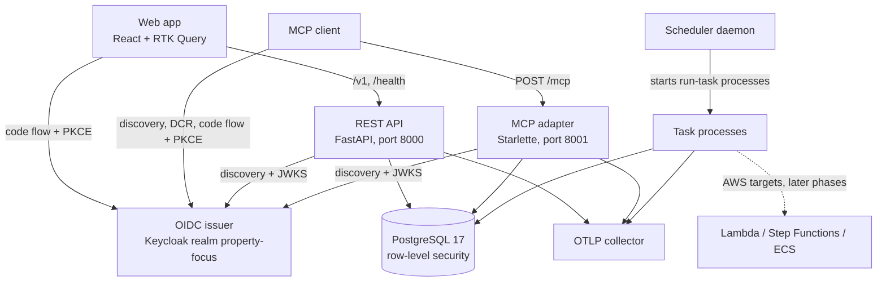
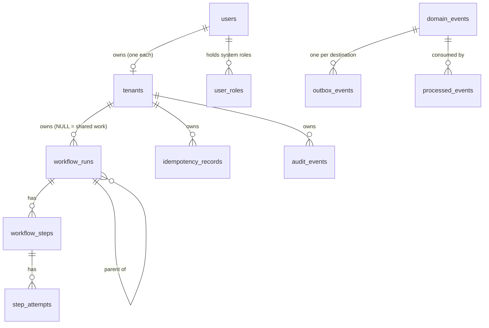

# Architecture

Property Focus is a personal real-estate analyst: it will ingest MLS listings, build evidence-backed property intelligence and rank homes against each search's requirements. This document describes the system as it exists in the repository today. Phase 0 built the foundation only: sign-in, accounts, tenancy, background-work plumbing, telemetry, a web shell and the deployment path. No listing, property or search feature exists yet. The design and its roadmap live in `specs/property-focus/master-plan.md` and the decision register `specs/property-focus/architecture-decisions.md`.

## System context



Two request adapters face the outside world. The REST API serves the web app; the MCP adapter serves any client that follows the MCP authorization specification. Both trust one OpenID Connect issuer, which is a Keycloak realm kept as code in `infrastructure/keycloak/realm-property-focus.json` (amendment A4). Neither adapter calls the identity provider beyond its discovery document and key set, so a different standards-compliant issuer (the retained Cognito stack, for example) works by configuration alone.

Behind the adapters sits one Python modular monolith, `backend/src/property_focus`, with four layers: `domain/` (pure rules), `application/` (use cases and ports), `adapters/` (REST, MCP, database, auth, secrets, telemetry) and `runtime/` (task entry points, launchers, scheduler). The application layer uses the database and telemetry adapters directly (models, unit of work, trace context) and reaches every other adapter, such as secrets and task launchers, through ports. `backend/scripts/check_boundaries.py` enforces the import rules between them.

## What happens on a request

A person opens the web app. The sign-in boundary sees no session and redirects to the issuer with an authorization-code request protected by PKCE (`S256`). The issuer returns a code to `/auth/callback`, the app exchanges it for tokens and keeps them in memory only.

Every API call then carries `Authorization: Bearer <access token>`. The API verifies the token against the issuer's key set, then maps the token's issuer and subject to an internal user. On a person's first request it creates that user and the one tenant they own (their account, as they would say). The tenant always comes from this mapping, never from a path or body field. The route then opens a unit of work in that tenant's scope, and PostgreSQL row-level security admits only that tenant's rows.

An MCP client follows the same path with different discovery. Its first unauthenticated `POST /mcp` gets `401` with a `WWW-Authenticate` header naming `/.well-known/oauth-protected-resource/mcp` (the official MCP SDK serves the protocol; the root form serves the same document). That metadata names the issuer; the client reads the issuer's metadata, registers itself through anonymous dynamic client registration, signs the person in with PKCE and retries with a token. From there the token check and tenant resolution are the same function the REST API uses.

```mermaid
sequenceDiagram
    participant C as Client (web app or MCP)
    participant A as REST API or MCP adapter
    participant K as OIDC issuer
    participant D as PostgreSQL
    C->>A: request + Bearer token
    A->>A: correlation ID, server span
    A->>K: JWKS (cached up to 10 min; refetched at most once a minute on unknown kid)
    A->>A: verify signature, iss, audience, exp/nbf, token type, alg
    A->>D: provision user + owned tenant if new, read roles
    A->>D: BEGIN; SET LOCAL pf.tenant_id, pf.user_id
    D-->>A: rows admitted by RLS
    A-->>C: JSON, or application/problem+json / JSON-RPC error
```

## What happens to background work

Background work is a **workflow run**. A request (or a task) admits a run in the same transaction as the change that caused it. Downstream work travels through a transactional outbox: recording a domain event writes one outbox event and one `QUEUED` run per destination task kind. After commit, the outbox publisher hands each run's `TaskInput` envelope to a task launcher. On dogfood and in development the launcher starts a detached `property-focus run-task` process; the AWS launchers (Lambda, Step Functions, ECS Fargate) exist and pass emulator tests but are not wired to any environment yet.

Each task execution calls `runtime/run_task.py`. It takes the run's lease, which bumps a fencing token, runs the registered handler in the run's own tenant scope, and commits the handler's writes together with the run's result only if the lease is still current. A failure maps to a stable error code and its failure class, which decide between a scheduled retry, a pause for a person, or a failed run. Two scheduled kinds keep this self-healing: `outbox-sweep` (every minute) launches outbox events a crash left pending, and `repair` (every five minutes) relaunches runs whose lease expired or whose launch was lost. Because repair is the only thing that relaunches a run at its retry time, its five-minute cadence, not the retry policy's seconds-long delays, bounds how soon a retry starts. Phase 0 registers no product task handlers; only the scheduled kinds do work.

## Domain model

The foundation tables cover identity, tenancy, workflow state, events and audit. Product tables (properties, listings, searches) arrive in later phases.



A workflow run as stored:

```json
{
  "id": "6f1c2a4e-0b7d-5d3e-9a41-2c8e7f0b1d22",
  "tenant_id": "1e0a9c3b-7d42-4f18-b6a5-3c9d2e8f4a10",
  "kind": "example-task",
  "input": {"subject_type": "property", "subject_id": "c2b7e0f4-91a3-4d6e-8f25-7a1b3c4d5e66"},
  "input_digest": "<sha256 of canonical input>",
  "state": "RUNNING",
  "fencing_token": 3,
  "launch_count": 2,
  "lease_expires_at": "2026-11-02T18:15:00Z",
  "correlation_id": "4b9e1f0c2d7a4e8b9c3d5f6a7b8c9d0e",
  "trace_context": {"traceparent": "00-…-…-01"},
  "deadline_at": "2026-11-03T18:00:00Z",
  "result_refs": []
}
```

## Deployment

| Environment | How it runs | Identity provider |
|---|---|---|
| Local development | `make dev` runs the API, MCP adapter, Vite and the scheduler as host processes against `compose.yaml` services (Postgres, Keycloak, MiniStack, Mailpit, OTel collector). `docker compose --profile app` runs the same backend as images. | Local Keycloak at `http://localhost:8080/realms/property-focus` |
| Dogfood | One DigitalOcean host behind Cloudflare (proxied hostnames, Full (strict) TLS, firewall admitting only Cloudflare) running `infrastructure/dogfood/compose.yaml`: Caddy (TLS with a Cloudflare Origin CA certificate for an app host and an auth host), Postgres, Keycloak, API, MCP, scheduler, OTel collector and OpenObserve. Deployed by the `deploy-dogfood` workflow and `deploy.sh`; runbook in [operations](../operations.md). | Dogfood Keycloak on `PF_DOGFOOD_AUTH_HOST` |
| AWS (staging, production) | Not deployed. The CDK app synthesizes only the Cognito identity stack, retained for phase 9; `launcher_for` refuses AWS environments. MiniStack covers the AWS operations the code already uses ([compatibility](../compatibility.md)). | Cognito, later |

On dogfood every public request crosses Cloudflare first (amendment A5). Both hostnames, the app host (`propertyfocus.treb.tech`) and the auth host (`auth-propertyfocus.treb.tech`), are proxied DNS records. Cloudflare's Free managed WAF ruleset and one per-IP rate-limiting rule over sign-in, registration and `/mcp` sit in front of Caddy; Bot Fight Mode stays off because it would challenge MCP clients and token requests. The host firewall admits ports 80 and 443 only from Cloudflare's published ranges, and Caddy takes the client address from `CF-Connecting-IP` only when the connection comes from those ranges. Cloudflare reaches Caddy over TLS (Full (strict)) and Caddy presents a Cloudflare Origin CA certificate for both hostnames. `deploy.sh` checks the ranges, the firewall and the certificate before it changes anything, and `make smoke-dogfood` checks from outside that responses carry `cf-ray` and that the origin refuses direct connections. Details: [infrastructure and delivery](./modules/infrastructure-and-delivery.md#dogfood-host) and the [Cloudflare edge runbook](../operations.md#cloudflare-edge).

## Observability

Every process calls `configure_telemetry` once. Logs are JSON lines on standard error carrying `trace_id`, `span_id` and `correlation_id`. Traces and metrics go over OTLP/HTTP to `PF_OTLP_ENDPOINT` when it is set. Redaction runs on every log line and every exported span: registered secret values, sensitive keys and credential patterns in free text. Runs and outbox events store the W3C trace context they were created in, so one trace follows work from the request through every downstream task.

## Configuration

Configuration is `PF_*` environment variables read once into the frozen `Settings` model (`backend/src/property_focus/config.py`); secrets are never settings and come through the `SecretProvider` port. `PF_ENVIRONMENT` has no default. The full list with defaults is in [configuration and secrets](./modules/configuration-and-secrets.md) and `.env.example`.

## Module docs

| Area | Doc |
|---|---|
| `config.py`, `adapters/secrets.py` | [Configuration and secrets](./modules/configuration-and-secrets.md) |
| `domain/errors.py`, retry policy, error statuses | [Failures and retries](./modules/failures-and-retries.md) |
| `adapters/db/`, migrations, roles, RLS | [Database and tenancy](./modules/database-and-tenancy.md) |
| `adapters/auth/oidc.py`, `application/context.py`, Keycloak realm, Cognito stack | [Identity and authentication](./modules/identity-and-auth.md) |
| `adapters/rest/`, OpenAPI export | [REST API](./modules/rest-api.md) |
| `adapters/mcp/server.py` | [MCP adapter](./modules/mcp-adapter.md) |
| `application/workflows.py`, `runtime/` | [Workflows and tasks](./modules/workflows-and-tasks.md) |
| `adapters/telemetry.py` | [Telemetry](./modules/telemetry.md) |
| `frontend/` | [Web app](./modules/web-app.md) |
| Compose, images, dogfood, CDK, CI | [Infrastructure and delivery](./modules/infrastructure-and-delivery.md) |
