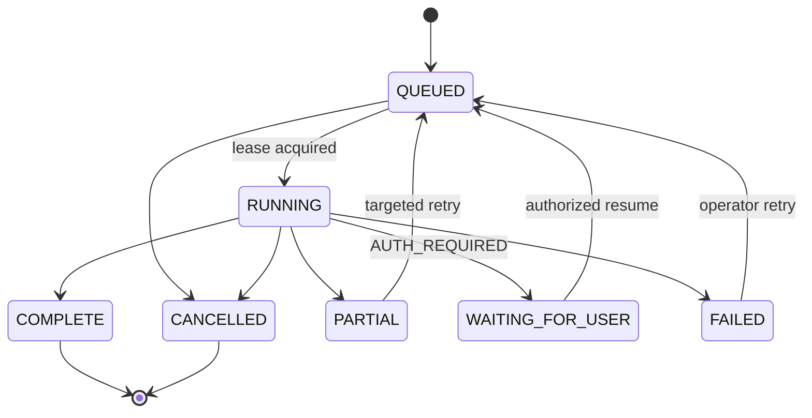

# Workflows and Tasks

All background work runs as **workflow runs**: rows that record what should happen, who it belongs to and how far it got. Short-lived task executions take a lease on a run, do the work outside any database transaction, and commit the result in one short transaction with the run's new state. A transactional outbox carries events from one task to the next, and two scheduled kinds recover anything a crash leaves behind. Delivery is at least once everywhere; leases with fencing tokens make duplicates harmless.

Phase 0 built the engine only. `DEFAULT_TASKS` is empty, so no product task kind exists yet; the scheduled kinds `outbox-sweep` and `repair` are the only work that runs.

## Key files

| File | Role |
|---|---|
| `backend/src/property_focus/application/workflows.py` | State machine, admission, outbox (`record_event`, `OutboxPublisher`), leases, failure recording, `relaunch_stalled_runs` |
| `backend/src/property_focus/application/ports.py` | `TaskInput` envelope, `TaskLauncher` protocol |
| `backend/src/property_focus/runtime/run_task.py` | `run_task()`, `TaskRuntime`, `TaskContext`, `TaskResult`, `DEFAULT_TASKS` |
| `backend/src/property_focus/runtime/launcher.py` | `SubprocessTaskLauncher`, `LambdaTaskLauncher`, `StepFunctionsTaskLauncher`, `FargateTaskLauncher`, `launcher_for()` |
| `backend/src/property_focus/runtime/scheduled.py` | `SCHEDULED_KINDS`: `outbox-sweep`, `repair` |
| `backend/src/property_focus/runtime/scheduler.py` | Crontab parser and the `Scheduler` daemon |
| `backend/src/property_focus/runtime/lambda_handler.py` | Lambda entry point (not deployed yet) |
| `infrastructure/dogfood/scheduler.crontab` | The schedule used by dogfood, `make dev` and the Compose `scheduler` |
| `backend/tests/unit/test_workflow_runs.py`, `test_scheduler.py`, `integration/test_workflows.py` | Engine tests |

## Run states



`ALLOWED_TRANSITIONS` encodes this; `check_transition()` raises `InvalidTransitionError` for anything else. A run has one `workflow_steps` row per kind and one `step_attempts` row per attempt.

## Admitting work

`admit_run(uow, operation, idempotency_key, kind, subject_type, subject_id, now, ...)` creates a `QUEUED` run in a tenant scope (it raises `TypeError` otherwise) together with an `idempotency_records` row, in the caller's transaction. A record replays its key until `expires_at`, 24 hours after the request (`IDEMPOTENCY_TTL`; the `idempotency_ttl` argument overrides it). The insert's `ON CONFLICT` replaces only an expired record, so a concurrent request with the same key waits for the first to commit and then replays it: at most one run is admitted per key while it lasts. Repeating the key within that time with the same kind and subject returns the first run with `replayed=True`; with a different request it raises `CodedError("idempotency_conflict")`. After it, the key admits a new run as a new key would. `repair` deletes expired records (`prune_idempotency_records`). The default deadline is 24 hours (`DEFAULT_RUN_DEADLINE`). The caller launches the run after commit; `repair` catches a lost launch.

`read_workflow_run(engine, context, run_id)` is the read use case behind REST `GET /v1/workflow-runs/{id}` (and any MCP tool that reads a run): it returns the run and its steps in the caller's tenant scope (`ExecutionContext.scope`), and raises `CodedError("not_found")` with the same explanation for a missing run and for one the caller may not see. `cancel_run()` moves `QUEUED` or `RUNNING` to `CANCELLED`.

## The outbox

`record_event(session, NewEvent(...), tenant_id, now, ...)` writes, in the caller's transaction, one `domain_events` row, one `outbox_events` row per destination task kind (both carrying `tenant_id`, NULL for shared work, which row security uses), and a `QUEUED` run per destination whose ID is `downstream_run_id(outbox_event_id)` (UUIDv5), so the publisher needs no lookup. Payloads hold IDs and references only.

`OutboxPublisher.publish(ids)` publishes each pending event in three steps, so no lock is held while the launch runs and the launched task can take its lease at once:

1. **Claim**, one short transaction: lock the event (`FOR UPDATE SKIP LOCKED`) unless another publisher's claim is live, count the run's launch with `next_launch(run)`, and set `claim_expires_at` 30 seconds ahead (`CLAIM_DURATION`). Each launch therefore has its own launch count.
2. **Launch**, outside any transaction.
3. **Acknowledge**, a second short transaction: mark the event `PUBLISHED` and clear the claim.

A failed launch, or a crash after the claim, leaves the event `PENDING`; once the claim expires the next sweep launches it again with the next launch count. `sweep()` publishes events pending for more than 30 seconds (`SWEEP_MIN_AGE`) with no live claim, at most 100 per pass. The publisher's and `relaunch_stalled_runs()`'s database work runs in a worker thread (`asyncio.to_thread`), so it never blocks the caller's event loop.

## The task envelope

```json
{
  "schema_version": 2,
  "workflow_run_id": "6f1c2a4e-0b7d-5d3e-9a41-2c8e7f0b1d22",
  "task_kind": "example-task",
  "subject_type": "property",
  "subject_id": "c2b7e0f4-91a3-4d6e-8f25-7a1b3c4d5e66",
  "input_digest": "<sha256>",
  "application_version": "0.1.0",
  "idempotency_key": "6f1c2a4e-0b7d-5d3e-9a41-2c8e7f0b1d22.2",
  "deadline": "2026-11-03T18:00:00Z"
}
```

`TaskInput` is untrusted: it travels through process arguments and invocation payloads. The task loads tenant and scope from the run it names and refuses an envelope whose kind or input digest disagrees. Unknown fields are rejected. The deadline is the run's `deadline_at`, which every run has.

The idempotency key is `<run id>.<launch count>`. `next_launch(run)` increments the run's `launch_count` in the launching transaction and builds the envelope (`task_input_for(run)` builds it for the current count). Every delivery of one envelope carries the same key, so concurrent duplicate deliveries start one Step Functions execution; every relaunch by the publisher or `repair` carries a new one, so a run whose execution failed before taking its lease is started again instead of being mistaken for a duplicate.

## Running a task

`run_task(task, runtime)` is the single entry point for every execution (CLI `run-task --task-input`, Lambda, Fargate):

1. `acquire_lease()` in the service scope locks the run. It declines (`Declined`) with `rejected` (no matching run), `already_finished` (`COMPLETE`, `PARTIAL`, `FAILED` or `CANCELLED`), `already_waiting_for_user` (`WAITING_FOR_USER`), `lease_held` (another task holds an unexpired lease, or a scheduled retry is not due) or `failed` (deadline passed, or `max_attempts` attempts already started without a result, recorded as `timeout` or `internal_defect`). Otherwise it moves the run to `RUNNING`, increments `fencing_token`, sets `lease_expires_at = now + lease_duration` (15 minutes by default), and opens a new attempt. The lease's scope is the run's tenant (`TenantScope` with the tenant owner) or `ServiceScope` for shared work; `Lease.tenant_id` is read from that scope.
2. Inside a `task <kind>` span that continues the run's recorded trace, the registered handler runs with a `TaskContext` (`task`, `secrets`, `tenant_id`, `correlation_id`, `now`). No database transaction is open while it runs, however long it waits on a source. It stages its result instead: `write(apply)` queues a function that gets the final transaction's `UnitOfWork` (in the lease scope), and `emit(event)` queues a `NewEvent`.
3. One short transaction in the lease scope commits the result: `complete_run()` locks the run and checks the fencing token first, then the staged writes run in order and the staged events are recorded (`record_event`). A stale lease raises `StaleLeaseError` before any staged write runs, the transaction rolls back, and the attempt is closed as `CANCELLED`.
4. After commit, the events the handler emitted are published.

Runtime connections set `idle_in_transaction_session_timeout` to one minute (`IDLE_IN_TRANSACTION_TIMEOUT` in `adapters/db`); every transaction above is short, so the server only ever ends a session that leaked one ([database and tenancy](./database-and-tenancy.md)).

A handler signals failure by raising `CodedError`; any other exception becomes `internal_defect`. `fail_attempt()` records the class, code, retryability and safe explanation on the step and applies `failure_effect()` ([failures and retries](./failures-and-retries.md)). A scheduled retry keeps the run `RUNNING` with its lease expiring at the retry time. Nothing launches the run at that time: `repair` relaunches it on its first pass after it, so a retry starts up to one repair interval (5 minutes) later than the policy's delay, and the policy's short delays (2, 4, 8 seconds) are in effect rounded up to the repair cadence.

`run_task` returns one of `complete`, `partial`, `retry_scheduled`, `waiting_for_user`, `failed`, `already_finished`, `already_waiting_for_user`, `lease_held`, `rejected`, `stale` (the `TaskRunOutcome` comment says what each means). The CLI prints it and the Lambda handler returns it. It never raises for a task failure.

## Launchers

| Launcher | Target | Used by |
|---|---|---|
| `SubprocessTaskLauncher` | Detached `python -m property_focus.cli run-task <kind> --task-input <json>` in a new session | Development and dogfood (`launcher_for`) |
| `LambdaTaskLauncher` | Asynchronous Lambda `Invoke` (`InvocationType=Event`) | Not wired yet |
| `StepFunctionsTaskLauncher` | `StartExecution` named from the idempotency key (one name per launch); `ExecutionAlreadyExists` counts as started | Not wired yet |
| `FargateTaskLauncher` | ECS `RunTask` (`FARGATE`, no public IP) with a command override | Not wired yet |

`launcher_for()` raises `NotImplementedError` for beta and production. AWS throttling maps to `rate_limited` and service errors to `dependency_transient`. The AWS launchers pass against MiniStack ([compatibility](../../compatibility.md)).

## Scheduling

| Kind | Crontab | Does |
|---|---|---|
| `outbox-sweep` | every minute | `OutboxPublisher.sweep()` |
| `repair` | every 5 minutes | `relaunch_stalled_runs()`: `RUNNING` runs whose lease expired and `QUEUED` runs untouched for 5 minutes, at most 100 per pass, oldest first, skipping runs a task has locked; each relaunch is counted (`next_launch`) and committed before it is launched. The partial index `ix_workflow_runs_unfinished_updated_at` (on `updated_at`, `state IN ('QUEUED', 'RUNNING')`) serves the scan. Then `prune_idempotency_records()` deletes up to 1000 expired idempotency records, oldest first (index `ix_idempotency_records_expires_at`). Returns runs launched plus records deleted |

`property-focus schedule --crontab <file>` runs the `Scheduler` daemon. It parses standard five-field cron lines (UTC, `*`, lists, ranges, steps; day-of-week 0 and 7 are Sunday), starts each command without a shell, skips an entry whose previous process is still running, and reaps finished processes. It does no business work itself (D26). Each scheduled kind does one bounded pass and exits. `test_runtime_manifests.py` checks that every crontab entry starts a registered kind.

## Design decisions

- Runs are committed with the change that caused them, so work is never lost between a write and its follow-up.
- Fencing tokens, not process liveness, decide who may commit; a slow or resurrected task cannot overwrite a newer attempt.
- Handlers and launches do their I/O outside database transactions, so a slow source or execution service holds no row locks, connections in a transaction, or snapshots; the only transactions are short ones under the current lease or claim.
- Recovery is periodic relaunching instead of in-process loops, so every execution is short-lived and the same code runs as a process, a Lambda or a container.
- Every run and outbox event stores its W3C trace context, so one trace spans the request and all downstream tasks ([telemetry](./telemetry.md)).

## Related docs

- [Failures and retries](./failures-and-retries.md)
- [Database and tenancy](./database-and-tenancy.md) for service and tenant scopes
- [Operations](../../operations.md) for replaying work on dogfood
