# Master Plan: Property Focus

Created: 2026-11-01  
Status: draft  
Project slug: `property-focus`  
Canonical repository path: `/specs/property-focus/master-plan.md`  
Scope: greenfield real-estate intelligence monorepo

The repository root anchors paths in this document; `/specs` means a directory inside the repository, not the operating system root.

The user's decision register ([architecture-decisions.md](architecture-decisions.md), cited as D1–D56, plus amendments A1–A3 confirmed by the user on 2026-11-02) wins on any conflict with this plan. An amendment wins over the decision it amends.

---

## ABOVE THE LINE: Design Narrative

### Background

You receive real-estate listings through MLS emails and inspect listing pages to decide which homes deserve attention. An MLS, or multiple listing service, distributes listing information to authorized participants. TheMLS is the first supported listing source.

A **property** represents a physical home or parcel. A **listing** represents one marketing episode for that property. A relisting can change price, agent, or source identifier without creating a new home (D4).

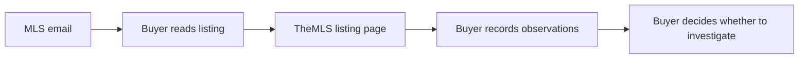

The proposed product acts as a personal real-estate analyst. It interprets every qualifying property for you: why it fits, why it does not, what is concerning, and whether it is worth seeing (D1). Each person signs up for their own account. A **tenant** is that account: the boundary for one person's private data, such as their preference profile, notes and destinations (A1). A user can share a search with other accounts, such as a spouse's, and collaborate on it.

### Two products for residential buyers

A Homebuyer asks whether a property fits daily life and what to check on a visit. A residential Investor asks what income the property can support at a given purchase price. Both may open the same duplex. Give them distinct onboarding, navigation and property pages within one website, with one sign-in and one backend.

| Experience | Onboarding and feed | Property page and next action |
|---|---|---|
| Homebuyer · `/homebuyer` | Run the preference interview, then start a home search with budget and geography, optionally shared with a spouse or partner. Rank homes by fit. | Lead with fit, layout, location, affordability and unknowns. Shortlist a home or flag a question for a visit. |
| Investor · `/investor` | Start an acquisition search with financing assumptions and income criteria. Rank by the search's investment criteria. | Lead with units, occupancy, documented rents, expenses and projected cash flow. Compare purchase scenarios and their binding constraints. |

A **search subscription** is an entry mechanism, not the main product object (D17). It holds a source, search criteria and a notification policy. It also carries an acquisition strategy and the criteria specific to that strategy. The property remains the object you inspect.

Searches are where people collaborate. Each person keeps one private **PreferenceProfile**: lifestyle goals, preferences, hard requirements, destinations and tradeoffs. A search carries its own criteria, and its members share them (A1).

| Layer | Owned by | Visible to | Holds |
|---|---|---|---|
| PreferenceProfile | One account; one active profile per account | Its owner only | Lifestyle goals, preferences and hard requirements about the home, destinations, tradeoffs, examples |
| SearchSubscription | One owner account, plus invited members | Its owner and members | Source, geography and listing criteria, notification policy, strategy (`owner_occupancy`, `live_in_and_rent`, `rental_hold`), hard and soft criteria, preferences copied from a member's profile, search destinations, budget, financing and investment criteria |

A profile reaches a search only by copy. When a member creates a search, or later chooses to apply their profile, the system copies that profile's requirements and preferences into a new search version. Later edits to the private profile leave the search unchanged until someone applies it again.

We recommend copying over live merging (plan recommendation). Merging two people's private profiles would need rules for conflicting weights, would expose private data to the other member, and would let one person's private edit silently change a shared ranking.

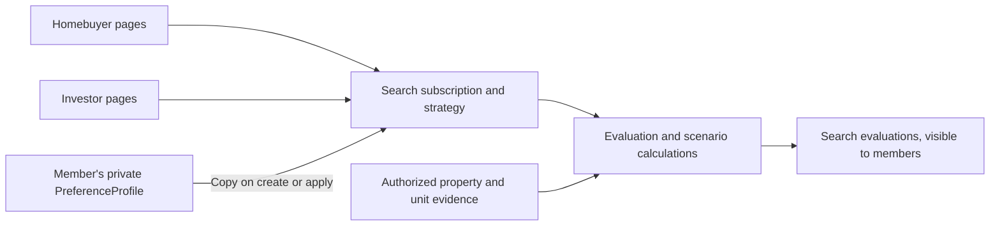

We recommend that a `rental_hold` search skip the Lifestyle fit dimension (plan recommendation). Copying a profile into a `rental_hold` search leaves out hard requirements about the buyer's own daily life (preference category `household_lifestyle`), because the buyer's commute does not bear on a rental's merit.

### Accounts and shared searches

The user account is the isolation boundary for private data. A shared search is a collaboration scope: its members see and edit that search's data and nothing else of each other's (A1).

| Data | Who has access |
|---|---|
| Preference profile, interview sessions, profile destinations and their travel times | The account owner only |
| Notes, likes and dislikes | Their author only, even on a shared search |
| Offer scenarios and offer outcomes | The account that created them (plan recommendation; the user's answer did not list them as shared) |
| Search criteria and versions, copied preferences, search destinations, evaluations, shortlist, visit questions | Every current member of the search |
| Tours | Every current member of the search (plan recommendation) |
| Property facts and intelligence | Every account the source rights allow (D7) |

The owner invites people by email address. The invitee accepts while signed in to an existing account, or signs up first and then accepts. Removing a member revokes access on that member's next request.

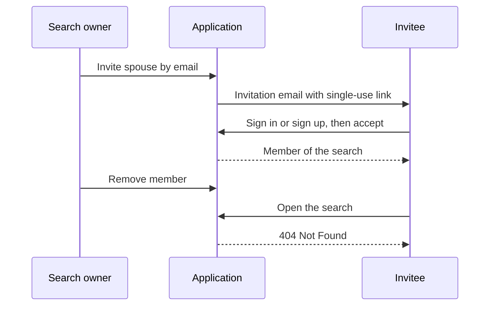

We recommend that only the owner invites or removes other members, that any member may leave, and that the owner can neither leave nor be removed (plan recommendation). Otherwise the owner and members hold the same rights on the search. Any member may approve a material change to the search's criteria, and the system records who approved (see Preferences).

### The problem

The planning record contains no measured inbox volume, handling time, or conversion rate. We therefore treat the following as design failure cases, then measure their frequency during dogfood rather than inventing a savings estimate.

#### Duplicate-home failure

Repeated emails and relistings can make you review the same home without seeing its history. Address text alone cannot distinguish units, and source listing identifiers cannot identify a home across marketing episodes.

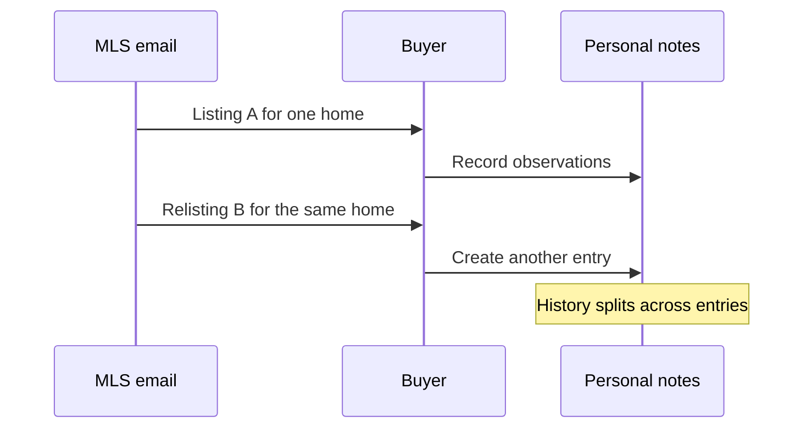

#### Unsupported-conclusion failure

A photo can suggest a quiet yard while concealing road noise. Without evidence and uncertainty, you cannot tell an observation from a model's inference.

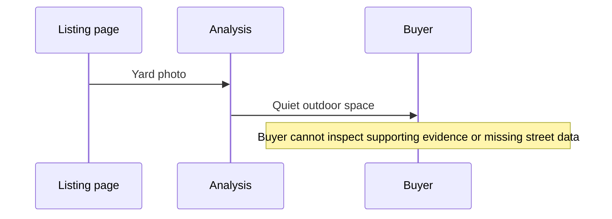

#### Blocked-result failure

One unavailable data source can delay the whole assessment. You still need the listing facts and a clear account of missing information.

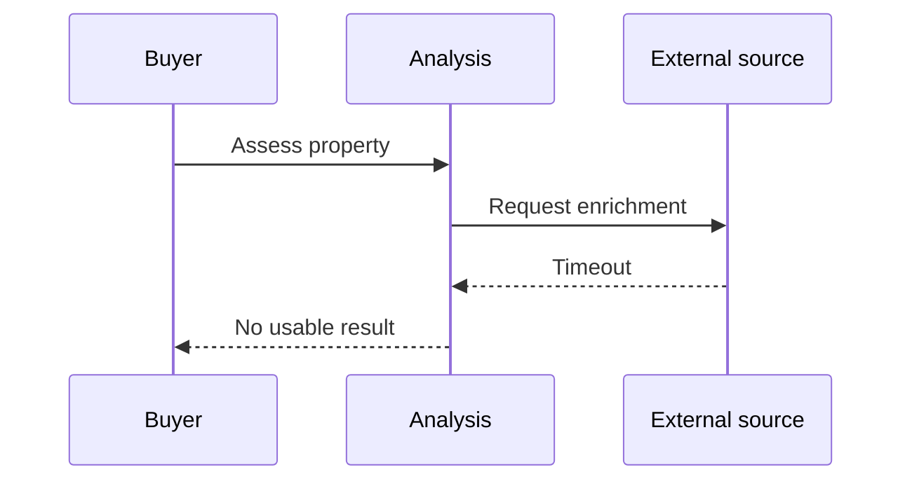

### The design

We recommend a Python modular monolith with separate runtime adapters (D18). Engineers keep domain rules in one application layer and deploy API handlers, short-lived tasks and browser tasks as workload needs dictate. This limits distributed-system overhead while preserving the chosen AWS deployment path.

The application layer coordinates use cases. Domain modules implement identity, claim resolution, evaluation, valuation and offer calculations without importing FastAPI, AWS clients, or browser code.

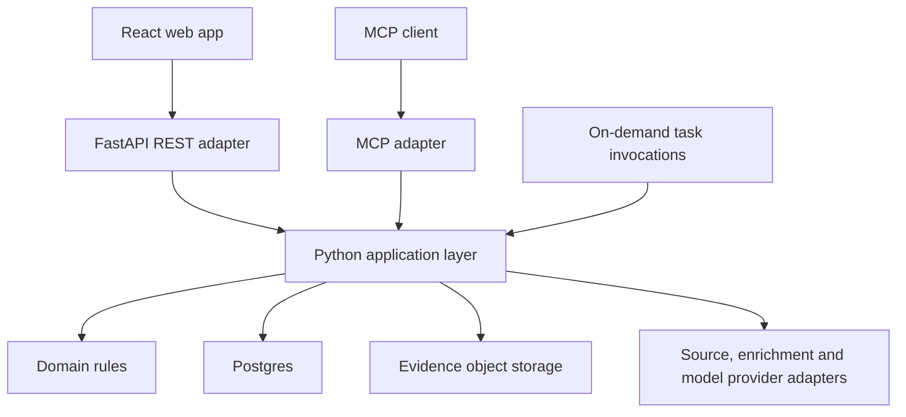

Engineers generate the frontend's RTK Query client from FastAPI's OpenAPI schema (D29). MCP exposes the same application use cases through a parallel adapter; MCP calls do not route through REST, and neither adapter duplicates business rules. Users receive the same authorization checks and result semantics through both surfaces.

The REST API is resource-oriented (D30). Reads and edits use resources such as `GET /properties/{id}/intelligence` and `PATCH /preferences/{id}`. Workflows use explicit action endpoints such as `POST /properties/{id}/deep-analysis` and `POST /properties/{id}/reanalyze`.

We recommend serving MCP beside the REST API, so remote agents need no local process:

- **Transport.** MCP uses the streamable HTTP transport at `/mcp`.
- **Sign-in.** Any MCP client that implements the MCP authorization specification signs in through Cognito with OAuth authorization code and PKCE, the web app's flow shown under Deployment, authentication, and operations (A3). We build nothing for a particular client.
- **Token check.** Each MCP request carries a bearer access token. One shared check maps it to the internal user and tenant for both adapters (D28).
- **No HTTP proxy.** The MCP server calls application services directly, never FastAPI over HTTP (D29).

#### Property pipeline

Property understanding happens once per property and serves every tenant (D7). Sources emit observations; normalization and identity resolution follow; deterministic hard filters drop properties no active subscription could accept (D3); intelligence runs on the survivors; search evaluation comes last.

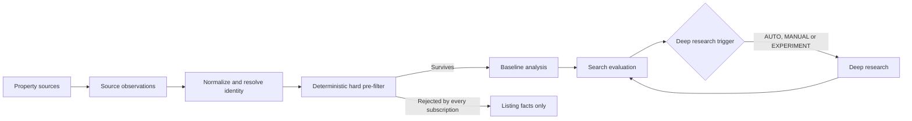

A **property source** is any adapter that emits source observations: the MLS mailbox, the TheMLS browser, a manual add by URL or address, an uploaded document (D2, D17). Sources never write canonical properties. Adding Zillow, Redfin or a RESO feed later means adding a source, not changing the property domain.

The pre-filter evaluates listing facts against each active subscription's effective hard requirements: the search version's hard criteria, which include any profile hard requirements a member copied into the search. A property survives when at least one subscription returns pass or unknown; unknown never counts as false (D7). Funnel stages carry versions so engineers can run a candidate stage in shadow beside the current one (D3).

#### Execution model: on-demand tasks

The system spends most of its time idle, so it runs no always-on worker fleet (D26). Each unit of work is a short-lived task invocation: Lambda first in AWS, on-demand Fargate RunTask for browser or heavy work. Step Functions invokes those tasks directly; SQS buffers bursts and applies backpressure but does not define the execution model (D21, D26).

DigitalOcean dogfood emulates the same model with on-demand processes and containers. A scheduler daemon starts short-lived task processes and does no business work itself. The always-on services are Postgres, MiniStack, the API and MCP services (D27), the reverse proxy, the observability stack and that scheduler.

The register sets IMAP polling every 15 to 30 seconds (D22). Neither EventBridge Scheduler nor cron fires faster than once a minute, so we recommend one short-lived `imap-poll` invocation per minute. It polls at 20-second intervals (configurable within 15 to 30), stops starting polls after 45 seconds, and exits. A Postgres advisory lock prevents overlapping invocations. On 2026-11-02 the user accepted that this schedule can leave an occasional gap above 30 seconds between polls.

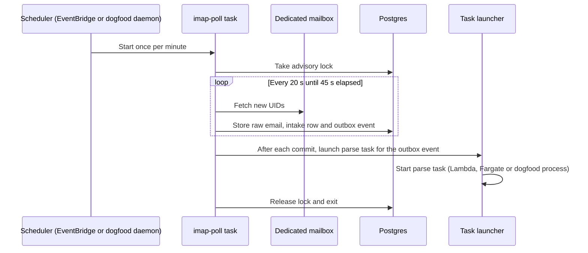

The intake task only stores raw mail and enqueues work. Parsing, identity resolution, enrichment and analysis each run as their own on-demand task.

The committing task publishes its own outbox events. Right after commit it starts each downstream task through the task launcher and marks the event published. A scheduled `outbox-sweep` task runs once a minute and launches any event still pending after 30 seconds, which covers a crash between commit and launch. Downstream tasks deduplicate by idempotency key, so a double launch is harmless (D54).

#### Ingestion and browser enrichment

The first acquisition path polls a dedicated mailbox over IMAP. The user chose IMAP polling because it is simple and avoids coupling ingestion to Gmail-specific APIs; the `EmailIngress` port stays pluggable so SES, Gmail or an inbound-mail webhook can replace it later (D22). Intake preserves the original `.eml` as immutable evidence before parsing, records malformed messages for review, and checkpoints mailbox progress after durable intake. Email ingestion uses no LLM. Mail delivery and task delivery can repeat, so engineers enforce deduplication at both boundaries (D54).

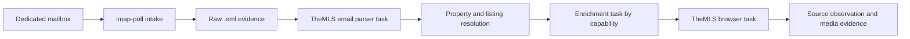

Enrichers advertise **capabilities** rather than vendor names (D11). The TheMLS browser advertises `LISTING`, `PHOTOS`, `REMARKS` and `LISTING_HISTORY`; later providers advertise `SALE_HISTORY`, `ASSESSOR`, `PERMITS` and the rest. A capability registry names a primary provider and, where useful, a secondary and a shadow provider.

Browser tasks use Playwright with one persistent, encrypted TheMLS profile on the dogfood host (D23). Each browser task runs in an on-demand container that mounts the profile and holds a credential lease; account-level concurrency starts at one. The session moves through four lifecycle states; reauthentication pauses dependent work and notifies an administrator, who holds the `operator` role, instead of looping through login attempts.

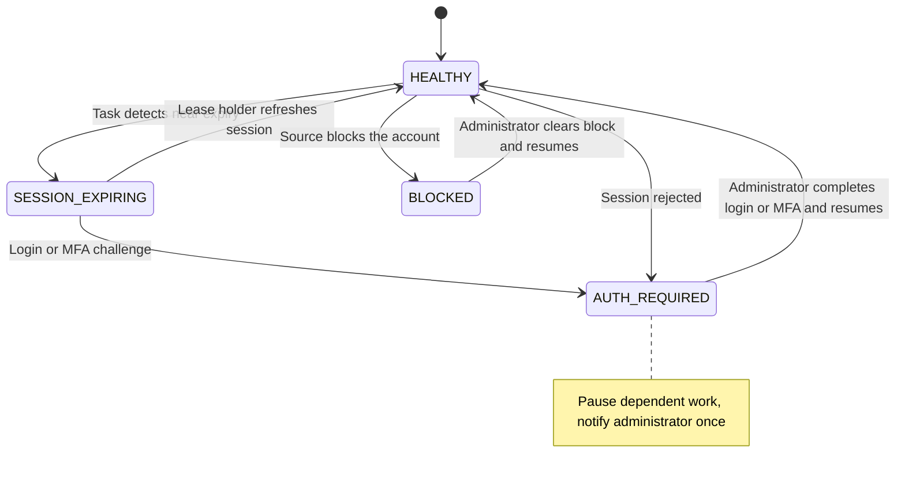

AWS runs browser tasks on Fargate RunTask and stores the encrypted profile outside the container. Engineers may use Lambda for short, measured browser tasks after a compatibility test, but must not require a browser session to survive a Lambda invocation. Ordinary Lambda functions have a 900-second invocation limit, which supports a bounded-task design [R2].

Browser tasks accept listing URLs from an allowlisted TheMLS host set, block private-network destinations and unsafe redirects, and enforce media size limits. Source pages and emails are untrusted input. AI adapters treat their contents as evidence, with no authority to issue tools or alter application instructions.

#### Identity, history, and evidence

Identify the asset offered for sale before resolving its address. A whole duplex offered in one sale has one property, one listing episode and two component units. Two condos offered for sale separately have distinct property identities even if they share a street address. A unit label on a rent roll identifies the subject of an occupancy or rent claim. It provides no evidence that the unit is for sale on its own.

Engineers use internal UUIDs for properties and listings. They scope external identifiers to their source and jurisdiction. A property may have several parcels or units, so automatic merging requires stronger evidence than address similarity.

| Concept | Meaning |
|---|---|
| Property | Stable identity for a home or parcel grouping |
| Listing | Source-specific marketing episode with current state and history |
| SourceObservation | Immutable record of what one source reported at one time |
| Claim | Immutable typed assertion about one attribute of a subject, supported by evidence |
| Evidence asset | Content-addressed original or derived artifact with provenance |
| AnalysisRun | One versioned analyzer or enricher execution and its outputs |
| PropertyEvaluation | One search subscription's versioned assessment of one property, visible to the search's members |

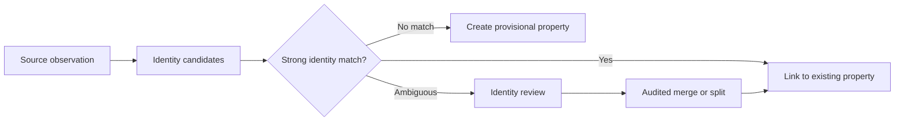

Identity resolution prefers the parcel identifier (county plus assessor parcel number), then normalized address with coordinates, then source-specific IDs (D4). Each link carries a confidence. A source-scoped listing ID identifies a listing episode unless source behavior proves otherwise. Ambiguous cases keep their candidate links, and operators can reverse a merge using retained aliases and provenance.

Postgres holds the relational core: Property, Listing, Tenant, SourceObservation, Claim, AnalysisRun and PropertyEvaluation (D24). JSONB holds evolving analyzer payloads and claim values until an attribute earns a first-class column. Relational current state stays authoritative; we do not use pure event sourcing (D25). A price change commits four writes in one transaction.

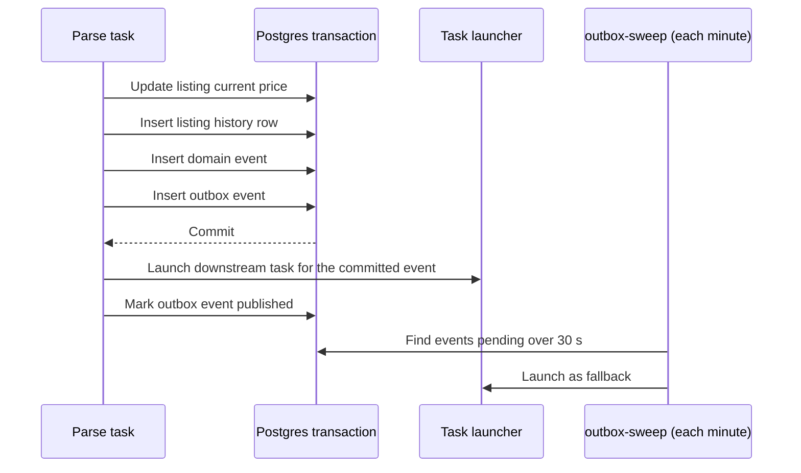

Evidence lives in content-addressed object storage keyed by SHA-256 (D44). Identical bytes from repeated listing versions deduplicate to one object where source rights permit. Postgres records hash, media type, object key, source URL, provider, capture time and property and listing references. Writers cannot overwrite evidence; corrections create new claims. AWS uses versioned S3 with deny-overwrite/delete policies and an approved Object Lock retention policy for evidence classes that permit it [R6]. DigitalOcean dogfood must pass write-once and restore tests; an emulator alone does not establish durable immutability.

#### Ontology and claims

An **ontology** is the versioned catalog of property attributes: their meaning, type, unit, allowed values and resolution rule. Postgres stores it as immutable versions in `ontology_versions` and `ontology_attributes` (D33). Seed definitions live as files under `/ontology` and load into the database, but the database copy is canonical, so ontology changes need no application deployment.

```mermaid
stateDiagram-v2
    [*] --> DRAFT: Load seed or edit
    DRAFT --> ACTIVE: Publish after validation
    ACTIVE --> RETIRED: Successor published
    RETIRED --> [*]
    note right of ACTIVE: Exactly one ACTIVE version; analysis runs record the version they used
```

Executable behavior stays in code. An attribute names a resolution rule from a code registry and passes scalar parameters; JSONB never holds expressions or a rule language (D33).

V1 starts rich, because re-analyzing every property when a new buyer cares about a skipped feature costs more than extracting a broad profile once (D32). The target is roughly 75 to 150 standardized attributes plus extensible observations.

| Category group | Example coverage |
|---|---|
| Structure, rooms, layout | Living area, bedrooms, primary-suite location, open plan, single-level living |
| Indoor/outdoor, yard, garage | Indoor-outdoor flow, usable yard area, privacy, garage spaces, EV readiness |
| Condition, kitchen, architecture | Overall condition, renovation era, kitchen quality, architectural style |
| Location and traffic | Walkability, parks, street traffic level, cul-de-sac status (D42) |
| Risks, development potential | Flood and fire zones, ADU potential, lot split potential |

A **claim** is an immutable assertion: property, attribute, value, provider, source type, observation time, confidence and evidence (D12). Every claim points at durable evidence: a photo, an image or floorplan region, an MLS text span, an assessor or permit record, or a provider response (D35). A resolver then picks the current best value per attribute under that attribute's rule. List price prefers the current listing; parcel ID prefers the assessor.

Every resolved value carries one of four statuses (D7).

| Status | Meaning |
|---|---|
| `OBSERVED` | A source or person reported the value directly |
| `INFERRED` | An analyzer derived it from evidence, with confidence |
| `UNKNOWN` | No usable claim exists; never treated as false |
| `CONFLICTING` | Claims disagree and the rule cannot settle it |

Staleness is a separate property of a value, tracked by invalidation (D13), not a fifth status. Confidence describes an analyzer's uncertainty; it does not turn an inference into an observation.

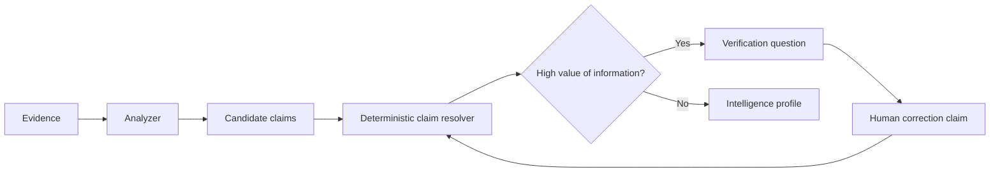

Human corrections become claims with high authority for subjective or visible attributes, and the original AI output stays (D36). A human claim does not override an official parcel or legal fact without supporting evidence. The system asks people to verify only when the answer could change a decision: priority equals uncertainty times preference importance times potential score impact (D37). After a tour it asks a few high-value questions, not a checklist.

#### Analysis tiers

Every surviving property receives a baseline **B-level** analysis. Conditional **C-level** deep research runs for roughly the top 20 to 30 percent of properties, for anomaly and opportunity cases, and on manual request (D1, D6). A property becomes usable as soon as listing facts resolve; deep research adds to it later (D53).

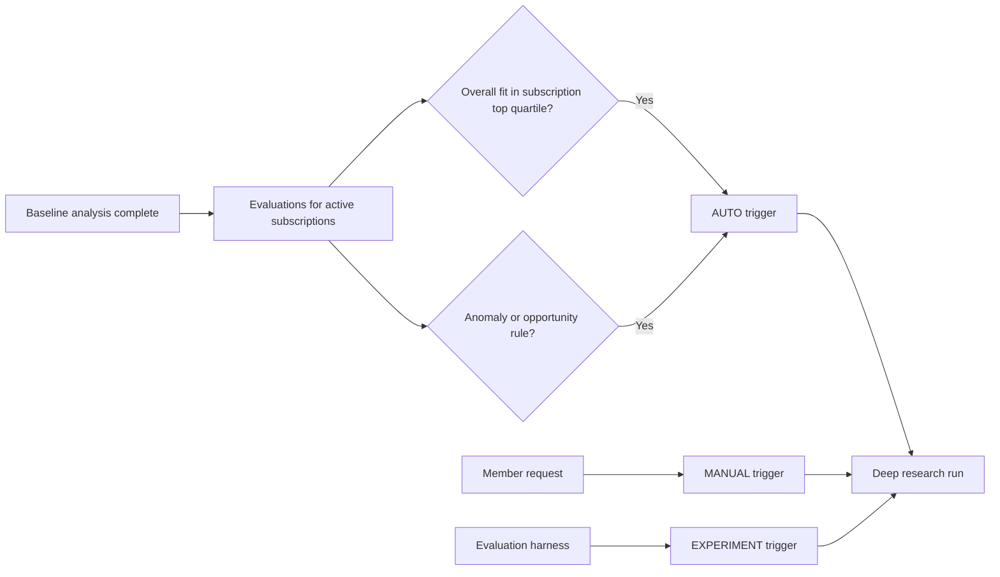

Each trigger records its type (`AUTO`, `MANUAL` or `EXPERIMENT`), the trigger strategy and version, and its reasons (D6). The default strategy fires when a property's overall fit reaches the subscription's top quartile over a trailing 30 days, which lands inside the register's 20 to 30 percent band. Anomaly rules cover a price drop of 5 percent or more, a `CONFLICTING` hard-requirement attribute, and, once valuation exists, a list price below the valuation's 10th percentile. `EXPERIMENT` triggers let the evaluation harness deep-research rejected properties to measure the funnel.

Deep research results are property intelligence, so they serve every authorized tenant. Budgets attach to budget tiers, not analyzers (D56).

#### Analyzers and model providers

We use specialized analyzers instead of one giant multimodal prompt (D14). Each analyzer reads cached evidence, emits claims for a fixed set of ontology attributes, and records its model, prompt and analyzer versions with cost, latency, tokens and confidence.

| Tier | First set (phase 3) | Later, each with golden labels and an evaluation report |
|---|---|---|
| Baseline | TextAnalyzer, PhotoAnalyzer, ConditionAnalyzer, KitchenAnalyzer | IndoorOutdoorAnalyzer, YardAnalyzer, GarageAnalyzer |
| Deep | FloorplanAnalyzer, LayoutAnalyzer | NaturalLightAnalyzer, PrivacyAnalyzer, GuestSuiteAnalyzer |

Analyzers request capabilities, not vendors (D31). A `ModelRouter` maps a capability such as `VISION` or `STRUCTURED_OUTPUT` to a `ModelProvider` under model policy. Two adapters, OpenAI and Anthropic, ship with the first analyzer set in phase 3 and pass the same provider contract (A2). Configuration, not analyzer code, says which provider serves each capability.

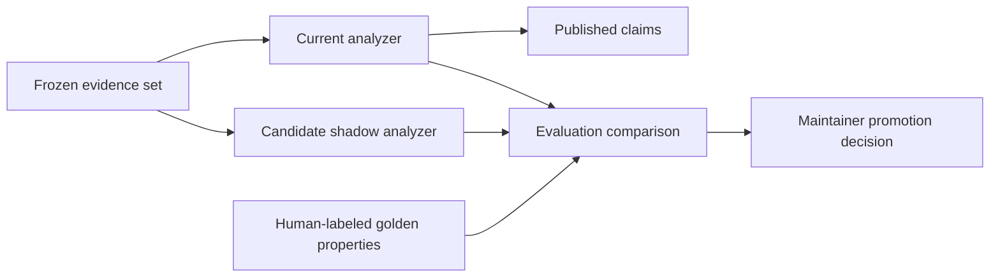

Evaluation and shadow experimentation ship in V1 (D45). The same harness compares analyzers, resolvers, comp selectors, valuation models, deep-research triggers and scoring strategies on quality, cost and latency (D56). Shadow outputs stay outside published claims, evaluations and notifications until a maintainer promotes a version. Provider fallback preserves requested capabilities and privacy constraints, and a failed call does not authorize an unlimited cascade of paid attempts.

Each computation has an identity: the hash of its input evidence plus analyzer, prompt, model and ontology versions (D54). Repeating identical inputs reuses the stored run; changing any version produces a new run, and no run is ever overwritten (D8).

#### Reusable intelligence and tenant privacy

Engineers separate property facts, location context, and market context from each account's preferences and each search's criteria. Property facts are global; interpretation is private to one account or to one search's members.

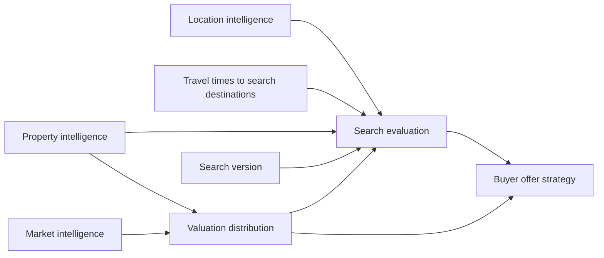

Reuse depends on source rights. Engineers may share a canonical property identifier across accounts, but they must scope evidence and claims to the accounts or entitlement groups allowed to use them. A person's offer scenarios, notes, likes and dislikes, source credentials and profile destinations remain private to their account. A cached result must include its entitlement scope in the cache key.

Location intelligence is its own reusable subsystem (D42). It covers walkability, parks, schools, retail, freeway and airport proximity, hazards, lot position, commercial proximity and streetscape. Busy versus quiet street is a first-class attribute built from the traffic signals below. The product distinguishes measured traffic from an inference.

| Signal | What it captures |
|---|---|
| Traffic level | Overall rating: quiet, moderate or busy |
| Functional class | Road role, from local street to arterial |
| Estimated daily traffic | Vehicles per day |
| Through-traffic likelihood | Whether drivers use the street to reach elsewhere |
| Lane count | Number of travel lanes |
| Speed limit | Posted speed |
| Signal proximity | Distance to the nearest traffic signal |
| Truck traffic | Heavy-vehicle share |
| Cut-through risk | Exposure to shortcut routing |
| Cul-de-sac status | Whether the lot sits on a dead-end street | Protected demographic characteristics and proxies for steering do not enter suitability scores.

People define their important destinations, such as work, school, family or the airport, with times of day (D43). The system computes time-of-day travel times per property and destination. A destination lives in one of two places:

| Destination | Visible to | Feeds |
|---|---|---|
| Profile destination | Its owner only | Travel times shown only to that owner |
| Search destination | The search's members | Travel times and the search's evaluation |

On a shared search, each member sees the shared evaluation plus travel times to their own private destinations (plan recommendation).

#### Preferences and the adaptive interview

Preferences live in two layers (D34). Global **preference definitions** describe how people may care about ontology attributes, for example "quiet street" satisfied by low traffic level and cul-de-sac status. A person's PreferenceProfile assigns importance, acceptable alternatives, goals, tradeoffs and learned evidence.

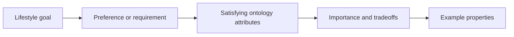

An adaptive interview builds the signed-in person's private profile from structured questions, conversation, example homes and property feedback (D15). The underlying goal often matters more than the literal feature: "a yard" may mean "somewhere the dog can run." The interview keeps explicit state, such as captured goals and open slots, and sends the model that state plus a few recent turns rather than the whole transcript. Voice may arrive later as another interaction adapter.

The profile and each search subscription evolve with feedback under the same versioning and approval rules (D16). Low-impact changes apply automatically. Material changes wait for explicit approval: hard requirements, budget, geography, a single weight shift above 0.05 normalized share or cumulative learned drift above 0.10 (thresholds confirmed by the user on 2026-11-02), or a major tradeoff, meaning one that involves a hard or critical preference. Budget and geography live on the subscription, so a change to either creates a subscription version, not a profile version. Only a profile's owner approves its changes. On a shared search, any member may approve or reject a material change, and the version records who did (plan recommendation). Every change creates a new version with evidence, and any version can be restored.

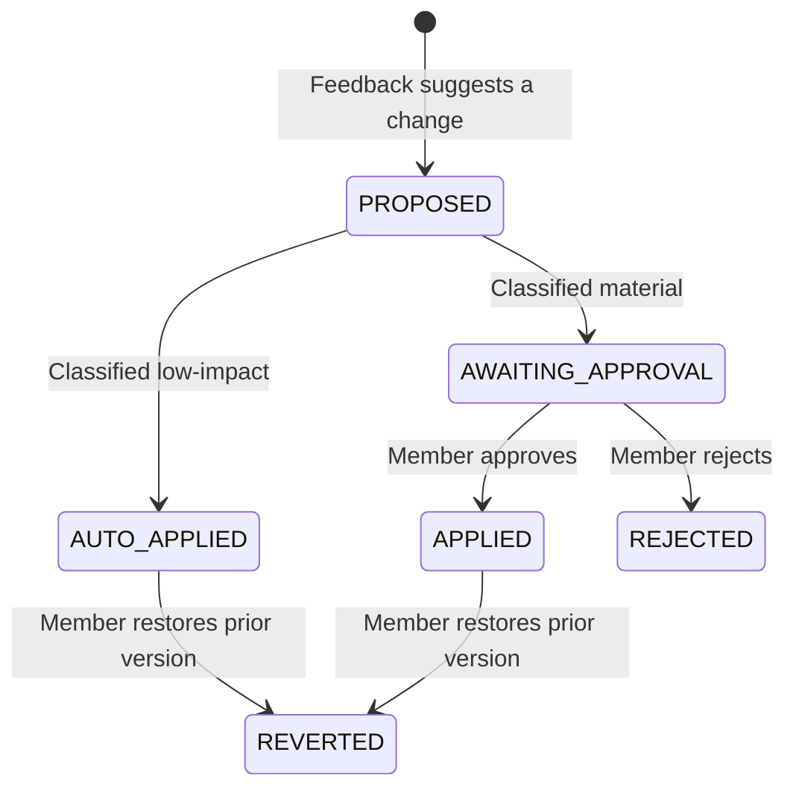

#### Multidimensional evaluation

A **PropertyEvaluation** reports fit in several dimensions instead of one opaque score (D9). A home can suit daily life and still be overpriced.

| Dimension | Computed from |
|---|---|
| Requirements | Hard requirements: pass, unknown or fail |
| Lifestyle fit | Weighted preferences on the search version and travel times to search destinations |
| Property quality | Condition, kitchen, layout and similar attributes |
| Value | The valuation distribution against list price (D38) |
| Investment | Underwriting outputs against the subscription's investment criteria; income strategies only, phase 8 |
| Critical mismatches | Critical-importance preferences the home clearly misses |
| Overall | Deterministic combination of the above |

```mermaid
flowchart LR
    Facts[Resolved values with status] --> Req[Requirements check]
    Inputs[Search version] --> Req
    Req -->|Pass or unknown| Dims[Lifestyle, quality and value scores]
    Req -->|Fail| Excluded[Excluded with reasons]
    Dims --> Pen[Critical mismatch penalties]
    Pen --> Overall[Overall fit and coverage]
    Overall --> Explain[LLM explanation of computed numbers]
```

Deterministic code computes every score, penalty and unknown treatment; an LLM may explain the result but never invents a number (D9). Requirements use three-valued logic: an unknown fact cannot satisfy a hard requirement, and the feed keeps unknown homes in a separate group from confirmed passes. Within each dimension, unknown values contribute zero against a fixed denominator and a separate coverage figure shows how much evidence exists. This avoids inflating a home's rank because it has less evidence.

The feed orders homes by requirements group, pass before unknown, and then by overall fit. It hides `fail` homes by default and shows them only when you filter for them.

For `rental_hold` and `live_in_and_rent` searches, we recommend an **Investment** dimension. Deterministic code compares underwriting outputs, such as monthly cash flow, cap rate and rent coverage, with the search's targets. The Investor feed ranks by an overall score that weights Investment most heavily. An unknown cash flow counts as zero and lowers coverage; it never counts as a failed target.

#### Buyer strategy

Choose among owner occupancy, living in one unit and renting the others, and holding the property for rental income. For a live-in duplex search, the buyer can require a unit available at closing. A lease on the other unit supports a rent claim for that unit. If the closing-date availability is unknown, show the home in the feed's `unknown` requirements group.

#### Valuation and offer strategy

Valuation is a separate reusable subsystem, not part of lifestyle analysis (D38). It starts with deterministic, explainable comparable selection that weighs micro-location, sale recency, size, lot, bed and bath configuration, architecture, condition, views, pool, garage and layout quality (D39). The product always shows which comps it selected and why.

```mermaid
flowchart LR
    Comps[Eligible comparable sales] --> Select[Weighted comp selection with reasons]
    Facts[Property facts] --> Select
    Select --> Range[Price distribution and confidence]
    Range --> Value[Value dimension]
    Range --> Scenarios[Offer scenario calculator]
    Buyer[Search budget and financing, buyer risk tolerance] --> Scenarios
    Scenarios --> Bids[Value, competitive and win-focused bids plus walk-away]
```

The canonical valuation is a distribution, not a point (D40): a central estimate, a likely range, a confidence and a comparison to list price. Two equal midpoints with different uncertainty receive different value treatment. Sparse or stale comps produce an abstention or a wide interval with a low-confidence label.

Underwriting answers a different question: how much cash remains for this buyer after operating expenses, reserves and debt payments? Record the period and source for each input. Rent due under a lease, cash collected and an agent's projected rent can differ. Label each basis and show missing inputs before presenting a total.

Offer strategy is buyer-specific and sits above valuation (D41). A scenario stays private to the account that creates it (plan recommendation). It combines the distribution with the buyer's budget, financing, competition, risk tolerance and regret tolerance to produce a value bid, a competitive bid, a win-focused bid and a walk-away threshold. When the buyer records what happened to an offer, the system keeps the outcome for future learning. It does not assert a seller's acceptance probability without a calibrated model, and it never submits offers or negotiates.

#### Orchestration and partial results

AWS uses Step Functions Standard for multi-step analysis, SQS for buffering, and EventBridge for schedules and domain-event routing (D21). State machines stay small, about 5 to 15 meaningful states, with business logic in Python; V1 uses no Temporal. Payloads pass IDs and evidence references. Each task commits its result and outbox event in one database transaction.

```mermaid
stateDiagram-v2
    [*] --> QUEUED
    QUEUED --> RUNNING
    RUNNING --> COMPLETE: Required components succeed
    RUNNING --> PARTIAL: Usable output with missing components
    RUNNING --> WAITING_FOR_USER: Source login or verification needed
    RUNNING --> FAILED: No usable output or terminal defect
    WAITING_FOR_USER --> QUEUED: Authorized resume
    PARTIAL --> QUEUED: Targeted retry
    FAILED --> QUEUED: Operator retry after correction
    QUEUED --> CANCELLED: User cancellation
    RUNNING --> CANCELLED: Cooperative cancellation
```

Partial results are first-class (D53). Missing data resolves to `UNKNOWN`, each capability retries independently, and new data recomputes only dependent analysis. A profile reports its completeness.

```mermaid
sequenceDiagram
    participant Flow as Analysis workflow
    participant Property as Property analyzers
    participant Location as Location enrichment
    participant Result as Result assembler
    Flow->>Property: Analyze evidence
    Flow->>Location: Enrich location
    Property-->>Result: Usable property claims
    Location-->>Result: Retry budget exhausted
    Result-->>Flow: PARTIAL profile with missing-location reason
```

Invalidation is separate from recomputation (D13). When an input changes, the system marks dependent capabilities stale under one of four modes: `EVENT` recomputes now, `LAZY` recomputes on next read, `BATCH` waits for a scheduled sweep, and `MANUAL` waits for an operator. A new ontology version marks results eligible for recomputation without forcing a backfill.

Failures fall into six classes with fixed handling (D55). Failed work persists in Postgres and appears in the operations screen, not only in logs or dead-letter queues.

| Class | Handling |
|---|---|
| `TRANSIENT` | Bounded exponential retry with backoff, except outcomes that need provider reconciliation first |
| `AUTH_REQUIRED` | Pause dependent work; notify operator once |
| `DATA_UNAVAILABLE` | Record `UNKNOWN`; retry on the invalidation schedule |
| `INVALID_INPUT` | No retry; ask for correction |
| `PERMANENT` | No retry; record and surface |
| `BUG_UNKNOWN` | No automatic retry; dead-letter for an engineer and audited replay |

#### Deployment, authentication, and operations

Dogfood runs on DigitalOcean with Docker Compose, standalone Postgres, object storage, and MiniStack for the AWS APIs it proves compatible (D19). Engineers pin the MiniStack image digest and test the specific services used; the upstream service list is a capability claim, not evidence of deployment parity [R7]. Where MiniStack lacks a workflow feature, a local runner executes the same task handlers in one on-demand process behind the same task contracts.

```mermaid
flowchart LR
    Dev[Local Compose] --> CI[GitHub Actions path-aware checks]
    CI --> Dogfood[DigitalOcean dogfood]
    Dogfood --> Gate[AWS compatibility gate]
    Gate --> Staging[AWS staging]
    Staging --> Release[Approved AWS release]
```

AWS starts with API Gateway and Lambda for FastAPI (D27), Cognito for identity (D28), S3 for evidence, and RDS Postgres with bounded connection pools. The MCP adapter runs as its own Lambda behind the same API Gateway at `/mcp`; dogfood runs it as a separate container behind the same TLS proxy. Fargate handles browser sessions and tasks whose measured runtime or memory exceeds the Lambda budget. CDK in TypeScript defines AWS infrastructure (D20); DigitalOcean uses a documented container deployment manifest rather than an invented claim that AWS CDK deploys it.

Users authenticate with Cognito authorization code flow and PKCE in dogfood and AWS. We recommend deploying only the Cognito identity stack to a real AWS account in phase 0, so dogfood signs in through Cognito long before the phase 9 AWS release. Local development can use a signed fixture issuer behind an explicit development flag. Engineers validate issuer, audience, token use and expiry in both adapters, resolve the token to the user's account, and check active search membership on every search-scoped request. People sign up through the Cognito hosted UI with a verified email address; the first authenticated request creates the user's account (A1). Service tasks use scoped workload credentials rather than a user's browser token.

```mermaid
sequenceDiagram
    participant User as User
    participant Web as Web app
    participant Cognito as Cognito
    participant API as Application adapter
    participant DB as Postgres
    User->>Web: Sign in
    Web->>Cognito: Authorization code with PKCE
    Cognito-->>Web: Tokens
    Web->>API: Request with access token
    API->>API: Validate token and membership
    API->>DB: Transaction with account and search scope
    DB-->>API: Authorized rows
    API-->>Web: Result
```

Engineers use database row-level security as defense in depth, alongside application authorization. Runtime roles neither own tables nor bypass row security. Pool users set account (tenant) and user context per transaction and clear it at transaction end. A search-scoped row is visible only through the user's active membership in that search. Shared, rights-cleared intelligence uses explicit authorization paths rather than a null-tenant shortcut [R5].

Application code asks for logical secrets and configuration by name (D49). AWS resolves them from Secrets Manager and Parameter Store, with GitHub OIDC for deployments; dogfood injects them at deployment. Browser session state counts as a credential. Secrets never enter prompts, logs, fixtures, evidence or analysis records.

OpenTelemetry and structured JSON logs instrument every stage (D50). One trace links an MLS email through ingestion, property, workflow, analysis run, model call, claim and notification. AWS exports to CloudWatch; dogfood exports to a lightweight self-hosted stack. Operators use an operations screen for queue age, failed work, credential status, cost and replay history.

```mermaid
flowchart LR
    Commit[Committed result and outbox event] --> Notify[Notification dispatcher]
    Notify --> Inbox[In-app strategy]
    Notify --> Mail[Email strategy]
    Mail --> Status[Delivery status and dedupe ledger]
    Inbox --> Status
    Status --> Ops[Operations screen]
```

Notifications use a pluggable `NotificationStrategy`; V1 ships email and in-app strategies, and SMS, Slack, push or webhooks can follow (D51). Every notification deep-links to the property page, which holds the full record (D10). Users choose channels. Every current member of a search receives its alerts through their own channel settings, and a removed member receives none. Each subscription's notification policy sets thresholds, digests and cooldowns that prevent repeated alerts for the same result version. External mail delivery can remain ambiguous after a timeout, so the dispatcher uses provider idempotency where available and records uncertain sends for reconciliation.

The property page holds seven sections: Summary, Photos, Personal Fit, Property Intelligence, Deep Research, Timeline and Feedback (D10). The Investor page adds income and scenarios.

Engineers attribute paid work to account (tenant), search, property, workflow, analyzer, model, provider, and shared-intelligence scope from the first paid call (D56). Cost categories cover browser compute, vision and text analysis, maps and location APIs, property-data APIs, deep research and tenant evaluation. Before a provider call, tasks reserve estimated spend in a transactional budget ledger; completion reconciles actual usage. Budgets are configured per budget tier, not inside individual analyzers. Paid work started for a search charges the search owner's account; a member's manual request charges that member's account (plan recommendation). The analysis tier (`BASELINE` or `DEEP`) says which analyzers run; the budget tier (`BASELINE`, `DEEP` or `EXPERIMENT`) says whose money pays. A harness-triggered deep run is analysis tier `DEEP` charged to budget tier `EXPERIMENT`, and runs and reservations record both. Budget exhaustion defers optional enrichment while preserving intake and access to existing results. The ledger and reservations arrive with the first paid analyzer in phase 3; phase 5 adds cost views and operator budget controls.

```mermaid
flowchart LR
    Task[Paid task] --> Reserve{Reserve budget-tier funds}
    Reserve -->|Allowed| Call[Provider call]
    Reserve -->|Denied| Defer[Deferred component]
    Call --> Reconcile[Reconcile actual cost]
    Reconcile --> Ledger[Usage ledger]
```

Operators back up Postgres and evidence storage independently and off the dogfood host (D52). Backups run daily, keep 30 daily copies and longer-lived monthly snapshots, and face periodic restore drills. The initial recovery objectives are a 24-hour recovery point and an 8-hour recovery time, pending a measured drill. Infrastructure and configuration stay reproducible from Git. Before AWS production, the team must demonstrate point-in-time database recovery and restoration of evidence references, encryption access, and application configuration.

```mermaid
flowchart LR
    Live[Database and evidence] --> Backup[Encrypted independent daily backups]
    Backup --> Isolated[Isolated restore environment]
    Isolated --> Verify[Reference and digest checks]
    Verify --> Drill[Operator recovery report]
```

### Non-goals

- Commercial acquisitions and lease searches. Residential lease documents remain relevant evidence for a purchase.
- Automated offer submission, brokerage transaction management, and autonomous negotiation.
- Nationwide source coverage or a general web crawler in the MVP.
- A lender appraisal, guaranteed sale price, or calibrated seller acceptance prediction before supporting evaluation.
- Household accounts with one shared login or one shared preference profile. Each person has an account and shares searches (A1).
- Live merging of several members' private profiles into a shared search's evaluation. Members copy profile content into the search instead (plan recommendation).
- An always-on worker fleet, a custom workflow engine, Temporal, a graphical ontology editor, a feature store, or a vector database before a demonstrated use case.
- Billing, organizations and fine-grained RBAC. A search has only `owner` and `member` roles, and the system roles are `reviewer` and `operator` (D5, A1).
- A public multi-tenant SaaS launch during dogfood. Engineers still enforce tenant isolation from the first migration.
- Replacing source licensing agreements with a technical caching policy.

### Alternatives and trade-offs

| Decision | Attractive alternative | Reason for rejection or deferral | Accepted cost |
|---|---|---|---|
| Two product sections on one website | Separate websites at launch | Both audiences need the same sign-in, listing evidence and calculations. Separate route groups let each audience start with its own questions. | Maintain two sets of navigation and page layouts. A later domain split can reuse the same API. |
| Individual accounts with shareable searches (A1) | One household tenant with one shared profile (original D5) | The user chose individual accounts and sharing; people in one household keep their own preferences while working on a common search | Membership checks on every search route, plus invitation and removal flows |
| Copy profile content into a search on create or apply | Live-merge every member's private profile into the search's evaluation | Merge rules for conflicting weights would be arbitrary, a private edit would silently change a shared ranking, and private destinations would leak to other members | A copied requirement can lag its source profile until a member re-applies it; a rental search drops lifestyle requirements on copy |
| Python modular monolith | Independent microservices | Early boundaries will change; network contracts add deployment and debugging work | Shared release cadence; enforce modules through import rules |
| Postgres plus JSONB | Document-only store | Identity, access scope, provenance, and idempotency need transactions and constraints | Schema migrations plus JSON schema evolution |
| Relational state plus outbox | Pure event sourcing | Every read would rebuild state from a log; auditability needs only immutable history and domain events (D25) | Four writes per state change |
| Claims plus evidence | One mutable AI summary | Reviewers cannot reconstruct conflicting observations or reproduce scoring | More records and explicit resolution policy |
| Ontology in Postgres | Ontology as code files only | A file-only ontology needs a deployment for every attribute change (D33) | Seed files and database copy must stay in sync through a load command |
| Specialized analyzers | One multimodal property prompt | One prompt cannot be tested, versioned or replaced piecemeal (D14) | More analyzer definitions and a router |
| Conditional deep research | Deep research on every property | Cost and latency grow with inbox volume while most homes fail fit (D1, D6) | Some useful findings arrive only after a trigger fires |
| Multidimensional deterministic evaluation | LLM ranks homes from prompts, or one blended score | Prompt changes would change eligibility without a stable explanation; one score hides an overpriced fit (D9) | Engineers maintain utility functions, dimension weights and ontology mappings |
| Step Functions Standard | Temporal | Durable workflows fit both, but AWS-native orchestration matches the selected hosting path and reduces dogfood infrastructure (D21) | Local parity needs tests; workflow definitions use AWS semantics |
| On-demand task invocations | Always-on worker fleet | Idle workers cost money in a mostly idle system (D26) | IMAP needs a once-a-minute multi-poll invocation; dogfood needs a launcher |
| Lambda-first | Fargate for all compute | Idle containers add operating cost for intermittent short jobs | Cold starts, connection constraints, task-size discipline |
| Fargate browser task | Browser in all Lambdas | Session management and variable page runtimes complicate a short-lived runtime | A container task and credential lease need operations |
| OpenAPI codegen | Hand-maintained frontend client | Two endpoint/type definitions drift | Generated output and deterministic regeneration become CI inputs |
| Parallel MCP adapter | MCP wrapper around REST | Shared use cases avoid transport coupling and retain one authorization implementation | Two adapter contract suites |
| MiniStack dogfood | AWS-only development | Local/dogfood feedback benefits from the selected emulator path | Engineers prove service compatibility in real AWS before release |
| Content-addressed evidence | Mutable source URL references | Source pages change or expire | Storage, retention, access entitlement, and deletion obligations |
| Selective verification | Human review of all claims | Review volume could block the feed (D37) | Low-impact inferred fields retain uncertainty labels |
| Comparable-sales baseline | Opaque valuation model first | No supplied training corpus or backtest supports a more complex initial model (D39) | Sparse markets may require abstention |

### Phased rollout

| Phase | Outcome and scope boundary | Exit evidence |
|---|---|---|
| 0. Foundation | Monorepo layout (D47), configuration and secrets port, auth with the Cognito identity stack deployed alone to a real AWS account, one tenant per user account (A1), migrations, path-aware CI, Compose, on-demand task launcher and scheduler, outbox publisher and `outbox-sweep`, failure taxonomy, telemetry baseline, MCP adapter skeleton at `/mcp`, MiniStack compatibility inventory | Two-account isolation checks, account provisioning test, repeatable clean bootstrap, path-aware CI run, Cognito sign-in smoke, MCP auth contract test |
| 1. MLS ingestion | Scheduled IMAP intake, raw `.eml` retention, TheMLS email parser, source observations, identity, listing history with outbox, manual add by URL or address (API), first MCP tools | Replayed email corpus creates no duplicate listing episode or observation |
| 2. TheMLS enrichment | Browser profile lifecycle, capability-based enrichment, content-addressed media, failure classification | Captured listing with expired-session recovery and immutable evidence |
| 3. Property intelligence | Ontology v1 in Postgres (75+ attributes), claims with D7 statuses and resolution, search subscriptions with versioned hard criteria, an owner membership row and membership checks on every search route, hard pre-filter, requirements evaluation, model router with OpenAI and Anthropic adapters (A2), first analyzer set, baseline and deep tiers with manual trigger, budget ledger and tier reservations, invalidation, human correction claims, value-of-information queue, evaluation harness with shadow runs | No paid analyzer call on a pre-filter reject, golden-property evaluation and evidence-linked profile, both provider adapters passing the provider contract, non-member `404` on search routes |
| 4. Preferences and evaluation | Per-account PreferenceProfile versions, copying a profile into a search, preference definitions, adaptive interview, preference evolution for profiles and subscriptions, multidimensional evaluation, automatic deep-research triggers | Deterministic golden evaluations, unknown handling and trigger-rate report |
| 5. Homebuyer dogfood | Homebuyer onboarding, feed and seven-section property page, manual add UI, search sharing (invite, accept, member list, removal), shortlist, visit questions, tours with post-tour questions, corrections, email and in-app notifications, operations UI, cost views and operator budget controls, backups | Two accounts sharing one search complete the intake-to-review loop on DigitalOcean; a removed member gets `404`; restore drill passes |
| 6. Location intelligence | Location subsystem with busy/quiet street attributes, first permitted location source, profile and search destinations, time-of-day travel times | Field-level evaluation with measured versus inferred labels |
| 7. Market intelligence | Explainable comp selection, price distributions, Value dimension, holdout evaluation | Backtest report and calibrated interval checks or explicit abstention |
| 8. Investor experience and offer strategy | Investor onboarding and feed, rent-roll intake, unit-level occupancy, operating expenses, financing, cash flow, Investment dimension and `scoring_v3` ranking, offer bids and walk-away threshold, offer outcomes. Expose the live-in scenario in Homebuyer too. | One duplex evaluated under both strategies, Investor feed ordered by `scoring_v3`, plus reproducible scenarios and isolation tests |
| 9. AWS release hardening | CDK deployment, Step Functions/Fargate compatibility, AWS-side shadow runs, operational drills | AWS staging smoke, fault injection, budget alarms, restore and rollback reports |

V1 is phases 0–8 running on DigitalOcean dogfood, including evaluation and shadow experimentation (D45). Phase 9 hardens the AWS production path. The team implements baseline evaluation, security, telemetry, idempotency, and backups in the phases that first need them. Phase 9 expands those controls; it does not postpone them until after dogfood.

### Risks and open questions

| Risk or unresolved input | Current design response | Decision owner and deadline |
|---|---|---|
| TheMLS automation, media storage, and reuse rights | Do not assume access rights; scope source connector and cached results to authorized use | User/source account owner before live source capture |
| Real email and page formats absent | Use synthetic fixtures, then capture redacted authorized examples | User and connector engineer before parser acceptance |
| Mail host and authentication method unknown | IMAP port with provider configuration; prefer OAuth where supported | User before live mailbox setup |
| TheMLS MFA, session lifetime, and source-ID reuse unknown | Credential leases, `AUTH_REQUIRED`, fixture research, explicit episode policy | Connector engineer in phase 2 |
| MiniStack service fidelity and CDK bootstrap compatibility | Pin digest; record actual API tests and unsupported operations | Infrastructure engineer in phase 0 and AWS gate |
| Initial ontology attributes and preference weights unconfirmed | Seed the proposed 75+ attributes; require each dogfood user's review of their first preference version | User in phase 4 |
| Licensed evidence may prohibit cross-tenant reuse or long retention | Entitlement-aware storage and retention classes | Source owner before sharing or locking evidence |
| No valuation corpus or calibration target supplied | Baseline and holdout design; abstain until release gate passes | Model owner in phase 7 |
| No public-record provider chosen for `ASSESSOR`, `PERMITS`, `ZONING`, `TAX_HISTORY` | Deep tier runs without those capabilities and marks them `UNKNOWN` until a permitted provider exists | User before the provider enters a phase |
| AI budget per tier and useful latency target unconfirmed | Configurable conservative limits; measure pilot distribution | User and operator before the first paid analyzer run in phase 3 |
| Recovery targets may exceed single-host dogfood capability | Independent backups and timed restore drill | Operator before phase 5 release |
| Investor ranking: the ATL promises ranking by investment criteria, but no register decision fixes the metrics or weights | Recommend an Investment dimension over `underwriting.cash_flow`, `underwriting.cap_rate` and `underwriting.dscr`, and `scoring_v3` weights (BTL evaluation requirement) | User, before phase 8 |
| Interview-proposed budget or geography for a user with no matching search | Recommend a `SUBSCRIPTION` proposal with no target whose approval creates the subscription | User, before phase 4 |
| Cognito support for OAuth dynamic client registration unknown | MCP uses one pre-registered public client ID, which any client implementing the MCP authorization specification can use when it accepts a configured client ID; a client that only supports dynamic registration cannot connect until this research closes. Cognito also accepts only allowlisted callback URLs, so a client with a new redirect URI needs an allowlist entry on the shared client (configuration, no code) | Infrastructure engineer in phase 0 |

Resolved by the user on 2026-11-02 (recorded in the register as A1–A3 where they change a decision):

- Households: each person has an account and shares searches (A1), replacing D5's one shared household profile. The copy rule, owner and member rights, and per-member destinations above are plan recommendations derived from that answer.
- D16 materiality thresholds: 0.05 normalized share per learned weight change and 0.10 cumulative learned drift, kept.
- D22 cadence: one `imap-poll` invocation per minute polling every 20 s for 45 s, accepted with occasional gaps above 30 s between polls.
- AI provider: OpenAI and Anthropic adapters both ship in phase 3 (A2).
- MCP clients: no client list; any client implementing the MCP authorization specification connects (A3).
- Task specs live under `/specs/property-focus/tasks/`.

Open:

- [ ] Confirm the Investor launch size range before sourcing evaluation data. One to four units is the proposed starting boundary. Five-plus-unit support remains undecided.
- [ ] Confirm the first mailbox provider and authorized TheMLS workflow.
- [ ] Supply representative redacted MLS emails and permitted page/media examples.
- [ ] Confirm initial geography, hard requirements, budget limits, and notification destinations.
- [ ] Approve retention and reuse policy before immutable retention or shared caching of licensed material.
- [ ] Set valuation release thresholds after measuring the baseline on a representative held-out set.

---

## BELOW THE LINE: Execution Spec

> Human reviewers may stop here. Engineers and task-generation agents should use the following paths, contracts, acceptance criteria, and release gates.

### Scope and repository map

All paths below are repository-relative and designate files to create. There are no existing product files to modify. The top-level layout follows D47: `/backend`, `/frontend`, `/infrastructure`, `/ontology`, `/fixtures`, `/specs`, `/docs`, plus root tooling files and `/.github`. Evaluation datasets live under `/fixtures`; the evaluation harness configuration and reports live under `/backend/evals`. Generate lockfiles during bootstrap and commit them. Create modules when their phase begins; do not create empty framework layers merely to populate this map.

```text
/specs/property-focus/master-plan.md                 This document
/specs/property-focus/architecture-decisions.md       Canonical user decision register (D1–D56, amendments A1–A3)
/specs/property-focus/source-rights.md                Rights, retention and entitlement decisions
/specs/property-focus/evaluation-policy.md            Dataset splits, metrics, release thresholds
/docs/compatibility.md                              MiniStack versus AWS operation matrix
/docs/operations.md                                 Runbooks, recovery, incident, replay and restore-drill procedures
/README.md                                          Bootstrap and commands
/.markdownlint-cli2.yaml                            Markdown lint rules for docs/** and specs/** (CI docs-only path)
/AGENTS.md                                          Boundaries, verification and generated-file rules
/.gitignore                                         Secrets, sessions, local evidence and caches
/.env.example                                       Placeholder configuration; no credentials
/pyproject.toml                                     uv workspace root (member: backend) and shared tooling
/uv.lock                                            Locked Python dependency graph
/package.json                                       pnpm workspace and root commands
/pnpm-workspace.yaml                                Workspaces: frontend, infrastructure/cdk
/pnpm-lock.yaml                                     Locked JavaScript dependency graph
/tsconfig.base.json                                 Shared strict TypeScript settings
/Makefile                                           Exact commands specified below
/compose.yaml                                       Local Postgres, API, MCP, scheduler, MiniStack, mail sink, OTel stack
/.github/workflows/ci.yml                            Path-aware checks and artifact build (D48)
/.github/workflows/deploy-dogfood.yml                Reviewed DigitalOcean deployment
/.github/workflows/deploy-aws.yml                    OIDC, CDK diff, protected release
/.github/workflows/evaluate.yml                      Manual/scheduled replay, golden and shadow evaluation
/.github/workflows/live-integration.yml              Opt-in/nightly live provider and infrastructure tests
/.github/workflows/backup-restore-check.yml          Restore validation on isolated resources
/backend/pyproject.toml                             property-focus distribution, property_focus package, CLI entrypoint
/backend/alembic.ini                                Migration configuration
/backend/migrations/env.py                          Alembic metadata and settings
/backend/migrations/versions/0001_foundation.py     Illustrative name: phase 0 tenants (one per user account), users, user roles, workflow, idempotency, outbox and audit tables
/backend/migrations/versions/<NNNN>_<task>.py       Illustrative pattern: one appended migration per phase task, creating only that task's tables; never rewrite a released migration
/backend/src/property_focus/__init__.py              Package marker
/backend/src/property_focus/config.py                Typed settings, environment validation, budget-tier limits
/backend/src/property_focus/cli.py                   migrate/seed/ontology/run-task/replay/evaluate/restore-check commands
/backend/src/property_focus/domain/identity.py       Property and listing matching rules with confidence
/backend/src/property_focus/domain/claims.py         Claims, value statuses, evidence locators and scope rules
/backend/src/property_focus/domain/resolution_rules.py Code registry of named attribute resolution rules
/backend/src/property_focus/domain/ontology.py       Ontology validation, lifecycle and version compatibility
/backend/src/property_focus/domain/invalidation.py   Invalidation records and EVENT/LAZY/BATCH/MANUAL modes
/backend/src/property_focus/domain/funnel.py         Versioned hard pre-filter stage and effective hard-requirement set (phase 3)
/backend/src/property_focus/domain/subscriptions.py  Subscription versions, criteria validation, subscription materiality rules (phase 3); profile-copy rule by strategy (phase 4); owner/member rights (phase 3, invitations phase 5)
/backend/src/property_focus/domain/triggers.py       Deep-research trigger strategy and anomaly rules
/backend/src/property_focus/domain/verification.py   Value-of-information priority
/backend/src/property_focus/domain/preferences.py    Profile versions, preference definitions, materiality classifier
/backend/src/property_focus/domain/interview.py      Interview state machine and slot model
/backend/src/property_focus/domain/evaluation.py     Requirements (phase 3), dimension scores, penalties, overall fit (phase 4), Investment dimension (phase 8)
/backend/src/property_focus/domain/valuation.py      Weighted comp selection and price distribution
/backend/src/property_focus/domain/offers.py         Bid scenarios and walk-away calculations
/backend/src/property_focus/domain/underwriting.py   Unit income, cash flow and expense normalization
/backend/src/property_focus/domain/errors.py         Failure classes, stable codes and the requires_reconciliation flag
/backend/src/property_focus/application/ports.py     Repository, storage, model, source, enricher, launcher, secret and notification protocols
/backend/src/property_focus/application/context.py   Authenticated user, account tenant, per-request search membership check and entitlement
/backend/src/property_focus/application/ingestion.py Intake, manual add, document upload and identity use cases
/backend/src/property_focus/application/enrichment.py Capability registry and enricher selection (primary/secondary/shadow)
/backend/src/property_focus/application/intelligence.py Analysis tiers, profiles, corrections and verification use cases
/backend/src/property_focus/application/subscriptions.py Subscription create (owner row), version, revert and pre-filter re-run use cases (phase 3); apply-profile copy (phase 4); invite, accept, list members and remove (phase 5)
/backend/src/property_focus/application/preferences.py Profile, interview and proposal use cases for profile and subscription targets (phase 4)
/backend/src/property_focus/application/evaluation.py Evaluation, feed and deep-trigger use cases
/backend/src/property_focus/application/location.py  Location profiles and travel times for profile and search destinations
/backend/src/property_focus/application/finance.py   Valuation, offer and outcome use cases
/backend/src/property_focus/application/workflows.py Workflow runs, leases, idempotency, OutboxPublisher (post-commit launch and sweep) and state transitions
/backend/src/property_focus/application/notifications.py Notification selection, strategies and deduplication
/backend/src/property_focus/application/budgets.py   Tier reservations and usage attribution
/backend/src/property_focus/adapters/rest/app.py     FastAPI factory and middleware
/backend/src/property_focus/adapters/rest/schemas.py Pydantic API request/response schemas
/backend/src/property_focus/adapters/rest/routes.py  API endpoint bindings
/backend/src/property_focus/adapters/mcp/server.py   Streamable HTTP transport at /mcp (phase 0 skeleton) and tool bindings added in each tool's phase
/backend/src/property_focus/adapters/auth/cognito.py Token checks and account resolution (first request provisions the account) for REST and MCP; MCP protected-resource metadata
/backend/src/property_focus/adapters/db/models.py    SQLAlchemy models and constraints
/backend/src/property_focus/adapters/db/repositories.py Scoped repositories and unit of work
/backend/src/property_focus/adapters/db/rls.sql      Row security definitions installed by migrations
/backend/src/property_focus/adapters/storage/objects.py S3-compatible content-addressed evidence store
/backend/src/property_focus/adapters/secrets.py      Secrets Manager/Parameter Store and deployment-injected providers
/backend/src/property_focus/adapters/sources/imap.py Mailbox polling and checkpoint handling (EmailIngress)
/backend/src/property_focus/adapters/sources/themls_email.py MIME and listing-link parser (PropertySource)
/backend/src/property_focus/adapters/sources/themls_browser.py Playwright extraction and profile state (LISTING, PHOTOS, REMARKS, LISTING_HISTORY)
/backend/src/property_focus/adapters/sources/manual.py URL and address manual-add source
/backend/src/property_focus/adapters/sources/location.py First permitted location source (phase 6)
/backend/src/property_focus/adapters/sources/market.py First licensed comparable-sales source (phase 7)
/backend/src/property_focus/adapters/ai/base.py      ModelProvider contract and response validation
/backend/src/property_focus/adapters/ai/router.py    ModelRouter: capability and policy to provider/model
/backend/src/property_focus/adapters/ai/openai.py    OpenAI ModelProvider adapter; ships in phase 3 and passes the shared provider contract (A2)
/backend/src/property_focus/adapters/ai/anthropic.py Anthropic ModelProvider adapter; ships in phase 3 and passes the shared provider contract (A2)
/backend/src/property_focus/adapters/notifications/email.py EmailNotificationStrategy and delivery reconciliation
/backend/src/property_focus/adapters/notifications/in_app.py InAppNotificationStrategy
/backend/src/property_focus/adapters/telemetry.py    OTel setup, trace propagation and redaction
/backend/src/property_focus/runtime/run_task.py      Single-task entrypoint shared by Lambda, Fargate and dogfood processes
/backend/src/property_focus/runtime/lambda_handler.py AWS Lambda task adapter
/backend/src/property_focus/runtime/launcher.py      TaskLauncher: Step Functions/Lambda/Fargate in AWS, on-demand process or container in dogfood
/backend/src/property_focus/runtime/local_workflow.py Dogfood runner executing the analyze workflow's states in one on-demand process
/backend/src/property_focus/runtime/scheduled.py     Short-lived scheduled tasks: imap-poll, outbox-sweep, repair, invalidation-batch, backup (dogfood)
/backend/src/property_focus/analyzers/base.py        Analyzer protocol, registry, tier and attribute declarations
/backend/src/property_focus/analyzers/text.py        TextAnalyzer (baseline)
/backend/src/property_focus/analyzers/photo.py       PhotoAnalyzer (baseline)
/backend/src/property_focus/analyzers/condition.py   ConditionAnalyzer (baseline)
/backend/src/property_focus/analyzers/kitchen.py     KitchenAnalyzer (baseline)
/backend/src/property_focus/analyzers/floorplan.py   FloorplanAnalyzer (deep)
/backend/src/property_focus/analyzers/layout.py      LayoutAnalyzer (deep)
/backend/src/property_focus/analyzers/location.py    Street/traffic inference (phase 6)
/backend/src/property_focus/analyzers/documents.py   Rent roll, lease and expense statement extraction (phase 8)
/backend/src/property_focus/analyzers/explanation.py Evaluation explanation from computed numbers (no scoring)
/backend/src/property_focus/analyzers/prompts/text-v1.md Versioned prompt
/backend/src/property_focus/analyzers/prompts/photo-v1.md Versioned prompt
/backend/src/property_focus/analyzers/prompts/condition-v1.md Versioned prompt
/backend/src/property_focus/analyzers/prompts/kitchen-v1.md Versioned prompt
/backend/src/property_focus/analyzers/prompts/floorplan-v1.md Versioned prompt
/backend/src/property_focus/analyzers/prompts/layout-v1.md Versioned prompt
/backend/src/property_focus/analyzers/prompts/interview-v1.md Versioned interview question/proposal prompt
/backend/src/property_focus/analyzers/prompts/location-v1.md Versioned location interpretation prompt
/backend/src/property_focus/analyzers/prompts/documents-v1.md Versioned rent roll, lease and expense extraction prompt
/backend/scripts/export_openapi.py                  Deterministic schema exporter without live services
/backend/scripts/check_boundaries.py                Import rules for domain/application/adapters
/backend/scripts/check_fixture_secrets.py           Fixture, evidence and credential leak checks across the repository
/backend/evals/config/baseline.yaml                 Dataset hashes, metrics and thresholds
/backend/evals/reports/.gitkeep                     Report output directory marker
/backend/tests/unit/test_identity.py                Matching, merges, units, relistings and confidence
/backend/tests/unit/test_claims.py                  Statuses, resolution rules, provenance, human claims and scope
/backend/tests/unit/test_ontology.py                Seed validation, lifecycle and coverage
/backend/tests/unit/test_invalidation.py            Modes and ontology-change eligibility
/backend/tests/unit/test_triggers.py                AUTO/MANUAL/EXPERIMENT records, quartile and anomaly rules
/backend/tests/unit/test_funnel.py                  prefilter_v1 decisions, effective hard-requirement set, shadow stage, no LLM
/backend/tests/unit/test_verification.py            VOI formula, threshold and unreferenced-attribute exclusion
/backend/tests/unit/test_subscriptions.py           Subscription versions, If-Match, materiality, revert and evidence
/backend/tests/unit/test_preferences.py             Materiality, proposals for both targets, revert and interview state
/backend/tests/unit/test_evaluation.py              Requirements, dimensions, penalties, coverage and reproducibility
/backend/tests/unit/test_finance.py                 Comp selection, quantiles, value score, leakage and bid arithmetic
/backend/tests/unit/test_underwriting.py            Duplex, vacancy basis, missing values and debt service
/backend/tests/unit/test_ai.py                      Schema validation, router configuration, fallback, accounting and the shared provider contract run against both adapters
/backend/tests/unit/test_failures.py                Code-to-class mapping, retry policy and reconciliation-only codes
/backend/tests/unit/test_notifications.py           Strategy protocol, fake-strategy registration and dedupe keys
/backend/tests/unit/test_runtime_manifests.py       Parses compose files and scheduler.crontab; fails on a long-running worker command
/backend/tests/integration/test_ingestion.py        MIME, IMAP checkpoints, scheduled poll overlap and evidence writes
/backend/tests/integration/test_tenancy.py          Account isolation, search membership (non-member and removed-member 404s), author-only feedback, RLS, signed evidence URLs and adapter parity
/backend/tests/integration/test_workflows.py        Retries, leases, outbox, launcher and budget races
/backend/tests/integration/test_browser.py          Recorded browser pages and auth expiry
/backend/tests/integration/test_telemetry.py        End-to-end trace linkage and log redaction
/backend/tests/integration/test_recovery.py         Restore manifests and evidence integrity
/backend/tests/integration/test_evidence_immutability.py Write-once and restore checks against the real dogfood bucket
/backend/tests/contract/test_api.py                 OpenAPI responses and error contracts
/backend/tests/contract/test_mcp.py                 Tool schemas, authorization and result parity
/backend/tests/replay/test_golden_replay.py         Replay of retained email, page and evidence fixtures and golden set
/backend/tests/live/test_providers.py               Opt-in live provider and mailbox checks
/backend/tests/aws/test_pipeline.py                 Real AWS deployed smoke and redelivery
/frontend/package.json                              @property-focus/web scripts and dependencies, including @axe-core/playwright and @rtk-query/codegen-openapi
/frontend/index.html                                Vite entry document
/frontend/vite.config.ts                            Build and proxy settings
/frontend/playwright.config.ts                      Playwright projects, base URL and test directory e2e/
/frontend/tsconfig.json                             Strict web TypeScript settings
/frontend/src/main.tsx                              React root
/frontend/src/app/store.ts                          Redux store and RTK Query registration
/frontend/src/app/router.tsx                        Routes and sign-in boundary
/frontend/src/auth/session.ts                       PKCE session and token lifecycle
/frontend/src/api/openapi.json                      Committed exported schema
/frontend/src/api/codegen.ts                        RTK Query OpenAPI configuration
/frontend/src/api/baseApi.ts                        Auth headers, errors and cache tags
/frontend/src/api/generated.ts                      Generated endpoints and types
/frontend/src/products/homebuyer/Layout.tsx         Homebuyer navigation and route group
/frontend/src/products/homebuyer/Onboarding.tsx     Interview, requirements and search creation with optional profile copy
/frontend/src/products/homebuyer/HomeFeed.tsx       Homebuyer feed under /homebuyer: requirements group, overall fit, unknowns
/frontend/src/products/homebuyer/PropertyDetail.tsx Homebuyer property page: seven D10 sections, shortlist, visit questions, tours
/frontend/src/products/investor/Layout.tsx          Investor navigation and route group (phase 8)
/frontend/src/products/investor/Onboarding.tsx      Strategy, budget and financing assumptions
/frontend/src/products/investor/AcquisitionFeed.tsx Investment criteria and incomplete estimates
/frontend/src/products/investor/PropertyDetail.tsx  Shared D10 sections plus rent roll, expense evidence and scenario comparison
/frontend/src/pages/AddProperty.tsx                 Manual add by URL or address
/frontend/src/pages/Preferences.tsx                 Profile and subscription versions, proposals, approvals, revert, apply profile to a search (phase 5); profile and search destinations (phase 6)
/frontend/src/pages/SearchMembers.tsx               Search members, pending invitations, invite, leave and remove (phase 5)
/frontend/src/pages/Verification.tsx                VOI-ordered review queue and corrections
/frontend/src/pages/Notifications.tsx               In-app inbox and channel settings
/frontend/src/pages/Operations.tsx                  Role-gated failed work, credential state, costs and retry controls
/frontend/src/pages/Valuation.tsx                   Distribution and comparable explanations
/frontend/src/pages/OfferScenarios.tsx              Private scenario inputs, bids and outcomes
/frontend/src/components/FitDimensions.tsx          Multidimensional fit with coverage and critical mismatches
/frontend/src/components/InterviewPanel.tsx         Adaptive interview turns and proposal confirmation
/frontend/src/components/DeepResearchPanel.tsx      Tier status, trigger reasons and deep findings
/frontend/src/components/Timeline.tsx               Listing history, analysis runs and evaluation changes
/frontend/src/components/EvidenceViewer.tsx         Authorized image/document display with region highlights
/frontend/src/components/ResultStatus.tsx           PARTIAL, stale and UNKNOWN indicators
/frontend/src/styles.css                            Accessible layout and status styles
/frontend/tests/evaluation.test.tsx                 Fit dimensions and unknown presentation
/frontend/tests/operations.test.tsx                 Replay confirmation and role controls
/frontend/e2e/dogfood.spec.ts                       Sign-in, feed, evidence, preference, shortlist and feedback loop
/frontend/e2e/products.spec.ts                      Same-account subscriptions and duplex strategy switch
/frontend/e2e/sharing.spec.ts                       Two accounts: invite, accept, shared shortlist and visit question, author-only notes, removal
/frontend/e2e/accessibility.spec.ts                 axe scan and keyboard-only path for feed, dialogs and verification
/ontology/schema/attribute.schema.json              JSON Schema for seed attribute definitions
/ontology/v1.0.0/attributes.json                    Seed for ACTIVE v1: 75+ attributes across the D32 categories
/ontology/v1.0.0/preference-definitions.json        Seed global preference definitions referencing v1 attributes (D34)
/ontology/v1.1.0/attributes.json                    Phase 8 additive unit, lease and expense attributes
/ontology/v1.1.0/preference-definitions.json        Phase 8 additive investor preference definitions
/ontology/CHANGELOG.md                              Version compatibility and attribute migrations
/infrastructure/docker/backend.Dockerfile           API, MCP, scheduler and task image build stages
/infrastructure/docker/browser.Dockerfile           Pinned Playwright and browser task image
/infrastructure/cdk/package.json                    @property-focus/infra build, synth, test and deployment scripts
/infrastructure/cdk/cdk.json                        CDK app configuration
/infrastructure/cdk/bin/property-focus.ts           App and environment selection
/infrastructure/cdk/lib/data-stack.ts               RDS, S3, KMS and backup configuration
/infrastructure/cdk/lib/identity-stack.ts           Cognito user pool (self sign-up with verified email), web application client and one public MCP client (PKCE) shared by all MCP clients; deployable alone from phase 0
/infrastructure/cdk/lib/api-stack.ts                API Gateway, REST and MCP (/mcp) Lambdas and permissions
/infrastructure/cdk/lib/workflow-stack.ts           Step Functions, task Lambdas, queues, EventBridge Scheduler schedules targeting task Lambdas (imap-poll and outbox-sweep each minute, repair every 5 minutes, invalidation-batch hourly) and Fargate browser task
/infrastructure/cdk/lib/observability-stack.ts      Dashboards, alarms and budget notifications
/infrastructure/cdk/workflows/analyze.asl.json      Standard workflow definition (5–15 states)
/infrastructure/cdk/test/security.test.ts           Public access, IAM and encryption assertions
/infrastructure/cdk/test/workflow.test.ts           State count, retry, catch, timeout and reference-only payloads
/infrastructure/dogfood/compose.yaml                DigitalOcean production override: api, mcp, scheduler, browser-task profile, otel stack
/infrastructure/dogfood/scheduler.crontab           Each entry runs `property_focus.cli run-task <kind>`: imap-poll and outbox-sweep each minute, repair every 5 minutes, invalidation-batch hourly, backup daily
/infrastructure/dogfood/Caddyfile                   TLS termination and routes for web, /v1 API and /mcp
/infrastructure/dogfood/otel-collector.yaml         Collector pipeline to the self-hosted observability stack
/infrastructure/dogfood/deploy.sh                   Pinned image deployment and health checks
/infrastructure/dogfood/backup.sh                   Operator wrapper that runs `cli run-task backup` in the scheduler container for manual runs and drills
/fixtures/mail/multipart.eml                        Synthetic multipart MLS email
/fixtures/mail/duplicate.eml                        Duplicate delivery fixture
/fixtures/themls/listing.html                       Synthetic recorded page
/fixtures/themls/login.html                         Session-expired page
/fixtures/golden/golden-properties.jsonl            Real, rights-cleared, redacted properties with human-reviewed labels (D46); no synthetic cases
/fixtures/golden/manifest.json                      Golden set hashes, labels, reviewer, rights and split assignment
/fixtures/synthetic/synthetic-properties.jsonl      Synthetic labeled cases for deterministic and replay tests; never counted toward golden gates
/fixtures/valuation/valuation-holdout.jsonl         Time-split sales, added when licensed
```

Files to modify: none at project start. Migration file names above are illustrative: add one appended migration per phase task and never rewrite a released migration. Task specs MUST enumerate additional exact files before creating them.

Off-limits: credentials, browser profile and session state, unredacted private email, licensed source corpora, production database contents, and another account's private records. Do not commit these to the repository or to `/fixtures`. Do not edit `/frontend/src/api/generated.ts` by hand. Do not introduce `/.pvpd/` paths.

### Data model and invariants

Use UUID primary keys, UTC `timestamptz`, integer monetary minor units with ISO currency, decimal ratios, explicit unit codes, and WGS84 coordinates. Include `created_at` and schema version on persisted versioned records. Avoid floating-point money arithmetic. The relational core (D24) is `properties`, `listings`, `tenants`, `source_observations`, `claims`, `analysis_runs` and `property_evaluations`; JSONB holds evolving analyzer payloads and claim values. A state change writes current state, history, a domain event and an outbox event in one transaction (D25).

| Table | Required fields and constraints |
|---|---|
| `tenants`, `users`, `user_roles` | Each user owns exactly one tenant, created with the user on the first authenticated request (unique `tenants.owner_user_id`; A1); user identity bound to issuer/sub, independent of Cognito internals (D28); verified email copied from the token for invitation matching; `user_roles` holds only the system roles `reviewer` and `operator` |
| `source_accounts` | Tenant, provider, credential secret reference, entitlement group, browser session state (`HEALTHY`, `SESSION_EXPIRING`, `AUTH_REQUIRED`, `BLOCKED`); secret values absent |
| `ingest_messages` | Account, mailbox, UIDVALIDITY, UID, raw evidence asset ID, digest, parse version, state; unique account/mailbox/UIDVALIDITY/UID |
| `properties`, `property_aliases` | Stable ID, normalized address components, unit, country, coordinates, provisional state, identity confidence; parcel anchors scoped by jurisdiction; alias and merge audit |
| `property_units` | Stable unit ID, parent property FK, source aliases and unit label. The listing FK targets the sale property. Scope rent/occupancy claims to a unit and building expenses to the property. |
| `listings`, `listing_aliases` | Property ID, source, source-account scope, external ID, episode key, current price/status, first/last seen; unique scoped episode key |
| `listing_history` | Listing, changed fields, previous and new values, effective source time, source observation ID; append-only |
| `source_observations` | Source kind (`EMAIL`, `BROWSER`, `MANUAL`, `DOCUMENT`, `PROVIDER`), source account, listing/property refs, effective source time, captured time, content hash, normalized JSONB, evidence asset IDs; unique source/listing/content hash; immutable |
| `evidence_assets` | SHA-256 (object key `sha256/<first2>/<hex>`), media type, size, object version, source URL, provider, captured time, scope/entitlement, retention class; unique SHA-256 per scope; locator and digest never updated (D44) |
| `evidence_asset_refs` | Evidence asset, property ID, listing ID, source observation ID; property/listing references separated from object bytes |
| `ontology_versions` | Semantic version, state `DRAFT`/`ACTIVE`/`RETIRED`, digest, published_at, published_by; partial unique index allows one `ACTIVE`; non-`DRAFT` rows and their attributes immutable (D33) |
| `ontology_attributes` | Ontology version FK, key, category, subject type, value type, unit (nullable for unitless), allowed values, resolution rule name, scalar rule parameters, default invalidation mode, description; unique version/key; rule name must exist in `resolution_rules.py` |
| `preference_definitions` | Ontology version FK, key, category (`property`, `household_lifestyle`; plan recommendation, used by the profile-copy rule for `rental_hold` searches), lifestyle goals, satisfying attribute keys (FK to same-version attributes), utility function name from code registry, scalar parameters; unique version/key (D34) |
| `claims`, `claim_evidence` | Property/unit/listing/location/market subject, attribute key, typed JSONB value, ontology version, provider, source type (`SOURCE`, `ANALYZER`, `HUMAN`, `PROVIDER`), observed time, confidence method/value, analysis run ID or author principal, scope; immutable. Evidence join carries locator kind (`ASSET`, `IMAGE_REGION`, `FLOORPLAN_REGION`, `TEXT_SPAN`, `RECORD`, `PROVIDER_RESPONSE`) and locator JSON (D12, D35) |
| `verification_requests` | Target attribute/claim, VOI score and inputs, state, asked_at, answered claim ID; scoped to the asking account when tied to a preference |
| `analysis_runs` | Kind (analyzer/enricher/valuation/explanation), name, analysis tier (`BASELINE`/`DEEP`), budget tier (`BASELINE`/`DEEP`/`EXPERIMENT`), mode (`PUBLISHED`/`SHADOW`), provider, model, model version, prompt version, analyzer version, ontology version, computation key (unique), input evidence IDs, status (`COMPLETE`, `PARTIAL`, `FAILED`), confidence, tokens, cost, latency, result JSONB, workflow run ID; never updated after completion (D8, D14, D31) |
| `intelligence_profiles` | Subject, immutable revision, ontology/resolver versions, resolved values with status, claim IDs, component status, completeness, input digest, scope |
| `invalidations` | Subject, capability or attribute, cause (`SOURCE_CHANGE`, `ONTOLOGY_VERSION`, `ANALYZER_VERSION`, `HUMAN_CLAIM`, `TTL`), mode (`EVENT`, `LAZY`, `BATCH`, `MANUAL`), invalidated_at, resolved_by analysis run ID (D13) |
| `analysis_triggers` | Property, analysis tier, budget tier, type (`AUTO`, `MANUAL`, `EXPERIMENT`), strategy name and version, reasons JSONB, requesting principal or search subscription, workflow run ID, created_at (D6) |
| `preference_profiles`, `preference_versions` | Tenant (the owning account); one `ACTIVE` profile per account (partial unique index on `tenant_id`, A1); private RLS; versions append-only with ontology version, lifestyle goals, preferences (definition key, importance `critical`/`high`/`medium`/`low`, hard flag, acceptable alternatives), tradeoffs, examples, profile destinations (phase 6; private), dimension weights, unknown policy, origin (`EXPLICIT`, `LEARNED`, `INTERVIEW`, `REVERT`), evidence refs, digest |
| `preference_proposals` | Proposing account (tenant), target kind (`PROFILE`, `SUBSCRIPTION`), target ID (profile ID or search subscription ID; null only for a `SUBSCRIPTION` proposal that creates a subscription), base version (a `preference_versions` or `search_subscription_versions` row matching the target kind; check constraint), origin (`LEARNED`, `INTERVIEW`), diff, materiality (`LOW_IMPACT`, `MATERIAL`) with reasons, evidence feedback IDs, state (`PROPOSED`, `AUTO_APPLIED`, `AWAITING_APPROVAL`, `APPLIED`, `REJECTED`, `REVERTED`), resulting version, decided_by user; RLS: `PROFILE` proposals visible to the profile owner only, `SUBSCRIPTION` proposals to the search's members |
| `interview_sessions` | Tenant, profile, state JSONB (captured goals, filled and open slots, pending examples, step), recent turns (last 6), status; private RLS (D15) |
| `search_subscriptions`, `search_subscription_versions` | Owner user, name, experience; search-scoped RLS; versions append-only and immutable with base version, source, geography and listing criteria, notification policy, strategy (`owner_occupancy`, `live_in_and_rent`, `rental_hold`), strategy criteria (hard, and soft investment criteria each with metric, floor, target and weight), dimension weights (optional), copied preferences (hard requirements, soft preferences, dimension weights) with source profile version and applying user, search destinations (phase 6), budget, financing assumptions, origin (`EXPLICIT`, `LEARNED`, `INTERVIEW`, `REVERT`, `PROFILE_COPY`), evidence refs, created_by, digest (D16, D17, A1) |
| `search_members` | Search subscription FK, user FK, role (`owner`, `member`), added_by, added_at, removed_by, removed_at; partial unique indexes allow one active row per search/user and one active `owner` per search; creating a search inserts its owner row in the same transaction; removal sets `removed_at` and never deletes the row (A1) |
| `search_invitations` | Search subscription FK, invited email (lowercased), SHA-256 of the single-use token (raw token never stored), invited_by, expires_at (7 days; plan recommendation), state (`PENDING`, `ACCEPTED`, `EXPIRED`), accepted_by, accepted_at; partial unique index allows one `PENDING` row per search/email |
| `shortlist_entries` | Search subscription and property FKs, saved_by user, saved_at. Unique per subscription/property; search-scoped RLS, so every member sees every entry. |
| `property_evaluations` | Search subscription ID, property ID, intelligence profile revision, subscription version (which carries any copied preferences), ontology version, scoring version, underwriting version and digest (null for `owner_occupancy`), valuation ID (nullable), requirements status and per-criterion results, dimension scores and coverage (including `investment` from phase 8), critical mismatches, overall score, explanation reference, input digest; unique on input digest; search-scoped RLS (D9, A1) |
| `location_profiles` | Property, ontology version, location and traffic attribute claims, freshness, provenance (D42) |
| `travel_time_results` | Exactly one of owning tenant (profile destination) or search subscription (search destination), enforced by a check constraint; property, destination digest, time window, mode, minutes, provider, computed_at; RLS private to the account or scoped to the search (D43, A1) |
| `market_profiles`, `comparable_sales` | Geography/class/time scope, sale date/price, rights, provenance; dedupe source sale ID; exclude future information from historical runs |
| `valuations` | Property/profile, comp selector and model versions, as-of, currency, quantiles, central estimate, confidence, selected comps with similarity features, weights and reasons, list-price comparison, status (D39, D40) |
| `offer_scenarios` | Creating account (tenant), search subscription ID, subscription version, strategy, selected owner unit if applicable, unit input revisions, valuation ID, financial assumptions, value/competitive/win-focused bids, walk-away threshold, binding constraints, version; private RLS |
| `offer_outcomes` | Tenant, offer scenario, offered amount, result (`WON`, `LOST`, `WITHDRAWN`, `UNKNOWN`), final sale price if known, recorded_at; private RLS (D41) |
| `workflow_runs`, `workflow_steps`, `step_attempts` | Tenant/scope, kind, analysis tier and budget tier (null for non-analysis work), input digest, state (`QUEUED`, `RUNNING`, `COMPLETE`, `PARTIAL`, `WAITING_FOR_USER`, `FAILED`, `CANCELLED`), lease expiry, fencing token, failure class and code, parent, timestamps, result references |
| `idempotency_records` | Scope, operation, key, request digest, state, result ID, lease; unique scope/operation/key |
| `domain_events`, `outbox_events`, `processed_events` | Event ID/version, aggregate revision, payload reference, publish state; consumer/event unique |
| `notifications`, `notification_deliveries` | Recipient user and tenant, search subscription (nullable), event, result revision, strategy (`EMAIL`, `IN_APP`), property deep link, dedupe key, provider ID, state; strategy dedupe unique |
| `budget_reservations`, `usage_events` | Tenant/shared owner, property, workflow run, analysis run, analysis tier (null for non-analyzer spend), budget tier, cost category, analyzer, provider/model, estimate/actual, currency, tokens, duration, state; unique provider operation reference where available |
| `feedback` | Author account (tenant) and user, search subscription ID, property ID, target revision, `kind` (`note`, `visit_question`, `like`, `dislike`), text, time; RLS shows `visit_question` rows to the search's members and `note`, `like` and `dislike` rows to their author only; `visit_question` requires non-empty text; feedback does not mutate source evidence |
| `tours` | Search subscription, property, visited_at, recorded_by user; search-scoped RLS (plan recommendation) |
| `audit_events` | Account, principal, search subscription (nullable), target revision, action, redacted metadata, time |

Use indexes on scoped external IDs, subject/attribute/observation time, tenant/workflow state/created time, outbox pending time, profile input digest and computation key. Add GIN JSONB indexes only for measured query patterns. Store polygons and spatial queries with PostGIS only if the first location source requires them; record the extension in migrations and compatibility tests.

The isolation boundary is the user account (A1). Account-private tables MUST have `tenant_id NOT NULL`, scoped foreign keys where appropriate, and forced RLS. Search-scoped tables (`search_subscriptions`, `search_subscription_versions`, `search_members`, `search_invitations`, `property_evaluations`, `shortlist_entries`, `tours`, search-owned `travel_time_results`, and the `visit_question` rows of `feedback`) MUST be keyed by a non-null search subscription ID under forced RLS that admits a row only when the transaction's user has an active `search_members` row for that search. Invitation acceptance reads `search_invitations` by token hash through one dedicated database function, not through a membership policy. Evidence shared through an entitlement group MUST require an explicit membership join. Database maintenance roles and backup roles require a documented separation from runtime roles.

### Requirements and acceptance criteria

MUST: Bootstrap the pinned monorepo in the D47 layout and enforce dependency direction in phase 0.
- On a clean macOS arm64 or Linux x86_64 machine with Docker, the bootstrap commands below install dependencies, start local services, migrate an empty database and seed synthetic data without private credentials. `ci.yml` runs the bootstrap on a Linux x86_64 runner; the Foundation ready gate's clean-bootstrap log covers macOS arm64.
- The repository has top-level `/backend`, `/frontend`, `/infrastructure`, `/ontology`, `/fixtures`, `/specs` and `/docs`; `make check-layout` fails if `apps/`, `packages/`, `infra/` or `evals/` exist at the root.
- `backend/scripts/check_boundaries.py` fails if domain imports an adapter or runtime module, or application imports REST/MCP.
- CI runs `pnpm install --frozen-lockfile` and `uv sync --all-packages --frozen` before any check; a manifest change without a matching `pnpm-lock.yaml` or `uv.lock` update fails the build.
- `backend`, `frontend` and `infrastructure/cdk` each build and test with their own commands without building the others.

MUST: Run CI path-aware with the D48 check set.
- `ci.yml` runs Python lint/typecheck/tests, frontend lint/typecheck/tests, the OpenAPI generation check, the RTK Query generation check, replay/golden tests, CDK synth and the selected integration tests listed under Test strategy.
- Path filters: `backend/**` runs backend, generation and replay jobs; `frontend/**` runs frontend and generation-check jobs; `infrastructure/**` runs CDK test and synth; `ontology/**` and `fixtures/**` run backend ontology, replay and golden jobs. A pull request that changes only `docs/**` or `specs/**` runs only the secret scan and markdown lint (`markdownlint-cli2` with `/.markdownlint-cli2.yaml`); a recorded CI run demonstrates this at the Foundation ready gate.

MUST: Authenticate and authorize REST, MCP, tasks, evidence retrieval and operations controls.
- A token for account A cannot read, infer existence of, mutate, export or obtain signed URLs for account B's private records, or for the data of any search A is not an active member of; each attempt returns `404` with the same body as a nonexistent ID (`test_tenancy.py`).
- Expired, wrong-audience, wrong-issuer and wrong-token-use tokens fail. MCP and REST return equivalent permitted results for the same principal and use case.
- Operators need an explicit role and scope for retry, merge, source login, and budget changes; audit records identify actor and reason.
- MCP serves streamable HTTP at `/mcp`. An unauthenticated MCP request returns 401 with a `WWW-Authenticate` header naming `/.well-known/oauth-protected-resource`, whose metadata names the Cognito issuer. A Cognito access token issued to the MCP app client through authorization code with PKCE succeeds, validated by the same `adapters/auth/cognito.py` checks as REST (`backend/tests/contract/test_mcp.py`).
- MCP access is client-agnostic (A3). `test_mcp.py` drives the whole flow with a generic test client that follows the MCP authorization specification: it reads the `401` challenge, fetches the protected-resource metadata and the Cognito authorization-server metadata, completes authorization code with PKCE using the published MCP client ID, and calls a tool. No module under `adapters/mcp/` or `adapters/auth/` reads a client name, user agent or other client identity, and no configuration value names an MCP client. The one exception is the callback URL allowlist that Cognito requires on the shared MCP app client (see Risks).
- Phase 0: `make deploy-identity ENV=dogfood` deploys only `infrastructure/cdk/lib/identity-stack.ts` (user pool, web app client, MCP app client) to the dogfood AWS account; `cdk diff` for that command lists no resource outside the identity stack. `make smoke-dogfood` signs a synthetic user in through the deployed Cognito hosted UI with PKCE and calls one REST endpoint and the MCP endpoint with the issued token. The Foundation ready gate records both outputs.

MUST: Execute work as on-demand task invocations, not always-on workers (D26).
- Every background unit of work enters through `runtime/run_task.py` with a `TaskInput`; the same handler runs under `runtime/lambda_handler.py`, a Fargate task and a dogfood process. `backend/tests/integration/test_workflows.py` runs one handler through the dogfood launcher and the Lambda adapter and asserts identical committed results.
- `infrastructure/dogfood/compose.yaml` defines no service whose command loops over queues or mailboxes; the scheduler service runs only `infrastructure/dogfood/scheduler.crontab` entries, each a `property_focus.cli run-task <kind>` process that exits. `backend/tests/unit/test_runtime_manifests.py` parses both compose files and the crontab and fails on a long-running worker command or on a crontab entry that is not `run-task <kind>` for a kind registered in `runtime/scheduled.py`.
- Dogfood starts browser tasks with `docker compose run --rm browser-task` through a docker-socket proxy limited to create/start/wait/remove of the pinned browser image; ordinary tasks run as subprocesses of the scheduler container.

MUST: Poll the MLS mailbox every 15–30 seconds within scheduled short-lived invocations in phase 1 (D22, D26).
- EventBridge Scheduler (AWS) and the dogfood scheduler start `imap-poll` once per minute. The invocation polls at `IMAP_POLL_INTERVAL_SECONDS` (default 20, validated to 15–30), starts no poll after 45 seconds, and exits before 60 seconds.
- A Postgres advisory lock prevents overlap: a second concurrent invocation exits without fetching (`test_ingestion.py`).
- The user accepted on 2026-11-02 that per-minute scheduling can leave an occasional gap above 30 s between the last poll of one invocation and the first poll of the next. `test_ingestion.py` asserts the in-invocation interval and the 45 s and 60 s bounds; no test asserts a worst-case gap of 30 s or less. Dogfood reports the measured poll-gap distribution.
- `imap-poll` stores raw MIME, the `ingest_messages` row and an outbox event, then exits; it does not parse. Parsing runs as a separate task launched from the outbox.

MUST: Preserve and deduplicate MLS intake in phase 1.
- Store raw MIME bytes with digest before parse success; malformed messages remain visible in operations with an evidence reference. No LLM call occurs during email ingestion (`test_ingestion.py` asserts zero model-provider calls).
- Re-deliver one UID, replay its parsed content, and deliver an equivalent message under another UID: intake records preserve delivery history while source observations and listing output remain deduplicated.
- Resetting UIDVALIDITY rescans safely; malformed messages do not halt the mailbox; checkpoint advancement requires durable intake for the covered messages.

MUST: Model every source as a `PropertySource` emitting source observations (D2).
- The email parser, TheMLS browser, manual add and document upload each write `source_observations` and never insert `properties` directly; identity resolution creates or links properties afterward.
- A field reported differently by two sources keeps both claims with their provider and source type.

MUST: Allow manual property addition by URL or address from phase 1 (D17).
- `POST /properties` with `{url}` from an allowlisted host or `{address}` returns `202 {property_id, workflow_run_id}` and creates a `MANUAL` source observation; an address resolving to an existing property links to it; a non-allowlisted URL returns `422` with code `unsupported_source`.
- Phase 5 adds `frontend/src/pages/AddProperty.tsx`; `dogfood.spec.ts` adds a property by address.

MUST: Separate the experience, the search subscription and the acquisition strategy.
- Phase 5 ships Homebuyer onboarding, feed and property page under `/homebuyer` (`products/homebuyer/HomeFeed.tsx`, `products/homebuyer/PropertyDetail.tsx`). Phase 8 ships equivalent Investor entry points under `/investor` with acquisition criteria, rent roll and cash-flow comparison. Both call the same generated client and application use cases.
- Under one sign-in, create two subscriptions with distinct strategy criteria. Editing one subscription leaves the other's evaluations intact. Editing a private PreferenceProfile creates no search version and changes no evaluation until a member applies the profile to a search. Include subscription ID and version in evaluation caches, shortlist records, alerts and notification dedupe. Reuse authorized evidence without duplicating ingestion.
- An account has exactly one `ACTIVE` preference profile; creating a second for the same account fails the partial unique index on `tenant_id` (`test_preferences.py`). Two accounts sharing a search each keep their own active profile.
- A `rental_hold` evaluation has `lifestyle_fit: null` and uses the effective hard-requirement set defined under the pre-filter requirement. Copying a profile into a `rental_hold` search copies only hard requirements whose preference definition has category `property`; copying into an `owner_occupancy` or `live_in_and_rent` search copies every profile hard requirement (plan recommendation).
- REST and MCP reject a subscription version from another subscription. Check active search membership and input entitlements on the server for every search-scoped request, regardless of the active route.

MUST: Isolate private data per account and share a search only with its members (A1).
- Phase 0: the first authenticated request from a new Cognito subject creates one `users` row and one tenant owned by that user; repeating the request creates nothing (`test_tenancy.py`).
- Phase 3: `POST /search-subscriptions` inserts an active `owner` row in `search_members` in the same transaction. Every search-scoped REST route and MCP tool returns `404` to an account without an active membership, on reads and writes alike, with the same body as a nonexistent search ID (`test_tenancy.py`, `test_mcp.py`).
- Phase 5: `POST /search-subscriptions/{id}/invitations` with `{email}` from the owner returns `201` and sends exactly one invitation email carrying a single-use link; repeating it for an email with a `PENDING` invitation returns `200` with that invitation and sends nothing. A member who is not the owner gets `403`; a non-member gets `404`.
- `POST /search-invitations/{token}/accept` from a signed-in account whose verified email equals the invited email (case-insensitive) returns `200` and creates an active `member` row; an account created after the invitation accepts the same way. A mismatched email, an expired, already-used or unknown token each return `404` and create no membership row (plan recommendation: email match and 7-day expiry).
- `GET /search-subscriptions/{id}/members` returns every active member with role, plus pending invitations, to any member.
- `DELETE /search-subscriptions/{id}/members/{user_id}` returns `204` when the owner removes a member or a member removes themselves. Targeting the owner returns `409` with code `owner_cannot_leave`; a member removing another member gets `403` (plan recommendation). Authorization reads `search_members` on every request and never relies on token claims, so the removed account's next request to any route or tool for that search returns `404`, and it receives no later notification for the search (`test_tenancy.py`).
- Inside a shared search, member A's `note`, `like` and `dislike` feedback never appears in member B's responses, while A's visit questions, shortlist entries, tours, search versions and the search's evaluations do (`test_tenancy.py`, `frontend/e2e/sharing.spec.ts`).
- Account B's profile, profile versions, `PROFILE` proposals, interview sessions, profile destinations and their travel times, offer scenarios and offer outcomes return `404` to every other account, including members of B's searches.

MUST: Let subscription members shortlist homes, flag visit questions and record tours in phase 5.
- `PUT /search-subscriptions/{subscription_id}/shortlist/{property_id}` returns `201` on the first save and `200` with the same entry on repeats; one row exists per subscription/property. `DELETE` on the same path returns `204`, also when no entry exists.
- An entry saved in one subscription does not appear in `GET /search-subscriptions/{other_id}/shortlist` for the same account. Every member of a search sees entries saved by any member, each with `saved_by`. A non-member receives `404` on read and on `PUT`.
- `POST /properties/{id}/feedback` (D30) with `kind: visit_question` and non-empty `text` stores a question visible to every member of the subscription; `GET /search-subscriptions/{subscription_id}/feedback?kind=visit_question&property_id=...` lists it for any member; a non-member receives `404`. Empty `text` returns `422`. Feedback of kind `note`, `like` or `dislike` appears only in its author's responses.
- `POST /properties/{id}/tours` records a visit visible to every member of the subscription and creates, for the recording member, at most three post-tour verification requests, the highest VOI scores above the configured threshold (D37).
- `backend/tests/contract/test_api.py` and `backend/tests/integration/test_tenancy.py` cover these cases; `frontend/e2e/dogfood.spec.ts` shortlists a home and flags a visit question from the Homebuyer property page.

MUST: Resolve property and listing identities without destructive guesses (D4).
- Identity resolution tries parcel identifier, then normalized address plus coordinates, then source IDs, and stores a confidence on every link.
- A duplex offered in one sale produces one feed item with two child units. A lease or rent roll cannot create another sale listing. Unclear sale scope enters identity review.
- Same parcel/jurisdiction links an existing property when unit/parcel evidence is consistent; different condominium units remain distinct.
- A new marketing episode creates a listing linked to the same property. Ambiguous address-only matches enter review.
- Merge and split fixtures retain aliases, evidence relationships and a reversible audit trail; source-ID reuse cannot erase prior episodes.

MUST: Commit listing state changes with history and outbox atomically (D25).
- A price change updates `listings`, inserts `listing_history`, `domain_events` and `outbox_events` in one transaction; a fault injected before commit leaves none of the four; the publisher sends only committed events (`test_workflows.py`).
- `OutboxPublisher` in `application/workflows.py`: after commit, the committing task calls `TaskLauncher.launch` for each outbox event it wrote and marks it published. `outbox-sweep` (EventBridge Scheduler to a task Lambda in `workflow-stack.ts`; a `scheduler.crontab` entry in dogfood) runs once a minute and launches events pending longer than 30 seconds. A crash injected between commit and launch leads to exactly one committed downstream result, launched by the next sweep (`test_workflows.py`).

MUST: Capture TheMLS pages through a capability-based, credential-scoped browser task in phase 2.
- `application/enrichment.py` selects an enricher by capability; the TheMLS browser registers `LISTING`, `PHOTOS`, `REMARKS` and `LISTING_HISTORY`. Requesting a capability with no registered provider marks the component `DEFERRED` with `DATA_UNAVAILABLE` and no error (D11).
- A capability configured with a shadow provider records the shadow output as a `SHADOW` analysis run that never publishes claims.
- Capture a recorded listing's normalized facts, source time, HTML and referenced media with stable evidence locators.
- Expired-session fixture transitions the source account to `AUTH_REQUIRED` and the workflow run to `WAITING_FOR_USER` after one detection, emits one action notification, and resumes after operator-provided session refresh.
- Concurrent tasks for one account serialize; expired lease holders cannot overwrite a newer session or task result.
- Disallowed hosts, private IP redirects, oversized downloads and unsupported media fail with explicit codes and no internal network fetch.

MUST: Implement content-addressed evidence integrity and access scope before analysis (D44, D35).
- Storing the same bytes twice yields one object at `sha256/<first2>/<hex>` and two `evidence_asset_refs` rows; attempted overwrite of a committed digest/object reference fails; re-fetch verifies SHA-256; signed downloads expire and check entitlement at issuance.
- Every inferred claim has at least one `claim_evidence` row with a durable evidence asset ID and locator; inserting an `ANALYZER` claim without evidence fails a database constraint.
- A correction creates another record and preserves the prior evidence. A deletion/retention procedure records tombstones and invalidates dependent published views where source rights require removal.
- `infrastructure/cdk/test/security.test.ts` asserts S3 versioning, a deny-overwrite/delete policy for runtime roles, and Object Lock only on evidence classes that `source-rights.md` permits. An Object Lock policy must not prevent a required licensed-data deletion without a reviewed policy decision.
- `make storage-check ENV=dogfood` runs `backend/tests/integration/test_evidence_immutability.py` against the real DigitalOcean evidence bucket. A runtime-credential overwrite or delete of a committed object fails or leaves the recorded version readable with its recorded SHA-256; objects restored from the independent backup match their recorded digests. A MiniStack run of the same test does not count.

MUST: Store the ontology in Postgres as immutable versions in phase 3 (D32, D33).
- `cli ontology load ontology/v1.0.0` validates the seed against `ontology/schema/attribute.schema.json` and inserts a `DRAFT` version; `cli ontology publish <version>` makes it `ACTIVE` and the prior `ACTIVE` version `RETIRED` in one transaction. Updating a non-`DRAFT` version's attributes fails.
- ACTIVE v1 contains at least 75 attributes, each with category, subject type, value type, unit or explicit unitless marker, allowed values for enumerated types, and a resolution rule name registered in `domain/resolution_rules.py`. Each of the twelve categories `structure`, `rooms`, `layout`, `indoor_outdoor`, `yard`, `garage`, `condition`, `kitchen`, `architecture`, `location`, `risks`, `development_potential` has at least one attribute (`test_ontology.py`).
- A seed whose rule parameter is not a scalar, or whose rule name is not registered, fails load; JSONB holds no expressions.
- Every `analysis_runs` and `claims` row records the ontology version; `GET /properties/{id}/intelligence` returns it.
- A breaking change creates a new major version with an explicit attribute mapping; old claims are never reinterpreted.

MUST: Resolve claims to the four value statuses in phase 3 (D7, D12, D36).
- Every resolved value carries `status` of `OBSERVED`, `INFERRED`, `UNKNOWN` or `CONFLICTING`, plus value, confidence, evidence IDs and the analyzer version of the winning claim. No other status token exists in schemas or code (`test_claims.py` enumerates the type).
- A missing attribute resolves to `UNKNOWN` and never evaluates as false in any requirement or score.
- A fixed conflict fixture resolves deterministically under the attribute's rule and retains both claims; an unresolvable conflict yields `CONFLICTING`.
- A `HUMAN` claim outranks `ANALYZER` claims for attributes whose rule is `human_first_for_visible`; for attributes using `official_record_first` it does not outrank an assessor claim unless it attaches supporting evidence. The original analyzer claim and run remain.
- Profile output includes value status, evidence/claim IDs, input digest, scope, completeness, ontology version and resolver version; replaying identical inputs and versions yields the same canonical output digest.

MUST: Track invalidation separately from recomputation in phase 3 (D13).
- A source price change writes an `EVENT` invalidation and launches recomputation of dependent components only; an attribute with `LAZY` mode recomputes on the next read of the profile; publishing a new ontology version writes `BATCH` invalidations for affected attributes and starts no analysis run until `invalidation-batch` runs; `MANUAL` waits for `POST /properties/{id}/reanalyze` (`test_invalidation.py`).
- A stale value displays its invalidation time and keeps its status; staleness is not a value status.

MUST: Run two analysis tiers with recorded triggers (D1, D6, D53).
- Phase 3: every property that survives the phase 3 pre-filter receives a `BASELINE` run (TextAnalyzer, PhotoAnalyzer, ConditionAnalyzer, KitchenAnalyzer); a property with no surviving pre-filter decision receives none. `POST /properties/{id}/deep-analysis` creates a `MANUAL` trigger and a `DEEP` run (FloorplanAnalyzer, LayoutAnalyzer, plus later deep components).
- Phase 4: `domain/triggers.py` strategy `deep_trigger_v1` writes an `AUTO` trigger when a property's overall score is at or above the 75th percentile of that subscription's baseline overall scores over the trailing 30 days and its requirements status is not `fail`, or when an anomaly rule fires (list price drop of 5% or more; `CONFLICTING` hard-requirement attribute; from phase 7, list price below valuation p10). Each trigger stores type, strategy name and version, and reasons.
- On the golden replay corpus, `AUTO` triggers fire for 20–30% of baseline-evaluated properties, excluding anomaly triggers; the evaluation report records the rate.
- The evaluation harness can create `EXPERIMENT` triggers for properties rejected by the pre-filter; these runs record their analysis tier (`BASELINE` or `DEEP`, by analyzer set) and budget tier `EXPERIMENT`, reserve against the `EXPERIMENT` budget, and do not notify users.
- A property appears in `GET /properties` with listing facts and requirements evaluated before any analyzer completes. Its intelligence shows one state per analysis tier: `NOT_TRIGGERED` (no trigger), `PENDING` (triggered, no component complete), `PARTIAL` (some required components complete or failed) or `COMPLETE` (all required components complete). No other tier state token exists in schemas or code.

MUST: Apply a deterministic hard pre-filter before paid analysis in phase 3 (D3).
- `domain/funnel.py` stage `prefilter_v1` evaluates listing-fact claims against the effective hard-requirement set of every active subscription across all tenants; a property with known facts failing every subscription gets no `BASELINE` paid call; pass or unknown for any subscription lets it survive. `test_workflows.py` asserts zero `budget_reservations` and zero provider calls for a property rejected by every subscription.
- Effective hard-requirement set (plan recommendation): the subscription version's hard criteria, including any hard requirements a member copied in from a profile. No private profile joins the set live. Copy rule: into a `rental_hold` search, copy only requirements whose preference definition has category `property`; into other strategies, copy every profile hard requirement. Before phase 4 no profile exists, so the set is the subscription's own hard criteria. `test_funnel.py` and `test_evaluation.py` cover each strategy, and assert that editing a profile after a copy leaves the set unchanged.
- Creating a subscription or materially changing its criteria, including applying a profile, writes `BATCH` invalidations and re-runs the pre-filter over properties with an active listing; a newly surviving property receives a `BASELINE` run.
- The stage runs without an LLM in `backend/tests/unit/test_funnel.py`, records its version on each decision, and can run a candidate version in shadow, reporting disagreements without changing outcomes.

MUST: Version search subscriptions and gate material changes in phase 3 (D16, D17).
- `POST /search-subscriptions` creates a subscription and its first immutable `search_subscription_versions` row. `PATCH /search-subscriptions/{id}` with `If-Match` creates a new version and returns `200` with it; a stale ETag returns `412`; prior versions remain readable through `GET /search-subscriptions/{id}/versions`; no code path updates a version row (`test_subscriptions.py`).
- `domain/subscriptions.py` classifies a subscription diff as `MATERIAL` when it changes geography or budget; adds, removes or edits a hard criterion; changes strategy (plan recommendation); or moves a soft-criterion weight by more than 0.05 normalized share. Everything else, such as name or notification policy, is `LOW_IMPACT`. Table-driven tests cover each rule.
- Any member's `PATCH` with a `MATERIAL` diff returns `409` with code `material_change_requires_confirmation` and the material items unless the body sets `confirm_material: true`; the confirmed version records that member as `created_by`.
- From phase 4, `POST /search-subscriptions` and `PATCH /search-subscriptions/{id}` accept `apply_profile: true`. The server copies the caller's active profile version into the new version: hard requirements under the copy rule, soft preferences, dimension weights, and the profile destinations those preferences reference. The copy replaces the previously copied section, records the source profile version and the applying user, and has origin `PROFILE_COPY`. On `PATCH`, a copy that changes a hard requirement or a dimension weight is `MATERIAL`, and the `409` lists every profile destination that would become visible to members (plan recommendation).
- `POST /search-subscriptions/{id}/revert` with `{version}` and `If-Match` creates a new version with origin `REVERT` whose content digest equals the target version's.
- Every version records origin, `created_by` and evidence refs; a `LEARNED` or `INTERVIEW` version without evidence refs fails a database constraint.
- From phase 4, learned and interview changes to a subscription arrive as `preference_proposals` with target kind `SUBSCRIPTION` and follow the proposal rules under the PreferenceProfile requirement.

MUST: Implement specialized, versioned analyzers behind a model router (D14, D31).
- Each analyzer in `analyzers/` declares name, version, analysis tier, required capabilities, input evidence kinds and output attribute keys; an output claim for an undeclared key fails validation.
- Every `analysis_runs` row records provider, model, model version, prompt version, analyzer version, ontology version, tokens, cost, latency, confidence and structured result.
- `adapters/ai/router.py` selects a provider by capability (`VISION`, `STRUCTURED_OUTPUT`, `TEXT`) and the model policy in `config.py`; a request for a capability no configured provider offers returns `unsupported_capability` before a paid call.
- With both adapters configured, changing the provider mapped to a capability in `config.py` routes the next run for that capability to the other provider with no analyzer code change; `test_ai.py` asserts this for each capability (A2).
- Identical computation keys (input evidence digests plus analyzer, prompt, model and ontology versions) reuse the existing run; changing any one creates a new run (D54).

MUST: Implement bounded, provider-independent AI calls with structured validation.
- A fake provider can exercise analyzers without network access. The OpenAI (`adapters/ai/openai.py`) and Anthropic (`adapters/ai/anthropic.py`) adapters ship with the first analyzer set in phase 3, and both pass the same provider contract in `backend/tests/unit/test_ai.py`, using recorded provider responses and no network, at the Intelligence ready gate (A2).
- Invalid output is rejected; permit one bounded repair attempt under budget, then classify `schema_invalid` and preserve safe metadata.
- Record provider, model, prompt hash, schema hash, input evidence IDs, usage, latency and result digest. Do not log private source text.
- A malicious instruction embedded in email or HTML cannot call tools, change the schema, access credentials or authorize a write.

MUST: Prioritize human verification by value of information (D37).
- `domain/verification.py` computes `voi = uncertainty * importance * decision_impact`, where uncertainty is `1 - confidence` (1 for `UNKNOWN` and `CONFLICTING`), importance is the max normalized preference weight referencing the attribute across the current versions of the searches the asking user belongs to (1 for hard requirements), and decision impact is the absolute change in overall score or requirements status between the attribute's best and worst allowed values.
- `GET /verifications` orders by VOI descending and omits requests below `VOI_ASK_THRESHOLD`; an uncertain attribute that no preference references is never asked (`backend/tests/unit/test_verification.py`).

MUST: Version the PreferenceProfile and gate material changes in phase 4 (D16, D34).
- `PATCH /preferences/{id}` with `If-Match` creates a new immutable `preference_versions` row and returns `200` with it; prior versions remain readable through `GET /preferences/{id}/versions`; a stale ETag returns `412`.
- `domain/preferences.py` classifies a profile diff as `MATERIAL` when it adds, removes or edits a hard requirement; changes importance to or from `critical`; adds, removes or edits a tradeoff that involves a hard or `critical` preference; changes any dimension weight; or moves a soft weight by more than 0.05 normalized share, or cumulative learned drift exceeds 0.10 since the last explicit approval (thresholds confirmed by the user on 2026-11-02). Everything else is `LOW_IMPACT`. Geography and budget are subscription fields and use the subscription classifier. Table-driven tests cover each rule.
- A member's `PATCH` with a `MATERIAL` diff returns `409` with code `material_change_requires_confirmation` and the material items unless the body sets `confirm_material: true`.
- Learned updates from feedback create `preference_proposals` whose target kind is `PROFILE` or `SUBSCRIPTION`, classified by that target's classifier: `LOW_IMPACT` proposals apply automatically as a version of the target with origin `LEARNED` and their evidence feedback IDs; `MATERIAL` proposals wait as `AWAITING_APPROVAL` until `POST /preferences/{id}/proposals/{proposal_id}/approve` or `/reject` (profile) or `POST /search-subscriptions/{id}/proposals/{proposal_id}/approve` or `/reject` (subscription). A learned budget change leaves the subscription's current version unchanged until approval (`test_preferences.py`).
- Only the profile's owner may approve or reject a `PROFILE` proposal; any other account gets `404`. Any active member of the search may approve or reject a `SUBSCRIPTION` proposal; `decided_by` and an audit event record that member and the reason, and a second decision on the same proposal returns `409` (plan recommendation). Members see a `SUBSCRIPTION` proposal's diff, materiality and the count of supporting feedback items; the content of `note`, `like` and `dislike` evidence stays visible only to its author.
- `POST /preferences/{id}/revert` with `{version}` creates a new version whose content digest equals the target version's.
- Each preference references a definition in `preference_definitions` for the profile's ontology version; a reference to an unknown definition returns `422`.

MUST: Run the adaptive preference interview with explicit state in phase 4 (D15).
- `POST /preferences/{id}/interview-sessions` starts a session; `POST /interview-sessions/{id}/answers` returns the next questions and any proposals. Structured questions fill the required slots (geography, budget, bedrooms, property type, deal-breakers) before free conversation. A session edits only the caller's own profile. It takes an optional `search_subscription_id` of a search the caller belongs to (`404` otherwise): geography and budget answers become `SUBSCRIPTION` proposals against it, or, without one, a `SUBSCRIPTION` proposal with no target whose approval creates the subscription with the caller as owner (`201`); no geography or budget value ever enters a `preference_versions` row (`test_preferences.py`).
- The model request contains the session state object and at most the last 6 turns; `test_preferences.py` asserts that turn 20's request payload is no larger than turn 7's plus the size of the state delta.
- Proposals from the interview link each lifestyle goal to preferences, satisfying ontology attributes, importance and tradeoffs, and example properties; they apply only through the proposal approval path.

MUST: Implement deterministic evaluation: requirements in phase 3, dimensions in phase 4 (D9).
- A fixed intelligence profile revision, subscription version and scoring version produce identical requirements status, dimension scores, coverage, critical mismatches, overall score and explanation-input digest.
- Requirements (phase 3, over the effective hard-requirement set): hard false yields `fail`; hard unknown yields `unknown` unless another criterion fails, in which case `fail` takes precedence; `pass` requires all hard criteria true. Phase 3 evaluations carry requirements only, with null dimension scores and overall.
- For each scored dimension D in {lifestyle_fit, property_quality, value}: validate weights as nonnegative with positive total; `score_D = 100 * sum(weight * known_utility) / sum(all_weights)` and `coverage_D = sum(known_weights) / sum(all_weights)`. Unknown, `CONFLICTING` and stale values follow the frozen unknown policy and cannot silently pass hard requirements.
- Critical mismatches list every `critical`-importance preference whose known utility is 0. `overall = max(0, sum(dim_weight * score_D) / sum(dim_weight over applicable D) - CRITICAL_PENALTY * count(critical_mismatches))`; scoring version `scoring_v1` (phase 4) uses lifestyle 0.6 and property quality 0.4 with `CRITICAL_PENALTY = 15`; `scoring_v2` (phase 7) adds value with lifestyle 0.5, quality 0.25, value 0.25. Weights come from the subscription version's dimension weights, set directly or copied from a profile, when set. `owner_occupancy` subscriptions stay on `scoring_v2`.
- `analyzers/explanation.py` receives only the computed evaluation and cited claims; its output text is stored separately and changing it cannot change any number. A test with a fake provider returning numbers in text asserts unchanged scores.
- Exclude `fail` homes from the default feed; `requirements=fail` shows them. `GET /properties?search_subscription_id=` orders by requirements group (`pass`, `unknown`, `fail`), then overall descending under the subscription's scoring version, then `id`. For `rental_hold` and `live_in_and_rent` subscriptions from phase 8, the Investor and Homebuyer feeds order by requirements group, then `scoring_v3` overall descending, then `id`.
- From phase 8, for `rental_hold` and `live_in_and_rent` subscriptions, `application/evaluation.py` calls `domain/underwriting.py` with the subscription version's budget and financing assumptions and the property's resolved unit and expense values. Criteria on `underwriting.net_operating_income` and `underwriting.cash_flow` then evaluate like any other attribute; a null underwriting output yields `unknown`. `property_evaluations` stores the underwriting version and digest, and `test_evaluation.py` asserts identical results for identical inputs.
- Investment dimension (phase 8, `rental_hold` and `live_in_and_rent` only; plan recommendation): each soft investment criterion c on the subscription version names a metric in {`underwriting.cash_flow` (monthly, minor units), `underwriting.cap_rate` (annual NOI / list price), `underwriting.dscr` (annual NOI / annual debt service, the rent-coverage ratio)}, a `floor`, a `target` and a weight `w_c >= 0`; a criterion with `floor >= target` returns `422`. `u_c = clamp((x_c - floor_c) / (target_c - floor_c), 0, 1)` for a known metric value `x_c`; a null `x_c` (missing inputs) contributes 0. `score_investment = 100 * sum(w_c * u_c over known) / sum(w_c over all)`; `coverage_investment = sum(w_c over known) / sum(w_c over all)`. A subscription with no soft investment criteria has `investment: null`. Code computes every number; `analyzers/explanation.py` only explains it.
- `scoring_v3` (phase 8, income strategies; plan recommendation): `rental_hold` uses investment 0.5, value 0.3, property quality 0.2 (lifestyle null); `live_in_and_rent` uses lifestyle 0.3, investment 0.3, value 0.2, property quality 0.2; `CRITICAL_PENALTY = 15`. The overall formula above applies, so a null dimension leaves the denominator. The subscription version's dimension weights replace these when set. `test_evaluation.py` asserts the duplex investment scenarios under Key scenarios.
- A `live_in_and_rent` hard criterion on `unit.available_at_closing` passes when at least one unit is `true`, fails when every unit is `false`, and is `unknown` otherwise. Unknown homes appear in the `unknown` requirements group of the feed, never among confirmed matches.

MUST: Keep reusable intelligence separate from tenant decisions.
- Two authorized accounts may reuse a rights-cleared property profile, while their preference versions, profile destinations, travel times and offer scenarios differ and remain private; evaluations differ per search and stay within each search's members.
- A profile built from evidence restricted to one account is not served to another account through shared cache lookup.
- Changing a search's criteria or copied preferences recomputes its evaluations without recapturing unchanged source evidence or rerunning analyzers; changing an ontology or analyzer version creates a new profile revision.

MUST: Deliver location intelligence and destination travel times in phase 6 (D42, D43).
- The location subsystem writes claims for the location and traffic attributes in ontology v1, including `location.traffic_level`, `location.functional_class`, `location.estimated_daily_traffic`, `location.through_traffic_likelihood`, `location.lane_count`, `location.speed_limit`, `location.signal_proximity`, `location.truck_traffic`, `location.cut_through_risk` and `location.cul_de_sac`, each `OBSERVED` when measured and `INFERRED` when estimated.
- `location.traffic_level` (`QUIET`, `MODERATE`, `BUSY`) is a first-class attribute usable in hard and soft preferences.
- A destination lives on a preference version (profile destination, private) or on a subscription version (search destination, visible to members) and carries label, kind (`work`, `school`, `family`, `gym`, `airport`, `other`), location, time windows (weekday set plus arrive-by or depart-at time), mode and importance. Travel times are computed per property, destination and window and stored in `travel_time_results`.
- Only search destinations feed a search's evaluation; profile destinations produce travel times shown only to their owner (plan recommendation). Every other account, including a fellow member of a shared search, receives `404` for a profile destination or its results (`test_tenancy.py`).
- Changing a profile destination recomputes only its owner's travel times and changes no evaluation. Changing a search destination recomputes that search's travel times and evaluations.

MUST: Deliver the phase 5 user loop with graceful partial results.
- A user can sign in, run the interview, inspect the feed, open evidence, inspect fit dimensions and unknowns, edit preferences, approve a proposal, and submit a correction.
- The property page renders the sections Summary, Photos, Personal Fit, Property Intelligence, Deep Research, Timeline and Feedback (D10); `dogfood.spec.ts` asserts each heading. Every notification links to `/homebuyer/properties/{id}` (or the Investor equivalent).
- A location timeout leaves property facts visible with component status, last success time and retry information. The UI does not use color alone to convey eligibility or failure.
- `frontend/e2e/accessibility.spec.ts` (run by `make test-e2e`) scans the feed, property page dialogs and verification views with `@axe-core/playwright` and reports zero serious or critical violations. The same spec completes feed, evidence dialog and verification correction using the keyboard alone.

MUST: Route REST and MCP through application use cases.
- Phase 0 ships the MCP adapter skeleton: `adapters/mcp/server.py` with no product tools, `/mcp` routing in `infrastructure/dogfood/Caddyfile` and `compose.yaml`, the MCP app client in `identity-stack.ts`, protected-resource metadata and the `test_mcp.py` parity harness. Each tool then lands in the same phase as its REST counterpart, and each phase gate includes `test_mcp.py` parity for that phase's tools.
- Contract tests compare canonical results through both adapters for every tool in the MCP tool list: `list_properties`, `get_property`, `get_property_listings`, `get_property_history`, `add_property` and `get_workflow_run` (phase 1); `get_evidence_metadata` (phase 2); `get_property_intelligence`, `get_property_evaluation`, `request_deep_analysis`, `request_reanalysis`, `list_search_subscriptions` and `create_search_subscription` (phase 3); `get_preferences` and `update_preferences` (phase 4); `record_feedback` (phase 5); `create_offer_scenario` and `get_offer_scenario` (phase 8).
- Transport modules contain validation/serialization and authentication binding; domain calculations remain outside adapters.
- Regeneration of the OpenAPI schema and RTK Query client produces no uncommitted diff after a clean build.

MUST: Implement durable, idempotent workflow runs and outbox delivery before paid or external work (D54).
- Crash after database commit but before publish, after publish but before acknowledge, and after provider success but before workflow step completion: retries preserve one committed domain result and account for possible provider-side ambiguity.
- Duplicate queue delivery uses a unique idempotency key; same key/different input returns conflict. Lease expiry permits recovery and fencing tokens reject stale completion.
- Notification replay, email redelivery and workflow retry each produce one committed effect, enforced by database uniqueness constraints listed in the data model.
- Cancelled workflow runs publish no new profile after cancellation wins the commit race; preserve already committed evidence and usage.

MUST: Apply the D55 failure taxonomy, bounded retries and operations recovery.
- Every stable code in `domain/errors.py` maps to exactly one class in {`TRANSIENT`, `AUTH_REQUIRED`, `DATA_UNAVAILABLE`, `INVALID_INPUT`, `PERMANENT`, `BUG_UNKNOWN`} or is marked non-failure; `test_failures.py` fails on an unmapped code.
- Each failed step persists failure class, stable code, retryability, safe explanation, attempt count and correlation ID in `workflow_steps`.
- Retry only `TRANSIENT` failures automatically, with exponential backoff and jitter, honoring provider Retry-After, capped at four attempts including the initial attempt and by the workflow deadline. Exception: codes flagged `requires_reconciliation` in `domain/errors.py` (`notification_unknown`, `provider_outcome_unknown`) are `TRANSIENT` but never retry automatically; the `repair` task reconciles with the provider first and resends or re-calls only when the provider reports no prior effect. `test_failures.py` asserts no automatic retry is scheduled for a flagged code. `AUTH_REQUIRED` pauses dependent work; `DATA_UNAVAILABLE` resolves to `UNKNOWN` and retries on the invalidation schedule; `INVALID_INPUT`, `PERMANENT` and `BUG_UNKNOWN` never retry automatically.
- `GET /ops/workflow-runs` and `pages/Operations.tsx` list failed work by class with scoped, audited replay.

MUST: Enforce cost reservations and attribution from the first paid analyzer call in phase 3; add budget controls in phase 5 (D56).
- Phase 3: `application/budgets.py` reserves estimated spend in `budget_reservations` before every provider call against the paying account's budget for the call's budget tier (`BASELINE`, `DEEP`, `EXPERIMENT`), configured in `config.py`; analyzers contain no cost limits. Paid work started for a search charges the search owner's account; a member's `MANUAL` request charges that member's account (plan recommendation). Each reservation and usage event records analysis tier, budget tier, property, workflow run, analysis run, cost category, analyzer, model and provider. Concurrent tasks cannot reserve more than the available budget (`test_workflows.py`); reservations expire or reconcile after uncertain outcomes through a repair task.
- Every paid operation has one usage event linked to its workflow run and payer; shared costs have an explicit owner rather than duplicate full charges to multiple tenants.
- Exhausted budget prevents new optional provider calls, marks those components `DEFERRED` and leaves ingestion and existing-result access usable.
- Evaluation reports include cost and latency per property next to quality metrics for every compared version.
- Phase 5: `GET /ops/costs` and `pages/Operations.tsx` show estimated versus actual usage by budget tier, analysis tier, category, analyzer and provider, missing provider prices, and budget reset timezone; an operator with budget-change scope adjusts tier limits with an audit record. Do not report an unknown cost as zero.

MUST: Provide email and in-app notifications through `NotificationStrategy` with deduplication (D51).
- `EmailNotificationStrategy` and `InAppNotificationStrategy` implement one `NotificationStrategy` protocol; adding a strategy requires no change to `application/notifications.py` selection logic (`backend/tests/unit/test_notifications.py` registers a fake strategy).
- Replaying an event does not duplicate the in-app record; email dedupe uses result/event revision plus recipient/strategy and records ambiguous provider outcomes.
- A search event notifies each active member once, through that member's own channel settings, with the recipient user in the dedupe key; a member removed before dispatch receives nothing (`test_notifications.py`).
- User opt-out and the subscription's notification policy (threshold, digest window, cooldown) affect dispatch; source login failures notify once per unresolved episode.
- Notification content does not disclose private financial details; deep links require authenticated authorization.

MUST: Deploy through GitHub Actions with a portable secrets strategy (D49).
- Application code reads secrets only through the `SecretProvider` port by logical name; AWS uses Secrets Manager for secrets and Parameter Store or environment for configuration; dogfood uses deployment-injected values.
- CI scans committed files, `/fixtures` and evidence fixtures for secrets; cloud deployments use GitHub OIDC with scoped roles and protected production environments.
- Keep browser profile and session state encrypted outside Git and logs. Rotating a source credential invalidates affected sessions without losing evidence.
- A test seeds known secret values and asserts they never appear in logs, model request payloads, analysis run records or stored evidence.
- Build once, tag with commit and digest, promote the same image, run migrations as one controlled task, then run smoke checks. Roll back application images without reversing destructive schema changes; use expand/contract migrations.

MUST: Install telemetry, backup and recovery controls before dogfood release (D50, D52).
- Replaying `fixtures/mail/multipart.eml` produces one trace, linked across async hops with span links, containing spans for ingestion, property resolution, workflow, analysis run, model call, claim write and notification (`test_telemetry.py`). Logs are structured JSON with trace and correlation IDs; email bodies, cookies, tokens and financial details are redacted.
- AWS exports to CloudWatch; dogfood exports through `infrastructure/dogfood/otel-collector.yaml` to a self-hosted stack.
- Alert on oldest queue age, intake lag, credential failure, repeated parser failure, DLQ growth, failed-work count by class, workflow latency, error rate, database saturation and budget exhaustion. Initial thresholds are configurable and documented, then tuned from pilot observations.
- The `backup` scheduled task (`cli run-task backup`, started daily by `scheduler.crontab`; `infrastructure/dogfood/backup.sh` wraps it for manual runs) backs up Postgres and evidence storage to off-server storage, keeps 30 daily copies and 12 monthly snapshots, and fails if the latest backup is older than 26 hours.
- A restore drill runs before the Dogfood ready gate and quarterly afterward: restore into an isolated environment; verify relational counts, evidence manifests/digests and decryption access; record measured RPO/RTO against 24-hour/8-hour initial objectives in `docs/operations.md`.

MUST: Establish real AWS compatibility before AWS release.
- Deploy CDK stacks into an isolated account/environment and exercise S3, SQS redelivery/DLQ, the EventBridge `imap-poll` schedule, Step Functions retries/catches, Lambda auth and Fargate browser launch.
- `infrastructure/cdk/test/workflow.test.ts` asserts `analyze.asl.json` has between 5 and 15 states, and no Temporal dependency exists in any manifest (D21).
- Bound Lambda task runtime below its configured timeout; use references rather than HTML/media in workflow state. Use capped database pools and RDS Proxy only if concurrency measurements justify it.
- `docs/compatibility.md` records operation, pinned emulator version, local result, AWS result and fallback. An unsupported emulator operation cannot count as an AWS pass.

MUST: Evaluate changes using deterministic, replay and live test layers, golden properties and shadow runs (D45, D46).
- `fixtures/golden/manifest.json` versions the golden set with evidence hashes, labels, reviewer, consent/rights and split assignment. Loading fails for a case without a reviewer, `origin: real`, `rights_cleared: true` and `redacted: true`. Freeze historical as-of times to prevent future-data leakage.
- Synthetic cases live only in `fixtures/synthetic/`; the harness excludes them from every golden-gate metric and reports a golden gate as not met, never passed, when it has no real cases (`test_golden_replay.py`).
- Report identity precision, field-level correctness/abstention, hard-filter false passes, evaluation changes, evidence support, trigger rate, cost and latency; target zero false passes in the curated hard-filter gate.
- The harness accepts any versioned analyzer, resolver, comp selector, valuation model, trigger strategy or scoring strategy; shadow runs cannot publish profiles, change evaluations or send user notifications. Promotion requires a report and maintainer action; regression blocks automatic promotion. Shadow runs and promotion work on dogfood from phase 3 as part of V1 (D45); phase 9 adds AWS-side shadow runs only.
- Human corrections (`HUMAN` claims) feed the ground-truth set for the attributes they cover.

MUST: Gate probabilistic valuation and tenant offer strategy in phases 7 and 8 (D38–D41).
- Comp selection is deterministic: `domain/valuation.py` scores candidates on micro-location, sale recency, living area, lot size, bed/bath configuration, architecture, condition, views, pool, garage and layout quality with versioned weights; each valuation stores the selected comps, each comp's per-feature similarity and weight, and a reason string. `GET /properties/{id}/intelligence` exposes them.
- Return central estimate (p50), likely range (p10/p90, ordered), confidence (`HIGH`, `MEDIUM`, `LOW` plus the interval-width ratio), currency, as-of time, list-price comparison (difference and list price's percentile within the distribution), comparable IDs, support and model version; return `insufficient_data` when support policy fails.
- Value dimension: `raw = 100 * P(V >= list_price)` interpolated from the quantiles; `confidence_factor = clamp(1 - ((p90 - p10) / p50) / MAX_WIDTH_RATIO, 0, 1)` with `MAX_WIDTH_RATIO = 0.5`; `score_value = 50 + (raw - 50) * confidence_factor`. Two valuations with equal p50 above list price and different widths yield different value scores, the narrower one higher (`test_finance.py`).
- Backtest on time-separated held-out sales; report median absolute percentage error, bias and empirical p10-p90 coverage, including sparse segments. Store release thresholds in `evaluation-policy.md` before promotion; do not pick them after seeing candidate performance.
- In phase 8, accept a permitted rent roll, lease or expense statement through `POST /properties/{id}/documents` as immutable evidence and create dated unit claims for occupancy, lease end, contractual rent and rent period. Keep collected and projected rent as distinct claim types. Store operating expenses with subject, period and source. A buyer assumption remains private to its scenario.
- For a common period and currency, compute effective rental income from included units under a stated rent basis and explicit vacancy assumption. Apply vacancy once. Subtract operating expenses to obtain net operating income, then debt service and separately identified reserves for modeled cash flow. A live-in scenario excludes rent for the selected owner unit but keeps whole-property costs. Return null and missing-field reasons for incomplete required inputs. Allow an explicit zero.
- Offer scenarios: `walk_away = min(confirmed hard financial limit, underwriting price ceiling for income strategies, p50 * (1 + premium_tolerance))`; `value_bid = min(p50, walk_away)`; `competitive_bid = min(q(0.65 + 0.10 * high_competition), walk_away)`; `win_focused_bid = min(p90, walk_away)`, where `premium_tolerance` and `high_competition` come from the subscription version and active-competition claims. Bids satisfy `value_bid <= competitive_bid <= win_focused_bid <= walk_away` and never exceed a confirmed hard limit. Output each binding constraint.
- Recalculate offer scenarios from frozen buyer inputs, valuation revision, financing assumptions and repair reserves; identical inputs give identical outputs.
- `POST /offer-scenarios/{id}/outcomes` records offered amount, result and final sale price when known; outcomes stay private to the creating account and appear in the evaluation dataset only with that account's consent.
- Omit seller acceptance probabilities unless a separately evaluated probability model supports them.

SHOULD: Prefer one source, one concrete analyzer set and one deployment path per new phase.
- A phase task spec names the first implementation and a measurable need before adding another abstraction; unused placeholder services do not enter the release.

SHOULD: Minimize raw personal data and make retention enforceable.
- Source account deletion revokes credentials, cancels queued source work and applies the approved evidence policy. Audit records retain only the metadata the policy permits.

MAY: Add a licensed MLS API or RESO connector, or a Zillow/Redfin/Realtor source, as another `PropertySource`.
- It implements the same source observation/evidence contract and passes replay/identity tests; switching sources preserves property IDs and source attribution.

MAY: Add voice as an interview interaction adapter.
- It calls the same interview use cases and produces the same session state as text answers.

MAY: Add PostGIS, search indexing or vector retrieval after measured need.
- A benchmark or concrete query requirement justifies each dependency, and tests prove tenant/scope filtering before retrieval results reach analyzers.

### Initial interfaces and API shapes

Use Python 3.13+ with FastAPI, Pydantic, SQLAlchemy, Alembic, PostgreSQL, Playwright, boto3 and pytest (D20), and a current supported Node LTS selected and pinned at bootstrap. These are compatibility floors, not claims about the newest release. Resolve supported library versions then commit locks; avoid unbounded version ranges in deployment images.

```python
from dataclasses import dataclass
from datetime import datetime
from decimal import Decimal
from typing import Literal, Protocol
from uuid import UUID

ValueStatus = Literal['OBSERVED', 'INFERRED', 'UNKNOWN', 'CONFLICTING']
Requirements = Literal['pass', 'fail', 'unknown']
AnalysisTier = Literal['BASELINE', 'DEEP']             # which analyzers run
BudgetTier = Literal['BASELINE', 'DEEP', 'EXPERIMENT']  # which budget pays
TierState = Literal['NOT_TRIGGERED', 'PENDING', 'PARTIAL', 'COMPLETE']
TriggerType = Literal['AUTO', 'MANUAL', 'EXPERIMENT']
FailureClass = Literal['TRANSIENT', 'AUTH_REQUIRED', 'DATA_UNAVAILABLE',
                       'INVALID_INPUT', 'PERMANENT', 'BUG_UNKNOWN']
Capability = Literal['LISTING', 'PHOTOS', 'REMARKS', 'LISTING_HISTORY',
                     'SALE_HISTORY', 'TAX_HISTORY', 'ASSESSOR', 'AVM',
                     'OWNERSHIP', 'PERMITS', 'ZONING', 'PLANNING',
                     'STREET_IMAGERY', 'LOCATION_CONTEXT', 'TRAFFIC',
                     'TRAVEL_TIME']
ModelCapability = Literal['TEXT', 'VISION', 'STRUCTURED_OUTPUT']
ComponentState = Literal['PENDING', 'RUNNING', 'COMPLETE', 'DEFERRED',
                         'FAILED', 'WAITING_FOR_USER']

@dataclass(frozen=True)
class ExecutionContext:
    principal_id: str
    tenant_id: UUID   # the signed-in user's own account (A1)
    # Search access is not carried here: each search-scoped call checks
    # search_members for principal_id inside the transaction.
    entitlement_ids: tuple[UUID, ...]
    correlation_id: str
    roles: frozenset[str]

@dataclass(frozen=True)
class TaskInput:
    schema_version: int
    workflow_run_id: UUID
    task_kind: str
    subject_type: Literal['property', 'unit', 'location', 'market']
    subject_id: UUID
    input_digest: str
    task_version: str
    idempotency_key: str
    deadline: datetime
    # Tenant/scope MUST be loaded from the trusted workflow run, not queue fields.

@dataclass(frozen=True)
class CriterionResult:
    attribute: str
    outcome: Requirements
    contribution: Decimal | None
    reason_code: str
    claim_ids: tuple[UUID, ...]

class EvidenceStore(Protocol):
    async def put_immutable(self, *, scope_id: UUID, content: bytes,
                            media_type: str, sha256: str) -> UUID: ...
    async def read_authorized(self, ctx: ExecutionContext,
                              evidence_id: UUID) -> bytes: ...

class PropertySource(Protocol):
    source_kind: str
    async def observe(self, request: 'SourceRequest') -> 'list[SourceObservationDraft]': ...

class EmailIngress(Protocol):
    async def fetch_new(self, checkpoint: 'MailboxCheckpoint') -> 'list[RawMessage]': ...

class Enricher(Protocol):
    name: str
    capabilities: frozenset[Capability]
    async def enrich(self, capability: Capability, subject_id: UUID) -> 'EnrichmentResult': ...

class Analyzer(Protocol):
    name: str
    version: str
    tier: AnalysisTier
    model_capabilities: frozenset[ModelCapability]
    output_attributes: frozenset[str]
    async def analyze(self, evidence: 'EvidenceSet', ontology_version: str) -> 'AnalyzerOutput': ...

class ModelProvider(Protocol):
    capabilities: frozenset[ModelCapability]
    async def infer(self, request: 'InferenceRequest') -> 'InferenceResult': ...

class ModelRouter(Protocol):
    def select(self, capability: ModelCapability, policy: 'ModelPolicy') -> ModelProvider: ...

class TaskLauncher(Protocol):
    async def launch(self, task: TaskInput) -> str: ...  # returns execution reference

class NotificationStrategy(Protocol):
    channel: Literal['EMAIL', 'IN_APP']
    async def deliver(self, notification: 'Notification') -> 'DeliveryResult': ...

class SecretProvider(Protocol):
    async def get(self, logical_name: str) -> str: ...
```

`InferenceRequest` is a Pydantic model with `request_id`, `capability`, `model_policy`, `prompt_version`, `output_schema`, `evidence_refs`, `max_output_tokens`, `timeout_seconds`, `budget_reservation_id`, and `data_handling_policy`. `InferenceResult` contains validated JSON output, provider/model IDs and model version, token/image usage where supplied, latency, finish reason, raw-response evidence reference where retention permits, and billable-operation reference. Return `unsupported_capability` before a paid call if no provider can meet the contract.

Ontology v1 seed (`ontology/v1.0.0/attributes.json`) MUST contain at least 75 attributes. Representative keys per category; task specs enumerate the full list:

| Category | Representative keys |
|---|---|
| `listing` | `listing.asking_price`, `listing.status`, `listing.days_on_market` |
| `structure` | `structure.interior_area`, `structure.lot_area`, `structure.year_built`, `structure.stories`, `structure.unit_count` |
| `rooms` | `rooms.bedrooms`, `rooms.bathrooms`, `rooms.primary_suite_level`, `rooms.office_count` |
| `layout` | `layout.open_plan`, `layout.single_level_living`, `layout.bedroom_separation` |
| `indoor_outdoor` | `indoor_outdoor.flow`, `indoor_outdoor.covered_outdoor_area` |
| `yard` | `yard.usable_area`, `yard.privacy`, `yard.fenced` |
| `garage` | `garage.spaces`, `garage.type`, `garage.ev_ready` |
| `condition` | `condition.overall`, `condition.renovation_era`, `condition.roof_age` |
| `kitchen` | `kitchen.quality`, `kitchen.island`, `kitchen.updated` |
| `architecture` | `architecture.style`, `architecture.natural_light` |
| `location` | `location.walkability`, `location.park_distance`, `location.freeway_distance`, `location.traffic_level`, `location.cul_de_sac`, plus the D42 traffic keys listed in Requirements |
| `risks` | `risks.flood_zone`, `risks.fire_zone`, `risks.noise_exposure` |
| `development_potential` | `development_potential.adu_potential`, `development_potential.lot_split`, `development_potential.zoning` |

Use attribute-specific units and enums. Do not seed a buyer's desired values as observed property facts.

Phase 8 publishes ontology v1.1.0, an additive minor version with unit, lease and expense keys: `unit.label`, `unit.bedrooms`, `unit.bathrooms`, `unit.occupancy_status` (`occupied`, `vacant`, `owner_occupied`), `unit.lease_start`, `unit.lease_end`, `unit.available_at_closing` (boolean; no supporting claim resolves to `UNKNOWN`), `unit.contractual_rent`, `unit.collected_rent`, `unit.projected_rent` (each with amount, currency and rent period), `expense.operating_expense` (category, amount, currency, period), `expense.property_tax` and `expense.insurance`. `underwriting.net_operating_income`, `underwriting.cash_flow`, `underwriting.cap_rate` and `underwriting.dscr` are criterion attributes computed per subscription by `domain/underwriting.py` and stored with `property_evaluations`; they are not claims.

```typescript
type AcquisitionStrategy = 'owner_occupancy' | 'live_in_and_rent' | 'rental_hold';
type Experience = 'homebuyer' | 'investor';
type ValueStatus = 'OBSERVED' | 'INFERRED' | 'UNKNOWN' | 'CONFLICTING';
type Requirements = 'pass' | 'fail' | 'unknown';
type WorkflowRunState = 'QUEUED' | 'RUNNING' | 'COMPLETE' | 'PARTIAL' |
  'WAITING_FOR_USER' | 'FAILED' | 'CANCELLED';
type FailureClass = 'TRANSIENT' | 'AUTH_REQUIRED' | 'DATA_UNAVAILABLE' |
  'INVALID_INPUT' | 'PERMANENT' | 'BUG_UNKNOWN';

interface ResolvedValue {
  attribute: string;
  value: unknown; // OpenAPI emits attribute-specific unions where stable.
  unit: string | null;
  status: ValueStatus;
  confidence: { method: string; value: number | null };
  claim_ids: string[];
  evidence_ids: string[];
  analyzer_version: string | null;
  observed_at: string | null;
  invalidated_at: string | null; // stale when non-null; not a status
}
interface PropertyIntelligenceProfile {
  property_id: string;
  revision: string;
  ontology_version: string;
  resolver_version: string;
  input_digest: string;
  generated_at: string;
  completeness: number; // share of ACTIVE attributes not UNKNOWN
  values: ResolvedValue[];
  tiers: Array<{
    tier: 'BASELINE' | 'DEEP';
    state: 'NOT_TRIGGERED' | 'PENDING' | 'PARTIAL' | 'COMPLETE';
    triggers: Array<{ type: 'AUTO' | 'MANUAL' | 'EXPERIMENT';
      strategy: string; reasons: string[]; created_at: string }>;
  }>;
  components: Array<{
    name: string; state: string; last_success_at: string | null;
    failure_class: FailureClass | null; failure_code: string | null;
  }>;
}
interface DimensionScore {
  score: number | null; // 0..100
  coverage: number;     // 0..1
  contributions: Array<{
    attribute: string; contribution: number | null; claim_ids: string[];
  }>;
}
interface PropertyEvaluation {
  id: string;
  search_subscription_id: string;
  strategy: AcquisitionStrategy;
  property_id: string;
  profile_revision: string;
  subscription_version: string; // carries any copied profile preferences
  ontology_version: string;
  scoring_version: string;
  underwriting_version: string | null; // null for owner_occupancy
  valuation_id: string | null;
  input_digest: string;
  overall: { score: number | null; coverage: number };
  requirements: {
    status: Requirements;
    criteria: Array<{
      attribute: string; outcome: Requirements;
      reason_code: string; claim_ids: string[];
    }>;
  };
  lifestyle_fit: DimensionScore | null; // null for rental_hold
  investment: DimensionScore | null; // rental_hold and live_in_and_rent under scoring_v3; null otherwise
  property_quality: DimensionScore;
  value: (DimensionScore & {
    p_value_at_least_list: number; confidence_factor: number;
  }) | null; // null before scoring_v2 or without a valuation
  critical_mismatches: Array<{
    preference: string; attribute: string; reason_code: string; claim_ids: string[];
  }>;
  explanation: { text: string; analysis_run_id: string } | null; // never feeds scores
}
interface Valuation {
  id: string; property_id: string; as_of: string; currency: string;
  central_estimate: number; p10: number; p90: number;
  confidence: { label: 'HIGH' | 'MEDIUM' | 'LOW'; width_ratio: number };
  list_price_comparison: { difference: number; list_percentile: number } | null;
  comps: Array<{ sale_id: string; weight: number; reason: string;
    similarity: Record<string, number> }>;
  status: 'COMPLETE' | 'insufficient_data';
  model_version: string;
}
interface OfferScenarioResult {
  value_bid: number | null;
  competitive_bid: number | null;
  win_focused_bid: number | null;
  walk_away: number | null;
  binding_constraints: string[];
  missing_inputs: string[];
}
interface Problem {
  type: string;
  title: string;
  status: number;
  code: string;
  failure_class: FailureClass | null;
  detail: string; // Redacted, user-safe message.
  correlation_id: string;
  retryable: boolean;
  retry_after_seconds?: number;
}
```

The tenant is the signed-in user's own account, derived from the validated token and never from a path or body field (A1). Search-scoped requests name the search ID and pass an active-membership check on every request. The paths below are relative to `/v1`, except `/health/live`, `/health/ready` and the administrative OpenAPI export. Resources use plain REST verbs; action endpoints exist only for workflows (D30).

| Method and path | Request | Success response and behavior |
|---|---|---|
| `GET /properties` | `search_subscription_id` for ranked feed, `cursor`, `limit` 1..100, `requirements`, `status`, `as_of` | `{items: PropertySummary[], next_cursor: string|null}`; with a subscription, order by requirements group (`pass`, `unknown`, `fail`), then overall descending, then `id`; `fail` excluded unless requested; the opaque cursor binds to scope and evaluation revision; without a subscription, stable `(updated_at,id)` ordering and a scope-bound cursor |
| `POST /properties` | `{url}` or `{address}`; `Idempotency-Key` | `202 {property_id,workflow_run_id,status_url}`; manual add (D17); `422 unsupported_source` for a non-allowlisted URL; phase 1 |
| `GET /properties/{id}` | Optional `profile_revision` and `search_subscription_id` | Summary, component units, current listing, evaluation for the subscription when supplied, component status |
| `GET /properties/{id}/listings` | Cursor | Listing episodes with current state and source attribution |
| `GET /properties/{id}/intelligence` | Optional `profile_revision` | `PropertyIntelligenceProfile`, deep research tier state and findings, valuation and comps from phase 7, location profile from phase 6 |
| `GET /properties/{id}/history` | Cursor, `kinds` | Timeline: listing history, source observations, analysis runs, triggers, evaluation changes |
| `GET /properties/{id}/evaluation` | `search_subscription_id` | `200 PropertyEvaluation` for current versions, cached or deterministically computed |
| `GET /properties/{id}/evidence` | Pagination | Authorized evidence asset metadata, no raw storage credentials |
| `POST /evidence/{id}/download` | Empty body | Short-lived signed URL and expiry; default 5 minutes |
| `POST /properties/{id}/documents` | `multipart/form-data`: one `file` (`application/pdf`, `text/csv`, `application/vnd.openxmlformats-officedocument.spreadsheetml.sheet`, `image/jpeg`, `image/png`; max 20 MiB), `document_type` (`rent_roll`, `lease`, `expense_statement`), optional `unit_id`; `Idempotency-Key` | `202 {evidence_id,workflow_run_id,status_url}`; stores evidence private to the uploading account before extraction; the completed run's result references list the created claim IDs; a repeated digest returns the existing evidence; `413` oversize, `415` unsupported type; phase 8 |
| `POST /properties/{id}/deep-analysis` | `{reason?}`; `Idempotency-Key` | `202 {trigger_id,workflow_run_id,status_url}`; `MANUAL` trigger, analysis tier `DEEP`, `DEEP` budget tier checked; phase 3 |
| `POST /properties/{id}/reanalyze` | `{components?, analysis_tier, force:false}`; `Idempotency-Key` | `202 {workflow_run_id,status_url}`; resolves `MANUAL` invalidations; `force` restricted to operators and budget checked |
| `POST /properties/{id}/feedback` | `{search_subscription_id,target_revision,kind,text?}`; `kind` is `note`, `visit_question`, `like` or `dislike`; `text` required for `visit_question` | `201`; a `visit_question` is visible to the search's members, other kinds to the author only; a non-member gets `404`; `like`/`dislike` may create preference proposals |
| `POST /properties/{id}/tours` | `{search_subscription_id,visited_at}` | `201` tour visible to the search's members, plus up to three post-tour verification requests for the caller; phase 5 |
| `GET /workflow-runs/{id}` | None | Run state, step states, failure classes, safe failures, result references |
| `POST /workflow-runs/{id}/cancel` | `{reason}` | `202` cancellation request; cooperative semantics |
| `GET /preferences` | None | The caller's own active PreferenceProfile with current version and ETag |
| `PATCH /preferences/{id}` | Partial profile body, optional `confirm_material`; `If-Match` | `200` new immutable version, schedules re-evaluation; `409 material_change_requires_confirmation`; `412` stale base |
| `GET /preferences/{id}/versions` | Cursor | Version history with origin, evidence and diff |
| `POST /preferences/{id}/revert` | `{version}`; `If-Match` | `200` new version equal in content to the target |
| `GET /preferences/{id}/proposals` | State filter | Learned and interview proposals with materiality and evidence |
| `POST /preferences/{id}/proposals/{proposal_id}/approve` and `/reject` | `{reason?}` | `200` applied version or rejected proposal |
| `POST /preferences/{id}/interview-sessions` | Optional `{search_subscription_id}` | `201` session with state and first questions; geography and budget answers target that subscription; phase 4 |
| `POST /interview-sessions/{id}/answers` | `{answers}` (structured values or text, optional example property IDs) | `200` updated state, next questions, proposals |
| `GET /search-subscriptions` | None | Searches where the caller is an active member, with the caller's role and current versions |
| `POST /search-subscriptions` | `{name,experience,strategy,source,geography,criteria:{hard,soft},notification_policy,budget,financing?,dimension_weights?,apply_profile?}` | `201 {search_subscription_id,version}`, ETag; the caller becomes `owner`; phase 3 (`apply_profile` from phase 4) |
| `PATCH /search-subscriptions/{id}` | Partial body over the `POST` fields (geography, criteria, budget, financing, strategy, notification policy, name, dimension weights, search destinations), optional `apply_profile` (phase 4) and `confirm_material`; `If-Match`; any member | `200` new immutable version, schedules re-evaluation and pre-filter re-run; `409 material_change_requires_confirmation` for geography, budget, hard-criterion or strategy edits without `confirm_material`; `412` stale base; phase 3 |
| `GET /search-subscriptions/{id}/versions` | Cursor | Version history with origin, evidence and diff; phase 3 |
| `POST /search-subscriptions/{id}/revert` | `{version}`; `If-Match` | `200` new version equal in content to the target; phase 3 |
| `GET /search-subscriptions/{id}/proposals` | State filter | Learned and interview proposals targeting this subscription; phase 4 |
| `POST /search-subscriptions/{id}/proposals/{proposal_id}/approve` and `/reject` | `{reason?}` | `200` applied subscription version (or created subscription) or rejected proposal; phase 4 |
| `PUT /search-subscriptions/{id}/shortlist/{property_id}` | Empty body | `201` on first save, `200` with the same entry on repeat; DELETE on the same path returns `204`, idempotent; phase 5 |
| `GET /search-subscriptions/{id}/shortlist` | Cursor | Shortlist entries for this subscription only, saved by any member, each with `saved_by` |
| `GET /search-subscriptions/{id}/feedback` | `kind`, `property_id`, cursor | The search's visit questions plus the caller's own notes, likes and dislikes |
| `POST /search-subscriptions/{id}/invitations` | `{email}` | `201` invitation and one email with a single-use link; `200` with the existing `PENDING` invitation on repeat; owner only (`403` for a member, `404` for a non-member); phase 5 |
| `POST /search-invitations/{token}/accept` | Empty body; signed-in caller | `200 {search_subscription_id, role: member}` when the caller's verified email matches; `404` for a mismatched email or an unknown, expired or used token; phase 5 |
| `GET /search-subscriptions/{id}/members` | None | Active members with role, plus pending invitations; any member; phase 5 |
| `DELETE /search-subscriptions/{id}/members/{user_id}` | None | `204`; the owner removes a member or a member removes themselves; `409 owner_cannot_leave` for the owner; `403` when a member targets another member; access ends on the removed account's next request; phase 5 |
| `POST /claims/{id}/verifications` | `{outcome,corrected_value?,evidence_ids?,reason}` | `201` `HUMAN` claim and verification record (D36) |
| `GET /verifications` | State, cursor | VOI-ordered review queue restricted to allowed scope (D37) |
| `GET /notifications` | Cursor, unread filter | In-app inbox |
| `PATCH /notifications/{id}` | `{read:true}` | Updated record |
| `PUT /notification-settings` | Channel opt-ins and addresses, timezone | Validated settings; per-subscription policy lives on the subscription |
| `POST /offer-scenarios` | Subscription ID (caller must be a member), subscription and valuation revisions, owner unit ID for live-in, rent basis, `expense_claim_ids`, optional `expense_overrides` (category, amount, currency, period), financing, reserves, premium tolerance | `201` immutable scenario private to the caller, with `OfferScenarioResult`; each expense line is labelled `claim` or `buyer_assumption`; overrides stay private to the scenario; phase 8 |
| `GET /offer-scenarios/{id}` | None | Immutable scenario inputs and output; phase 8 |
| `POST /offer-scenarios/{id}/outcomes` | `{offered_amount,result,final_sale_price?}` | `201` private outcome record; phase 8 |
| `GET /ops/workflow-runs` | Failure class, code, age, source, cursor | Scoped operator list of failed and paused work |
| `POST /ops/workflow-runs/{id}/retries` | Steps, reason and idempotency key | `202` child run with prior-attempt links |
| `POST /ops/identities/merges` | Candidate IDs and reason | `201` audited merge; reviewer/operator gate |
| `GET /ops/costs` | Time range and grouping (budget tier, analysis tier, category, analyzer, provider, property) | Usage, reservations, unknown-cost flags and budget-tier limits; phase 5 |
| `PATCH /ops/budgets/{budget_tier}` | Limit, period, reason | `200` audited budget-tier change; phase 5 |
| `POST /ops/source-accounts/{id}/resume` | Refreshed secret version reference, reason | `202` retry episode; never accept a raw session in a loggable URL |

Valuations are read through `GET /properties/{id}/intelligence`; the baseline workflow computes them from phase 7, so no separate valuation endpoint exists.

REST errors use `application/problem+json`. Use 400 for malformed input, 401 for missing/invalid authentication, 403 for disallowed capabilities, 404 for absent or inaccessible object IDs, 413 for oversized uploads, 415 for unsupported upload media types, 409 for idempotency conflicts, invalid state transitions or unconfirmed material changes, 412 for stale preference or subscription versions, 422 for schema/domain validation, 429 for rate/budget admission limits and 503 for unavailable dependencies. Use `202` with deferred component status when a queued analysis can still provide useful work. Never return 200 with a hidden terminal failure.

For product-specific requests, MCP accepts the same subscription ID and version inputs as REST. Offer scenario results, through REST and the phase 8 MCP tools, include strategy, currency, period, included units, rent basis, effective rent, operating expenses, net operating income, debt service, reserves, cash flow, the four bid outputs and missing inputs. Return computed subtotals for which all inputs are available.

MCP tool names mirror the REST resources, and each lands with its REST counterpart: phase 1 `list_properties`, `get_property`, `get_property_listings`, `get_property_history`, `add_property`, `get_workflow_run`; phase 2 `get_evidence_metadata`; phase 3 `get_property_intelligence`, `get_property_evaluation`, `request_deep_analysis`, `request_reanalysis`, `list_search_subscriptions`, `create_search_subscription`; phase 4 `get_preferences`, `update_preferences`; phase 5 `record_feedback`; phase 8 `create_offer_scenario`, `get_offer_scenario`. Use the same request/result schemas and principal context. Mark mutating tools as writes, require idempotency keys for workflow creation, require `confirm_material` for material preference changes, and apply membership and budget checks. `list_search_subscriptions` returns only searches where the caller is an active member, and every search-scoped tool applies the same membership check as REST. Do not expose source credentials, arbitrary SQL, arbitrary URL fetching, operator tools, search membership changes or the interview in the initial MCP surface (plan recommendation for membership changes). Evidence content access uses authorized application reads, not public object URLs.

MCP transport and auth: serve the streamable HTTP transport at `/mcp` in stateless mode with JSON responses, so each request fits one Lambda invocation. `make dev` serves it on loopback 8001; dogfood runs it as the `mcp` service in `infrastructure/dogfood/compose.yaml`, routed by `infrastructure/dogfood/Caddyfile`; AWS runs it as a Lambda behind the API Gateway in `infrastructure/cdk/lib/api-stack.ts`. Publish OAuth protected-resource metadata at `/.well-known/oauth-protected-resource` naming the Cognito issuer, per the MCP authorization specification [R8]. MCP access is client-agnostic (A3): any client that implements the MCP authorization specification discovers Cognito from the protected-resource metadata and signs in with authorization code and PKCE. `identity-stack.ts` defines one pre-registered public MCP app client, and every MCP client uses its client ID; no code, configuration or test targets a particular client. Whether Cognito supports dynamic client registration stays a research item (Research still required, Risks); the design does not depend on it. MCP clients present the access token as `Authorization: Bearer`; the same `adapters/auth/cognito.py` checks as REST validate it and resolve the Cognito subject to the internal `users` row and that user's account (D28); search-scoped tools then check active search membership. The MCP Lambda imports the application layer directly (D29); Fargate is not used for MCP (D26, D27).

#### Workflow contract

`analyze.asl.json` MUST implement the following states, between 5 and 15 in total (D21), parameterized by analysis tier and budget tier. Store per-component results in Postgres so a workflow retry does not lose partial success.

```mermaid
flowchart TD
    Load[Load and authorize trusted workflow run] --> Acquire[Acquire lease and reserve budget-tier funds]
    Acquire --> Inputs[Resolve cached input evidence]
    Inputs --> Parallel[Run selected independent components]
    Parallel --> Analyzers[Analysis-tier analyzers]
    Parallel --> Enrich[Capability enrichment]
    Parallel --> Valuation[Valuation from phase 7]
    Analyzers --> Persist[Persist analysis runs, claims or classified failure]
    Enrich --> Persist
    Valuation --> Persist
    Persist --> Assemble[Resolve profile: COMPLETE or PARTIAL]
    Assemble --> Evaluate[Recompute dependent evaluations and triggers]
    Evaluate --> Commit[Commit result and outbox event]
    Commit --> Release[Reconcile budget and release lease]
```

In ASL, implement independent branches with catches inside each branch; do not fail the whole Parallel state for optional enrichment errors. Human waits persist as database state and terminate the current workflow; resume starts a new bounded execution. Use deterministic execution names derived from the admitted workflow run revision. The scheduled `repair` task repairs expired leases, stranded outbox events and unresolved budget reservations. Avoid a permanently polling state machine.

Dogfood runs `runtime/local_workflow.py` in one on-demand process, invoking the same task handlers with the same input envelope in the same state order. It is not required to emulate Step Functions internals. `docs/compatibility.md` MUST distinguish domain replay tests from actual ASL execution tests.

### Error handling and edge cases

| Scenario / stable code | Failure class | Expected behavior | Recovery |
|---|---|---|---|
| `invalid_input` | `INVALID_INPUT` | Reject before external work; identify safe invalid fields | User correction |
| `unsupported_source` | `INVALID_INPUT` | Manual add rejects a non-allowlisted URL | Use an address or supported URL |
| `unauthorized` / `forbidden` | Request error, not persisted work | No source call or information leakage | Sign in or request allowed membership |
| `duplicate` | Non-failure | Return existing admitted result/run for matching digest | No retry work |
| `idempotency_conflict` | `INVALID_INPUT` | Same key with changed input returns 409 | Caller selects a new operation key |
| `material_change_requires_confirmation` | Non-failure | 409 listing material items | Resubmit with `confirm_material: true` or approve the proposal |
| `owner_cannot_leave` | Non-failure | 409 when a removal targets the search owner | None in V1; the owner keeps the search |
| `identity_ambiguous` | Non-failure | Preserve provisional identity and candidates | Audited human link/merge |
| `auth_required` | `AUTH_REQUIRED` | Pause source work and notify once per episode | Operator refresh and explicit resume |
| `source_blocked` | `AUTH_REQUIRED` | Account state `BLOCKED`; pause dependent work | Operator clears block and resumes |
| `source_changed` | `BUG_UNKNOWN` | Preserve HTML/screenshot, stop unsafe parse, `PARTIAL` profile | Connector fix plus versioned replay |
| `source_removed` | `DATA_UNAVAILABLE` | Record observed unavailability; preserve authorized history | Refresh/status review; avoid declaring sold without evidence |
| `capability_unavailable` | `DATA_UNAVAILABLE` | No provider for capability; component `DEFERRED`, attributes `UNKNOWN` | Add provider; `BATCH` invalidation |
| `rate_limited` | `TRANSIENT` | Honor Retry-After and shared source concurrency | Delayed retry within deadline |
| `dependency_transient` | `TRANSIENT` | Bounded exponential retry, component status visible | Retry then `PARTIAL`/DLQ |
| `timeout` | `TRANSIENT` | Cancel child work if possible; release/reconcile resources | Targeted retry or Fargate routing after measurement |
| `schema_invalid` | `PERMANENT` (per input and version) | Exclude unvalidated claims; preserve safe diagnostic reference | One budgeted repair attempt, then analyzer review |
| `unsupported_capability` | `PERMANENT` | Reject provider selection before charge | Compatible adapter or deferred component |
| `budget_exceeded` | Non-failure (`DEFERRED`) | No new optional paid call | Budget approval or next period; keep usable result |
| `insufficient_data` | `DATA_UNAVAILABLE` | Abstain from valuation or specific inference | Additional permitted evidence |
| `evidence_integrity` | `BUG_UNKNOWN` | Quarantine artifact and dependent publication | Re-fetch authorized source; investigate storage |
| `entitlement_revoked` | `PERMANENT` | Deny reads and reuse; cancel work | Policy-driven retention/deletion |
| `conflicting_claims` | Non-failure | Preserve alternatives; value status `CONFLICTING` | Field-specific resolver/human verification |
| `stale_input` | Non-failure | Display invalidation time; requirements treat stale input per unknown policy | Recompute per invalidation mode |
| `notification_unknown` | `TRANSIENT`, `requires_reconciliation` (no automatic retry) | Keep in-app record; flag ambiguous external send | `repair` reconciles with the provider; resend only when the provider reports no delivery |
| `internal_defect` | `BUG_UNKNOWN` | Redacted failure, correlation ID and DLQ | Engineer fix; audited replay |
| MIME attachment bomb | `INVALID_INPUT` | Enforce byte/part/decompression limits; quarantine | Manual review; do not auto-open executable content |
| IMAP UID reset or mailbox move | Non-failure | Start new UIDVALIDITY namespace; content dedupe remains | Bounded rescan |
| Overlapping `imap-poll` invocations | Non-failure | Second invocation fails to take the advisory lock and exits | Next minute's invocation |
| Price/status arrives out of order | Non-failure | Retain observation and effective times; prevent older observation replacing newer status | Deterministic event-time resolution |
| `provider_outcome_unknown` (provider charged before process crash) | `TRANSIENT`, `requires_reconciliation` (no automatic retry) | Preserve reservation and uncertain call status | `repair` reconciles the provider operation; re-call only when the provider reports no prior effect; do not promise exactly-once billing |
| Database unavailable | `TRANSIENT` | Do not acknowledge queue or advance intake checkpoint | Retry after recovery |
| Object stored but DB commit fails | Non-failure | Leave unreferenced content-addressed object | Delayed orphan collector after safety window |
| In-flight cancellation | Non-failure | Gate publication in commit transaction | Preserve sunk usage and captured evidence |

Default source limits: 25 MiB raw email, 100 MIME parts, 20 MiB per media object, 200 MiB cumulative media per listing task, and 60-second source request timeout. Treat these as configurable initial safety limits; log limit events and tune from authorized fixtures. Never silently truncate evidence and mark it complete.

### Test strategy and exact commands

The implementation MUST provide these commands in the named manifests and Makefile. Tests should protect domain and operational behavior, rather than mirror method bodies. Tests fall into the three D46 layers.

| D46 layer | Included | Suites and scope |
|---|---|---|
| Deterministic | Yes, every PR (path-filtered) | `backend/tests/unit`, `backend/tests/contract`, `backend/tests/integration` against local Postgres, MiniStack, object store and mailbox fixture server; frontend unit tests; CDK assertions; no external network or real model calls |
| Replay | Yes, every PR touching backend, ontology or fixtures | `backend/tests/replay` over retained MLS email, page, provider and evidence fixtures in `/fixtures`, plus the real, human-reviewed golden set; synthetic cases run as replay tests but never count toward golden gates; offline evaluation with `--fail-on-regression` |
| Live integration | Opt-in, nightly and pre-release | `backend/tests/live` against authorized providers and mailbox; `backend/tests/aws` against staging; `storage-check` against the dogfood bucket; never required for ordinary pull requests |

Additional coverage inside those layers: browser E2E (product loop, auth redirects, evidence permissions, partial results, operations roles, accessibility), shadow isolation, recovery (independent restore, object integrity, secret access, outbox restart) and infrastructure (IAM scope, storage encryption, state count, timeout/catch coverage).

Bootstrap from repository root:

```sh
corepack enable
pnpm install --frozen-lockfile
uv sync --all-packages --frozen
cp .env.example .env
# Fill only required local values; synthetic mode needs no private source credentials.
docker compose up -d postgres ministack mailpit otel
uv run --package property-focus python -m property_focus.cli migrate
uv run --package property-focus python -m property_focus.cli ontology load ontology/v1.0.0
uv run --package property-focus python -m property_focus.cli ontology publish 1.0.0
uv run --package property-focus python -m property_focus.cli seed --dataset synthetic
make dev
```

At first bootstrap before lockfiles exist, maintainers run `pnpm install` and `uv sync --all-packages`, review resolved versions, and commit both locks. Thereafter use the frozen commands. `make dev` starts API on loopback port 8000, MCP on loopback 8001, Vite on 5173 and the local scheduler; it refuses non-development configuration.

Pull-request verification (CI runs the subset selected by path filters; `make verify` runs all of it locally):

```sh
# CI installs from locks first; lock drift fails the build.
pnpm install --frozen-lockfile
uv sync --all-packages --frozen
make check-layout
uv run ruff check backend
uv run ruff format --check backend
uv run mypy backend/src
uv run python backend/scripts/check_boundaries.py
uv run python backend/scripts/check_fixture_secrets.py
uv run pytest backend/tests/unit -q
uv run pytest backend/tests/integration backend/tests/contract -q
uv run pytest backend/tests/replay -q
uv run python backend/scripts/export_openapi.py --out frontend/src/api/openapi.json
pnpm --filter @property-focus/web generate:api
# The Make target fails if committed schema/client differ after regeneration.
make check-generated
pnpm --filter @property-focus/web lint
pnpm --filter @property-focus/web typecheck
pnpm --filter @property-focus/web test --run
pnpm --filter @property-focus/web build
pnpm --filter @property-focus/infra test --run
pnpm --filter @property-focus/infra synth
```

E2E, replay, evaluation and recovery:

```sh
make test-e2e
uv run --package property-focus python -m property_focus.cli replay --manifest fixtures/golden/manifest.json --offline
uv run --package property-focus python -m property_focus.cli evaluate --config backend/evals/config/baseline.yaml --offline --fail-on-regression
uv run --package property-focus python -m property_focus.cli evaluate --config backend/evals/config/baseline.yaml --mode shadow --no-publish
make restore-check
make compatibility-local
```

`make test-e2e` MUST start isolated synthetic services, run `pnpm --filter @property-focus/web exec playwright test` with `frontend/playwright.config.ts`, and clean up its own resources; the run includes `e2e/accessibility.spec.ts`. `make restore-check` restores a selected test backup to an isolated database/object namespace and runs `test_recovery.py`; it MUST refuse production targets. `make compatibility-local` produces the MiniStack operation report in `docs/compatibility.md`, including unsupported operations. `make check-layout` fails on root `apps/`, `packages/`, `infra/` or `evals/` directories.

Live integration and deployment validation after authorized provisioning:

```sh
make test-live
make deploy-identity ENV=dogfood
pnpm --filter @property-focus/infra diff --context environment=staging
make smoke-aws ENV=staging
make smoke-dogfood
make storage-check ENV=dogfood
```

`make test-live` runs `uv run pytest backend/tests/live -q` only when `PF_LIVE=1` and authorized credentials resolve through the secret provider. `make smoke-aws` MUST require an explicit staging account allowlist and invoke `uv run pytest backend/tests/aws -q`; it must not create or delete production data. `make smoke-dogfood` uses a synthetic account and verifies API readiness, a scheduled `imap-poll` invocation, launched tasks and authorized evidence access. `make storage-check ENV=dogfood` runs `test_evidence_immutability.py` against a dedicated test prefix in the dogfood bucket and refuses MiniStack endpoints. `make deploy-identity ENV=dogfood` runs `pnpm --filter @property-focus/infra exec cdk deploy PropertyFocus-Identity-dogfood --exclusively` against an allowlisted dogfood account and deploys nothing but the identity stack; `deploy-dogfood.yml` runs it on a protected environment. GitHub Actions controls deployments.

Key scenarios:

| Input | Expected assertion |
|---|---|
| Same email delivered three times, two UIDs | Delivery history retained; one source observation per content digest |
| Two `imap-poll` invocations start in the same minute | One polls; the other exits without fetching |
| Two condos in one building, each offered for sale | Two property identities and two feed entries |
| Whole duplex offered once, two units on its rent roll | One sale property and one feed entry with two unit records |
| Duplex units A/B have documented monthly rent of $1,500/$1,200; zero vacancy assumption, $700 operating expenses, $800 debt service, $100 reserves | Rental hold cash flow is $1,100/month. Occupying A leaves $1,200 rent and −$400/month. Both scenarios reference the same valuation revision. |
| Missing rent for B, only an agent projection available | Contractual-basis cash flow is unknown with B identified. A separate projection scenario labels its assumption. |
| Relisting with new external ID | New listing, existing property, preserved history |
| Price change on an existing listing | One transaction writes listing state, history, domain event and outbox event |
| Missing hard requirement and high soft score | Requirements `unknown`; no confirmed pass; listed after all `pass` homes |
| Contradictory bedroom claims | Deterministic resolution or `CONFLICTING` status and both evidence links |
| Human correction of kitchen quality versus analyzer claim | `HUMAN` claim wins; analyzer run and claim remain |
| Human claim contradicts assessor parcel ID without evidence | Assessor value stays resolved |
| New ontology version published | `BATCH` invalidations written; no analysis run until the batch sweep |
| Ontology seed with 74 attributes, or a missing category | `ontology load` fails |
| Property in the subscription's top quartile | `AUTO` trigger with strategy `deep_trigger_v1` and reasons |
| Member requests deep analysis | `MANUAL` trigger, `DEEP` run, property remains usable throughout |
| Property fails every subscription's known hard requirements | No `BASELINE` paid call; `EXPERIMENT` trigger possible from the harness |
| One failed optional enrichment | `PARTIAL` profile, successful facts and component retry |
| Account A tries account B's private evidence ID | Indistinguishable 404; no signed URL |
| Concurrent task retries and expired lease | One committed result; stale completion rejected |
| Two paid calls compete for remaining budget-tier funds | At most the budget-supported reservation succeeds |
| Learned weight change of 0.03 share | Auto-applied `LEARNED` version with evidence |
| Learned change to a profile hard requirement | `PROFILE` proposal `AWAITING_APPROVAL`; profile version unchanged until approval |
| Learned or interview change to a subscription's budget or geography | `SUBSCRIPTION` proposal `AWAITING_APPROVAL`; subscription version unchanged until approval; profile untouched |
| `PATCH /search-subscriptions/{id}` changes geography without `confirm_material` | `409 material_change_requires_confirmation`; with it, `200` and a new version with evidence; stale `If-Match` gives `412` |
| Subscription created while a property was earlier rejected by every subscription, and the property passes the new subscription | Pre-filter re-run makes it survive; one `BASELINE` run follows |
| Revert to an earlier preference version | New version with identical content digest |
| Interview turn 20 | Model request carries state plus last 6 turns |
| Explanation model output contains a different score | Stored evaluation numbers unchanged |
| Two valuations, equal p50 above list, different widths | Narrower interval gives the higher value score |
| Offer scenario with hard limit below p50 | All four outputs at or below the limit; limit listed as binding |
| Shortlist the same home twice in subscription 1, then open subscription 2 | One entry in subscription 1 (`201` then `200`); a second member of subscription 1 sees it with `saved_by`; subscription 2's shortlist is empty; a non-member gets `404` |
| Flag a visit question on a home in subscription 1 | `feedback` row with `kind: visit_question`; listed for subscription 1 only; visible to every member of subscription 1; a non-member gets `404` |
| Record a tour | At most three post-tour verification requests, highest VOI first |
| Live-in duplex search requires a unit available at closing; no claim supports `unit.available_at_closing` for either unit | Requirements `unknown`; home appears in the `unknown` requirements group of the feed, not among confirmed matches |
| Rental hold subscription evaluates a home far from a member's work destination | `lifestyle_fit` null; travel time does not affect overall |
| A member applies a profile with hard requirements "commute at most 30 minutes" (`household_lifestyle`) and "at least 2 bedrooms" (`property`) to a rental hold search; home has 3 bedrooms and a 50-minute commute | Copied set holds the bedroom requirement only; requirements `pass`; the same profile applied to an `owner_occupancy` search copies both and the home is `fail` |
| Member edits their private profile after applying it to a shared search | No new search version; evaluations unchanged until a member applies the profile again |
| Owner invites `spouse@example.com`; spouse signs up with that verified email and accepts | `201` invitation, one email; accept `200`; spouse lists the search in `GET /search-subscriptions` with role `member` |
| Account with a different verified email presents the same invitation token | `404`; no membership row |
| Owner removes the spouse, who then reads the shortlist and calls `get_property_evaluation` for the search | Both return `404` on the first request after removal; no further notifications for the search |
| Member A writes a `note` and a `visit_question` on a shared search | Member B sees the visit question and not the note |
| Member B approves a material `SUBSCRIPTION` proposal that came from member A's feedback | `200`; new subscription version; `decided_by` is B; a second decision returns `409` |
| Search event on a search with two members | One notification per member, each through that member's channel settings |
| Capability `VISION` remapped from the OpenAI adapter to the Anthropic adapter in `config.py` | Next `VISION` run records provider Anthropic; no analyzer code changed |
| Generic MCP test client with no client-specific configuration | `401` challenge, metadata discovery, authorization code with PKCE, then a successful tool call |
| Rental hold soft criteria: cash flow floor $0, target $1,000/month (weight 1); DSCR floor 1.00, target 1.25 (weight 1); duplex cash flow $500/month, DSCR 1.10 | `u` = 0.5 and 0.4; investment score 45, coverage 1.0; `scoring_v3` overall uses investment 0.5, value 0.3, quality 0.2 |
| Same subscription adds cap-rate floor 4%, target 6% (weight 1); debt service unknown, cap rate 5% | Cash flow and DSCR null; investment = 100 × 0.5 / 3 ≈ 16.7, coverage 1/3; requirements unaffected unless a hard criterion uses those metrics |
| Investor feed with two `pass` homes whose `scoring_v3` overall is 72 and 58 | 72 first, then 58; ties break by `id` |
| Dogfood bucket: overwrite and delete a committed evidence object with runtime credentials, then restore from backup | Recorded version and SHA-256 unchanged; restored objects match digests (`test_evidence_immutability.py`) |
| LLM output invents ontology key | Validation failure, no published unsupported claim |
| Source HTML includes prompt injection | No tool execution or policy change |
| Preference version changes only weights | New evaluation version; no source recapture or analyzer rerun |
| Shadow candidate scores better | Report only; no publication without promotion |
| Synthetic case added to `fixtures/golden/` | Manifest load fails; golden gate metrics count real reviewed cases only |
| Crash between commit and downstream launch | `outbox-sweep` launches the pending event within the next minute; one committed downstream result |
| Email send times out with unknown provider outcome | `notification_unknown`; no automatic retry; `repair` reconciles before any resend |
| Sparse comps or future-dated sale | Abstention or exclusion; no leaked future sale in backtest |
| Fixture email replay | One linked trace from intake to notification |
| Backup restore after host loss | Evidence references resolve and measured RPO/RTO report exists |

### Execution order and release gates

Create downstream task specs under `/specs/property-focus/tasks/` with exact files, dependencies and phase-specific acceptance evidence.

| Gate | Phase | Dependencies | Required artifacts |
|---|---|---|---|
| Foundation ready | 0 | Auth/RLS, Cognito identity stack deployed to the dogfood AWS account, migrations, locked tooling, D47 layout, task launcher and scheduler, outbox publisher and sweep, MCP adapter skeleton, synthetic fixtures | Clean-bootstrap log, two-account isolation and account-provisioning tests, path-aware CI run, no-long-running-worker check (`test_runtime_manifests.py`), `make deploy-identity` output and Cognito sign-in smoke, MCP 401/metadata and authenticated-call contract test, compatibility inventory |
| Intake ready | 1 | Evidence store, identity, outbox, scheduled `imap-poll`, manual add API, phase 1 MCP tools | Replay report, raw MIME integrity checks, poll-overlap test, ambiguity review fixture, phase 1 MCP parity |
| Intelligence ready | 2–3 | Browser, capability registry, ontology v1 ACTIVE, claims, subscriptions with versioned hard criteria and owner membership, pre-filter, requirements evaluation, first analyzer set, model router with OpenAI and Anthropic adapters, budget tiers and reservations, invalidation, evaluation harness with shadow runs, phase 2–3 MCP tools | Source session drill, ontology coverage report (75+ attributes), pre-filter report with zero paid calls on rejected properties, subscription versioning tests, non-member `404` tests on search routes and tools, provider contract report for both adapters (`test_ai.py`), profile evidence audit, golden-field report over real reviewed cases (synthetic excluded), shadow isolation test, phase 2–3 MCP parity |
| Evaluation ready | 4 | Per-account preference profile, profile copy into searches, proposals for both targets, interview, dimension scoring, triggers, phase 4 MCP tools | Deterministic golden evaluations, materiality table tests, profile-copy tests per strategy, owner-only `PROFILE` and any-member `SUBSCRIPTION` approval tests, trigger-rate report (20–30% AUTO), phase 4 MCP parity |
| Dogfood ready | 5 | Homebuyer UI with D10 sections, search sharing (invite, accept, members, removal), shortlist and visit questions, tours, notifications, operations UI, budget controls, backups, `record_feedback` MCP tool | End-to-end report, two-account sharing E2E (`sharing.spec.ts`) including removed-member `404`, phase 5 MCP parity, accessibility report, user-confirmed preference version, dogfood storage-check and restore report |
| Location ready | 6 | Permitted source, traffic attributes, destinations, travel times | Street inference labels (measured versus inferred), profile versus search destination privacy tests, source-rights entry |
| Valuation ready | 7 | Licensed comps and as-of dataset, comp selector, Value dimension | Frozen thresholds, holdout report, comp explanation audit, abstention behavior |
| Investor and offer ready | 8 | Valuation, rent evidence, financing, Investment dimension and `scoring_v3`, subscription-scoped routes, offer outcomes, phase 8 MCP tools | Same-account two-subscription E2E, duplex comparison, Investment and `scoring_v3` ordering tests, missing-rent checks, bid ordering tests, phase 8 MCP parity and privacy report |
| AWS ready | 9 | Infrastructure parity, AWS-side shadow runs, operations drills | CDK diff review, AWS smoke, failure/recovery and rollback reports |

No gate requires all future features. Dogfood uses real buying decisions only after source authorization, user-reviewed preference inputs, budget configuration and evidence visibility work. Engineers can build and test synthetic functionality while these inputs remain open.

### Decision traceability

One row per register decision and amendment. "Req" names the BTL requirement by its leading words.

| D | Decision | Implemented by | Phase |
|---|---|---|---|
| D1 | Personal analyst + conditional deep diligence | ATL Analysis tiers; Req "Run two analysis tiers" | 3–4 |
| D2 | Multi-source ingestion via `PropertySource` | ATL Property pipeline; Req "Model every source as a `PropertySource`"; MAY additional sources | 1 |
| D3 | Deterministic hard filtering before AI | ATL Property pipeline; `domain/funnel.py`; Req "Apply a deterministic hard pre-filter" (effective hard-requirement set, shadow stage); Req "Run two analysis tiers" (no `BASELINE` before pre-filter) | 3 |
| D4 | Identity is the physical property/parcel | ATL Identity; Req "Resolve property and listing identities" | 1 |
| D5 | Hybrid preferences with tenant isolation; household-profile part superseded by A1 | ATL Two products; data model `tenants`, `preference_profiles`, forced RLS; Reqs "Authenticate and authorize…", "Isolate private data per account…" | 0, 3–5 |
| D6 | Moderately aggressive deep research, AUTO/MANUAL/EXPERIMENT | ATL Analysis tiers; `analysis_triggers`; Req "Run two analysis tiers" | 3–4 |
| D7 | User-independent property analysis; four value statuses | ATL Ontology and claims; Req "Resolve claims to the four value statuses" | 3 |
| D8 | Preserve history and versioned intelligence | `listing_history`, `analysis_runs` immutability; Req "Implement specialized, versioned analyzers" | 1–3 |
| D9 | Multidimensional fit | ATL Multidimensional evaluation; `PropertyEvaluation` (incl. `investment`); Req "Implement deterministic evaluation" (requirements, `scoring_v1`–`v3`, Investment dimension, feed ordering) | 3, 4, 7, 8 |
| D10 | Notifications plus web UI; property page sections | ATL Deployment; Req "Deliver the phase 5 user loop" | 5 |
| D11 | Capability-based enrichment | ATL Ingestion; `application/enrichment.py`; Req "Capture TheMLS pages through a capability-based…" | 2 |
| D12 | Immutable claims + attribute-specific resolution | ATL Ontology and claims; `claims`; `resolution_rules.py`; Req "Resolve claims…" | 3 |
| D13 | Invalidation separate from recomputation | ATL Orchestration; `invalidations`; Req "Track invalidation separately" | 3 |
| D14 | Specialized analyzers | ATL Analyzers; `analyzers/`; Req "Implement specialized, versioned analyzers" | 3+ |
| D15 | Adaptive preference interview | ATL Preferences; `interview_sessions`; Req "Run the adaptive preference interview" | 4–5 |
| D16 | Versioned, selectively automatic preference evolution | ATL Preferences; `preference_proposals` (`PROFILE`/`SUBSCRIPTION` targets), `search_subscription_versions`; Reqs "Version search subscriptions…" (any-member confirmation, profile copy), "Version the PreferenceProfile…" (thresholds 0.05/0.10 confirmed 2026-11-02; owner-only `PROFILE` and any-member `SUBSCRIPTION` approval), "Run the adaptive preference interview…" | 3–4 |
| D17 | Property-centric app; `SearchSubscription`; manual add | ATL Two products; `search_subscriptions`, `search_members`; Reqs "Allow manual property addition", "Version search subscriptions…", "Isolate private data per account…" | 1, 3, 5 |
| D18 | Modular monolith | ATL The design; Req "Bootstrap…" (`check_boundaries.py`) | 0 |
| D19 | MiniStack + DigitalOcean dogfood, AWS target | ATL Deployment; Req "Establish real AWS compatibility"; `docs/compatibility.md` | 0, 9 |
| D20 | Python backend, React/TS frontend, TS CDK | Interfaces preamble; Scope map | 0 |
| D21 | Step Functions; SQS/EventBridge; 5–15 states; no Temporal | ATL Orchestration; Workflow contract; Req "Establish real AWS compatibility" | 3, 9 |
| D22 | Dedicated mailbox + IMAP polling | ATL Execution model; Req "Poll the MLS mailbox…" (occasional gaps above 30 s accepted by the user 2026-11-02) | 1 |
| D23 | Persistent TheMLS Playwright profile | ATL Ingestion state diagram; `source_accounts`; Req "Capture TheMLS pages…" | 2 |
| D24 | Postgres relational core + JSONB | ATL Identity; Data model preamble | 0–3 |
| D25 | Relational state + history + outbox | ATL Identity sequence; Req "Commit listing state changes…" | 1 |
| D26 | Direct task execution, Lambda-first, Fargate | ATL Execution model; Req "Execute work as on-demand task invocations" | 0 |
| D27 | Serverless API in AWS; FastAPI service on DO | ATL Deployment; `api-stack.ts`; `infrastructure/dogfood/compose.yaml` | 0, 9 |
| D28 | Cognito with independent app users (refined by A3) | ATL Deployment sign-in; Req "Authenticate and authorize…" | 0 |
| D29 | React + Vite + RTK Query codegen + MCP adapter (refined by A3) | ATL The design; MCP tool list; Req "Route REST and MCP through application use cases" (phase 0 skeleton, per-phase tool parity) | 0–5, 8 |
| D30 | Resource REST + workflow actions | API table; MCP tool list | 1–8 |
| D31 | Multi-provider AI (`ModelProvider`, `ModelRouter`; refined by A2) | ATL Analyzers; `adapters/ai/`; Reqs "Implement specialized…", "Implement bounded…" | 3 |
| D32 | Rich ontology (75–150 attributes) | ATL Ontology; ontology key table; Req "Store the ontology in Postgres…" | 3, 8 |
| D33 | DB-backed immutable/versioned ontology | ATL Ontology state diagram; `ontology_versions`, `ontology_attributes` | 3 |
| D34 | Global preference definitions reference the ontology | ATL Preferences; `preference_definitions`; Req "Version the PreferenceProfile…" | 4 |
| D35 | Claim-level evidence mandatory | `claim_evidence` locators; Req "Implement content-addressed evidence integrity…" | 2–3 |
| D36 | Human corrections as claims | ATL Ontology and claims; `POST /claims/{id}/verifications`; Req "Resolve claims…" | 3, 5 |
| D37 | Value-of-information verification | ATL Ontology and claims; Req "Prioritize human verification…"; tours | 3, 5 |
| D38 | Valuation as separate subsystem; Value dimension | ATL Valuation; Req "Gate probabilistic valuation…"; `scoring_v2` | 7 |
| D39 | Deterministic explainable comp selection | ATL Valuation; `valuations.comps`; Req "Gate probabilistic valuation…" | 7 |
| D40 | Probabilistic valuation output | `Valuation` interface; value score formula | 7 |
| D41 | Tenant offer strategy above valuation | ATL Valuation; `offer_scenarios`, `offer_outcomes`; bid formulas | 8 |
| D42 | Location intelligence subsystem; busy/quiet street | ATL Reusable intelligence; Req "Deliver location intelligence…" | 6 |
| D43 | Destinations and time-of-day travel times | ATL Reusable intelligence (profile versus search destinations); `travel_time_results`; Req "Deliver location intelligence…" | 6 |
| D44 | Content-addressed evidence storage | ATL Identity; `evidence_assets`; Req "Implement content-addressed evidence integrity…" | 1–2 |
| D45 | Evaluation and experimentation in V1 | ATL Analyzers; ATL Phased rollout (V1 = phases 0–8); Req "Evaluate changes using…" | 2–8 (V1); AWS-side shadow runs 9 |
| D46 | Three test layers + golden set of real properties | Test strategy layer table; `fixtures/golden/` (real, rights-cleared, redacted, human-reviewed) separate from `fixtures/synthetic/`; Req "Evaluate changes using…" | 0+ |
| D47 | Monorepo top-level layout | Scope map; Req "Bootstrap the pinned monorepo in the D47 layout" | 0 |
| D48 | GitHub Actions, dogfood, staging; path-aware CI | ATL Deployment; Req "Run CI path-aware…" | 0, 9 |
| D49 | Portable secrets/configuration | ATL Deployment; `SecretProvider`; Req "Deploy through GitHub Actions with a portable secrets strategy" | 0 |
| D50 | OpenTelemetry + structured JSON logs | ATL Deployment; Req "Install telemetry, backup and recovery controls" | 0, 5 |
| D51 | Email + in-app via `NotificationStrategy` | ATL Deployment; Req "Provide email and in-app notifications…" | 5 |
| D52 | Automated backups and restore drills | ATL Deployment; `backup.sh`; Req "Install telemetry, backup and recovery controls" | 5, 9 |
| D53 | Partial results first-class | ATL Orchestration; `PARTIAL` state; Req "Run two analysis tiers" (usable before analysis) | 3+ |
| D54 | Idempotency system-wide | ATL Analyzers (computation identity); Req "Implement durable, idempotent workflow runs…" | 0–3 |
| D55 | Failure taxonomy + persisted failed work + ops UI | ATL Orchestration table; Error table classes; Req "Apply the D55 failure taxonomy…" | 0, 5 |
| D56 | Cost attribution and tier budgets | ATL Deployment (analysis tier versus budget tier); `budget_reservations`; Req "Enforce cost reservations…" | 3, 5 |
| A1 | Individual accounts with shareable searches (amends D5) | ATL Background, Two products, Accounts and shared searches; `tenants`, `search_members`, `search_invitations`, search-scoped RLS; Reqs "Isolate private data per account…", "Separate the experience…", "Let subscription members shortlist…", "Apply a deterministic hard pre-filter" (copy rule); membership API rows | 0, 3–6 |
| A2 | OpenAI and Anthropic adapters initially (refines D31) | ATL Analyzers; `adapters/ai/openai.py`, `adapters/ai/anthropic.py`; Reqs "Implement specialized…" (config routing), "Implement bounded…" (shared contract); Intelligence ready gate | 3 |
| A3 | Client-agnostic MCP over OAuth (refines D28, D29) | ATL The design (MCP sign-in); MCP transport and auth paragraph; Req "Authenticate and authorize…" (generic client test) | 0 |

Cross-cutting principles map as follows: global facts and private interpretation (Req "Keep reusable intelligence separate…"); unknown is not false (Reqs on statuses and requirements logic); evidence and provenance (D35, D44 requirements); deterministic logic and AI that explains only (evaluation and pre-filter requirements); version every computation (D54 computation key); expensive understanding once (D7, analysis tiers); retries and partial failure (D53–D55); simple operations and only-needed abstractions (SHOULD "Prefer one source, one concrete analyzer set…").

### Research findings

#### Codebase findings

- The user states this is a brand-new repository. The current workspace contained no product source files during planning; there are no established code patterns, package boundaries or migrations to preserve.
- The proposed paths are design outputs, not findings from an existing application.
- The retrieved chat confirms the sequence from foundation through ingestion, TheMLS enrichment, property intelligence, matching, usable product, location, market, offers and hardening. The full set of 56 confirmed decisions and the amendments A1–A3 live in [architecture-decisions.md](architecture-decisions.md), the canonical decision list; the current user's architecture inventory supplies the broader required scope.

#### External research

These are primary-source findings checked on 2026-11-01. They support product/platform behavior, not source access rights or performance claims. Recheck live quotas, library support, regional availability and pricing during implementation. No production throughput or cost measurements exist yet.

| Ref | Source and finding | Design consequence |
|---|---|---|
| R1 | [AWS: Choosing workflow type](https://docs.aws.amazon.com/step-functions/latest/dg/choosing-workflow-type.html) distinguishes Standard and Express execution semantics. [Step Functions best practices](https://docs.aws.amazon.com/step-functions/latest/dg/sfn-best-practices.html) covers workflow reliability and operational constraints. | Start with Standard; protect external task effects against retries and replay. Do not equate workflow semantics with exactly-once provider billing. |
| R2 | [AWS Lambda quotas](https://docs.aws.amazon.com/lambda/latest/dg/gettingstarted-limits.html) documents the ordinary function invocation timeout limit of 900 seconds. | Bound short tasks; route browser/long work to Fargate based on measurements. |
| R3 | [Redux Toolkit: Code generation](https://redux.js.org/toolkit/rtk-query/usage/code-generation) documents OpenAPI support through `@rtk-query/codegen-openapi`. | Export FastAPI schema and generate RTK Query endpoints; check regeneration in CI. |
| R4 | [Playwright Python: Authentication](https://playwright.dev/python/docs/auth) warns that saved authentication state can impersonate an account. | Encrypt profile state, exclude it from Git and diagnostics, scope and lease its use. |
| R5 | [PostgreSQL: Row security policies](https://www.postgresql.org/docs/17/ddl-rowsecurity.html) explains row policies and privileged-role behavior. | Combine application checks with RLS; separate runtime ownership/bypass privileges and validate backup completeness. |
| R6 | [Amazon S3: Object Lock](https://docs.aws.amazon.com/AmazonS3/latest/userguide/object-lock.html) requires versioning and applies retention to object versions. | Record exact versions; choose retention per evidence class and source obligations before enabling a lock policy. |
| R7 | [MiniStack upstream repository](https://github.com/ministackorg/ministack) describes an AWS-emulation service surface. The documentation does not establish parity for this application's CDK resources or failure semantics. | Pin the image, test exact operations, maintain an explicit real-AWS release gate. |
| R8 | [MCP specification: Authorization](https://modelcontextprotocol.io/specification/2025-06-18/basic/authorization) and [Transports](https://modelcontextprotocol.io/specification/2025-06-18/basic/transports) define OAuth 2.1 with PKCE, protected-resource metadata and the streamable HTTP transport. Recheck the current revision during implementation. | Serve `/mcp` over streamable HTTP and authorize with Cognito bearer tokens. |
| R9 | [Amazon EventBridge Scheduler: schedule types](https://docs.aws.amazon.com/scheduler/latest/UserGuide/schedule-types.html) documents rate expressions in minutes, hours or days and invokes targets with 60-second precision. | Meet D22's 15–30 s cadence with multiple polls inside one per-minute invocation instead of an always-on poller; measure the real gap between polls in dogfood. |

Research still required: authorized TheMLS terms and page structure, mailbox OAuth support, initial location, travel-time, public-record and comp providers, DigitalOcean storage retention behavior, the dogfood scheduler's container-launch permissions, whether Cognito supports OAuth dynamic client registration for MCP clients (the design uses a pre-registered client either way), model data handling terms, regional AWS architecture pricing and measured pilot costs.

#### User-provided artifacts and confirmed inputs

Canonical decision list: [architecture-decisions.md](architecture-decisions.md) (`/specs/property-focus/architecture-decisions.md`) records the user's 56 confirmed architecture decisions, amendments A1–A3 (2026-11-02) and ten cross-cutting principles. Where this plan and the register disagree, the register wins.

User answers to the plan's open questions, 2026-11-02 (quoted where the user's words were supplied verbatim):

> let's have each user create an account and then you can share a search with your spouse etc.

> shouldn't matter — we'll use OAuth

The user also kept the D16 thresholds (0.05/0.10), accepted the D22 per-minute cadence with occasional gaps above 30 s, chose both OpenAI and Anthropic adapters, and confirmed task specs under `/specs/property-focus/tasks/`.

Subsequent product decisions: Homebuyer and residential Investor share a backend and sign-in, with separate sections of one website. Homebuyer ships first. The scope covers single-family homes and residential income acquisitions.

Verbatim user path override and repository statement from the referenced chat:

> `/.pvpd/specs/<project-name>/master-plan.md` don't use this, let's just have a /specs dir at the root level
> this is a brand new repo

Verbatim current architecture inventory:

> MLS email ingestion, TheMLS headless browser, property/listing identity, Postgres + JSONB, claims/evidence, versioned ontology and preferences, reusable property/location/market intelligence, deterministic hard filters and scoring, probabilistic valuation, tenant-specific offer strategy, Python/FastAPI backend, React/Vite/RTK Query frontend with OpenAPI codegen, MCP as a parallel adapter over the same application layer, TypeScript CDK, MiniStack/DigitalOcean dogfood, AWS Lambda-first + Step Functions/SQS/EventBridge/Fargate escape hatch, Cognito, multi-provider AI abstraction, immutable evidence/object storage, selective human verification, evaluation/shadow runs/golden properties, GitHub Actions, secrets strategy, OpenTelemetry/CloudWatch, email+in-app notifications, backups, graceful partial results, idempotency, failure taxonomy/ops UI, cost attribution/budgets, and phased MVP implementation.

User-supplied format artifact: `SKILL.md`, name `master-plan-format`, retrieved from the referenced chat attachment. Its required output structure is ATL design narrative plus BTL execution specification, exact file scope, imperative requirements with acceptance criteria, interfaces, error handling, tests, research links and artifact provenance. The user overrode its `.pvpd` path convention.

No source email corpus, TheMLS credential/session, property examples, ontology file, concrete buyer preferences, financial inputs, valuation dataset or deployment secrets were provided. Synthetic fixtures under `/fixtures/synthetic` are implementation artifacts, never user-supplied source data, and never count toward golden gates; the golden set waits for real, rights-cleared, redacted, human-reviewed properties.
