# Master Plan: Property Focus

Created: 2026-11-01  
Status: draft  
Project slug: `property-focus`  
Canonical repository path: `/specs/property-focus/master-plan.md`  
Scope: greenfield real-estate intelligence monorepo

The repository root anchors paths in this document; `/specs` means a directory inside the repository, not the operating system root. The project name and slug reflect the user’s requested rename to Property Focus.

This plan follows the supplied `master-plan-format` methodology, with the user's `/specs` path override. The user's architecture decision register ([architecture-decisions.md](architecture-decisions.md), 56 confirmed decisions cited here as D1–D56), current architecture inventory and the retrieved planning conversation define the confirmed inputs. Recommendations below fill implementation gaps; they do not imply prior approval of details the register does not record. Update Status to confirmed after design review, in-progress when implementation starts, and complete after the final release gates pass. Draft status does not mean the software exists.

---

## ABOVE THE LINE: Design Narrative

### Background

You receive real-estate listings through MLS emails and inspect listing pages to decide which homes deserve attention. An MLS, or multiple listing service, distributes listing information to authorized participants. TheMLS is the first supported listing source.

A **property** represents a physical home or parcel. A **listing** represents one marketing episode for that property. A relisting can change price, agent, or source identifier without creating a new home.

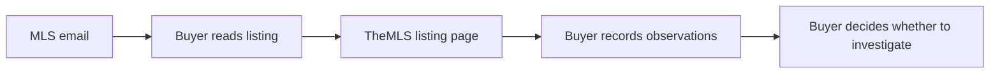

The proposed product records those observations with their sources and compares homes against your preferences. A **tenant** represents a private household or buying team; members share preferences and offer scenarios within that boundary.

### Two products for residential buyers

A Homebuyer asks whether a property fits daily life and what to check on a visit. A residential Investor asks what income the property can support at a given purchase price. Both may open the same duplex. Give them distinct onboarding, navigation and property pages within one website, with one sign-in and one backend.

| Experience | Onboarding and feed | Property page and next action |
|---|---|---|
| Homebuyer · `/homebuyer` | Start a home search with household needs and budget. Rank homes by fit. | Lead with layout, location, affordability and unknowns. Shortlist a home or flag a question for a visit. |
| Investor · `/investor` | Start an acquisition search with financing assumptions and income criteria. Rank by the search's investment criteria. | Lead with units, occupancy, documented rents, expenses and projected cash flow. Compare purchase scenarios and their binding constraints. |

A search belongs to a household or buying team. One account can keep a home search and an investment search open at the same time. The chosen experience controls presentation. The strategy saved with the search determines which assumptions to apply.

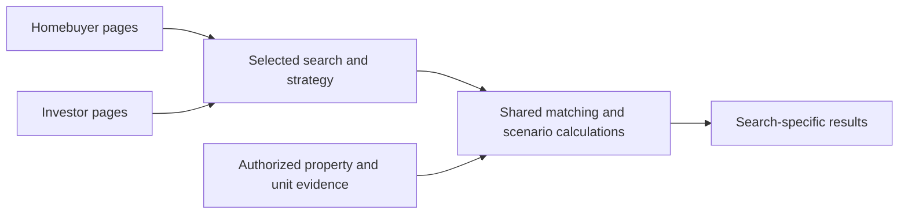

### The problem

The planning record contains no measured inbox volume, handling time, or conversion rate. We therefore treat the following as design failure cases, then measure their frequency during dogfood rather than inventing a savings estimate.

#### Duplicate-home failure

Repeated emails and relistings can make you review the same home without seeing its history. Address text alone cannot distinguish units, and source listing identifiers cannot identify a home across marketing episodes.

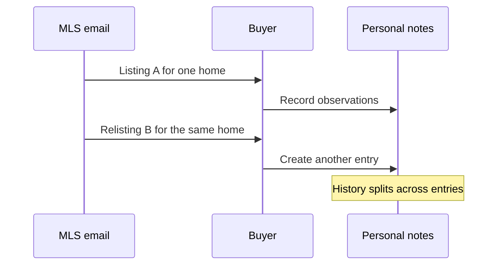

#### Unsupported-conclusion failure

A photo can suggest a quiet yard while concealing road noise. Without evidence and uncertainty, you cannot tell an observation from a model's inference.

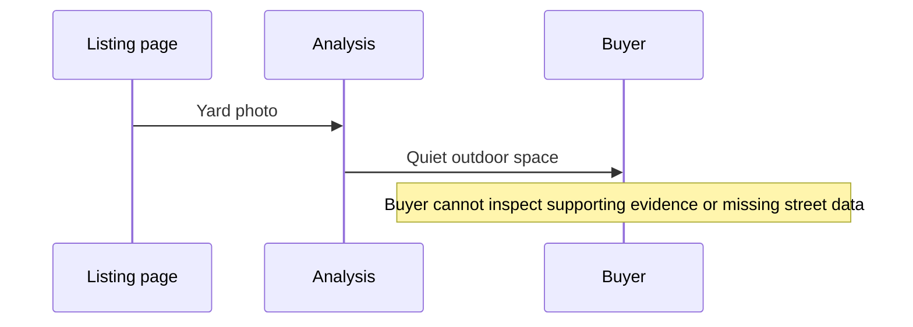

#### Blocked-result failure

One unavailable data source can delay the whole assessment. You still need the listing facts and a clear account of missing information.

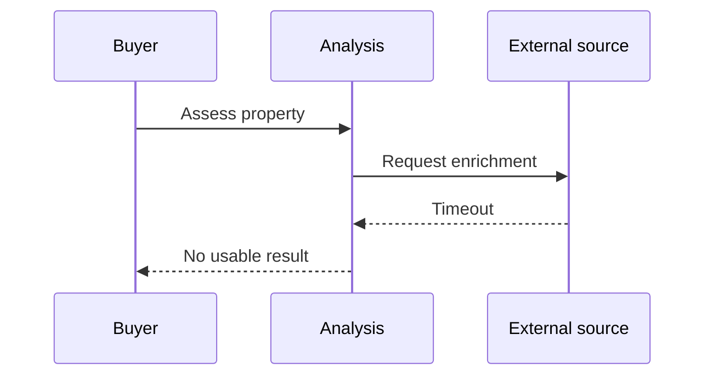

### The design

We recommend a Python modular monolith with separate runtime adapters. Engineers keep domain rules in one application layer and deploy API handlers, background tasks, and browser workers as workload needs dictate. This limits distributed-system overhead while preserving the chosen AWS deployment path.

The application layer coordinates use cases. Domain modules implement identity, claim resolution, scoring, valuation, and offer calculations without importing FastAPI, AWS clients, or browser code.

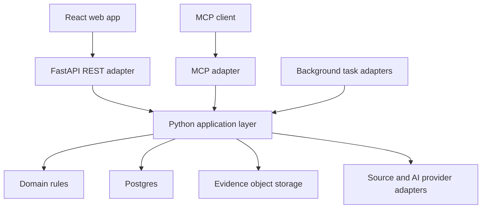

Engineers generate the frontend's RTK Query client from FastAPI's OpenAPI schema. MCP exposes the same application use cases through a parallel adapter; MCP calls do not route through REST, and neither adapter duplicates business rules. Users receive the same authorization checks and result semantics through both surfaces.

We recommend serving MCP over the streamable HTTP transport at `/mcp`, beside the REST API, so remote agents need no local process. MCP clients sign in through Cognito with the same authorization code and PKCE flow as the web app, shown in the sign-in diagram under Deployment, authentication, and operations. Each MCP request then carries a bearer access token; one token check maps it to the internal application user and tenant for both adapters (D28). The MCP server calls application services directly and never proxies HTTP into FastAPI (D29).

#### Ingestion and browser enrichment

The first acquisition path polls a dedicated mailbox over IMAP every 15 to 30 seconds. The user chose IMAP polling because it is simple and avoids coupling ingestion to Gmail-specific APIs; the email ingress stays pluggable so SES, Gmail or an inbound-mail webhook can replace it later (D22). Workers preserve raw email before parsing, record malformed messages for review, and checkpoint mailbox progress after durable intake. Mail delivery and job delivery can repeat, so engineers enforce deduplication at both boundaries.

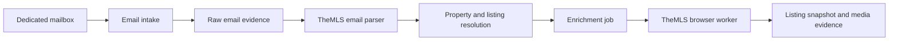

Browser workers use Playwright with one persistent, encrypted TheMLS session per source credential and hold a credential lease while they use or refresh it; account-level concurrency starts at one (D23). The session moves through four lifecycle states; reauthentication pauses dependent jobs and notifies an administrator, who holds the `operator` role, instead of looping through login attempts.


The browser starts as a container worker on DigitalOcean. AWS uses Fargate for persistent-session or long browser jobs. Engineers may use Lambda for short, measured browser tasks after a compatibility test, but must not require a browser session to survive a Lambda invocation. Ordinary Lambda functions have a 900-second invocation limit, which supports a bounded-task design [R2].

Workers accept listing URLs from an allowlisted TheMLS host set, block private-network destinations and unsafe redirects, and enforce media size limits. Source pages and emails are untrusted input. AI adapters treat their contents as evidence, with no authority to issue tools or alter application instructions.

#### Identity, history, and evidence

Identify the asset offered for sale before resolving its address. A whole duplex offered in one sale has one property, one listing episode and two component units. Two condos offered for sale separately have distinct property identities even if they share a street address. A unit label on a rent roll identifies the subject of an occupancy or rent claim. It provides no evidence that the unit is for sale on its own.

Engineers use internal UUIDs for properties and listings. They scope external identifiers to their source and jurisdiction. A property may have several parcels or units, so automatic merging requires stronger evidence than address similarity.

| Concept | Meaning |
|---|---|
| Property | Stable identity for a home or parcel grouping |
| Listing | Source-specific marketing episode |
| Snapshot | Immutable observation of a listing at a point in time |
| Claim | Typed assertion about a subject, supported by evidence |
| Evidence | Original content or a derived artifact with provenance |
| Intelligence profile | Versioned resolved view of claims for a subject |

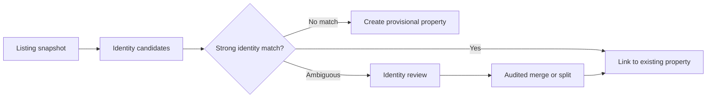

A source-scoped listing ID identifies a listing episode unless source behavior proves otherwise. County plus assessor parcel number provides a property anchor; normalized address, unit, and coordinates supply supporting signals. Workers preserve candidate links during uncertainty. Operators can reverse a merge using retained aliases and provenance.

We recommend Postgres for transactional relationships and JSONB for versioned, heterogeneous payloads. Engineers keep tenant IDs, subject IDs, timestamps, status, foreign keys, and uniqueness constraints in relational columns. JSONB holds claim values, source payloads, and model details; it does not replace schema validation or referential integrity.

Workers store raw `.eml`, HTML, screenshots, documents, and media in content-addressed object storage. They record object version, digest, content type, capture time, source locator, and access scope in Postgres. Writers cannot overwrite evidence; corrections create new claims. AWS uses versioned S3 with deny-overwrite/delete policies and an approved Object Lock retention policy for evidence classes that permit it [R6]. DigitalOcean dogfood must pass write-once and restore tests; an emulator alone does not establish durable immutability.

#### Claims and selective human verification

A claim records a value, the ontology field that gives it meaning, and the evidence that supports it. An **ontology** is the versioned catalog of those field meanings, types, units, and allowed values. Confidence describes an assessment method's uncertainty; it does not transform an inference into a verified fact.

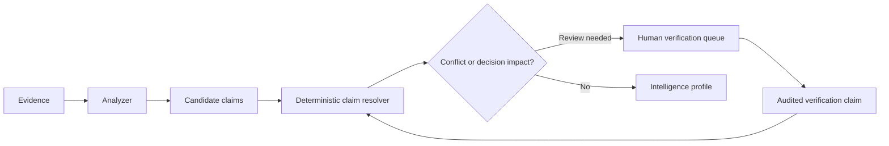

The resolver retains competing claims and selects a display value under a versioned policy. It considers source authority, observation time, verification status, and field semantics. A newer marketing description does not erase an assessor record; a field-specific rule decides whether either source supports the question.

Operators review identity ambiguity, source conflicts, low-confidence high-impact claims, and user corrections. Review effort follows impact: an uncertain hard requirement deserves attention before a decorative description. The product labels verified, inferred, disputed, stale, and unknown values and links users to accessible evidence.

#### Reusable intelligence and tenant privacy

Engineers separate property facts, location context, and market context from each tenant's preferences. A location profile describes a spatial scope such as a road segment or neighborhood; a market profile describes an area, property class, and time window. Each profile declares freshness and provenance.

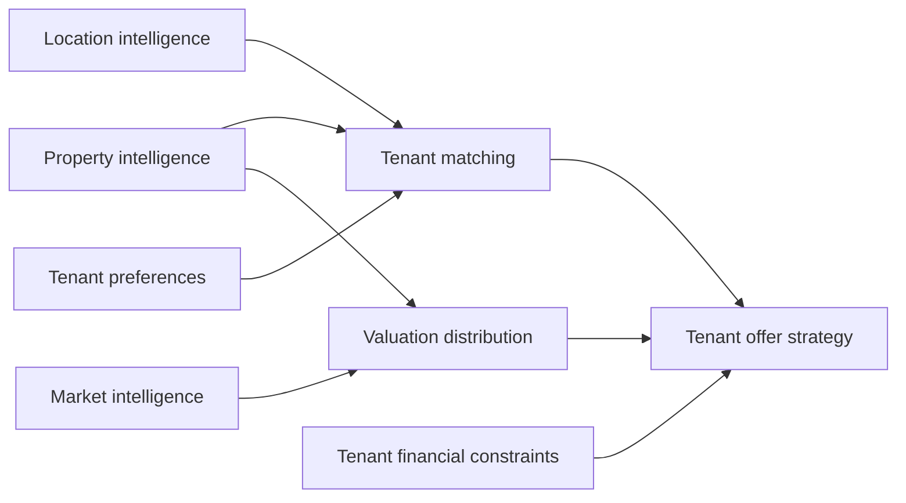

Reuse depends on source rights. Engineers may share a canonical property identifier across tenants, but they must scope evidence and claims to the tenants or entitlement groups allowed to use them. A household's offer ceiling, private notes, source credentials, and feedback remain tenant-private. A cached result must include its entitlement scope in the cache key.

For street quality, analyzers combine road classification, traffic data where available, map position, and user observations. The product distinguishes measured traffic from a quiet-street inference. Protected demographic characteristics and proxies for steering do not enter suitability scores.

#### Preferences, hard filters, and scoring

A preference revision freezes hard requirements, soft weights, missing-data policy, and financial constraints. Users can inspect why a home passed, failed, or needs verification. Engineers calculate eligibility before ranking and keep LLM prose outside the scoring function.

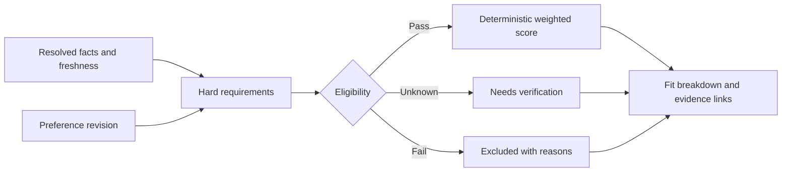

We recommend three-valued hard-filter logic: pass, fail, or unknown. Unknown facts cannot satisfy a hard requirement. Users may include unknown homes in a review feed, but the interface keeps them separate from confirmed matches.

For soft criteria, engineers use versioned utility functions bounded from zero to one. The score uses a fixed denominator across configured criteria; unknown values contribute zero pending verification, and the UI shows a separate coverage measure. This avoids inflating a home's rank because it has less evidence. Users may select a different policy through an explicit preference revision.

#### Buyer strategy

Choose among owner occupancy, living in one unit and renting the others, and holding the property for rental income. For a live-in duplex search, the buyer can require a unit available at closing. A lease on the other unit supports a rent claim for that unit. If the closing-date availability is unknown, show the home in the verification feed.

#### Valuation and offer strategy

A valuation describes a price distribution at a specific time, with comparable sales, adjustments, assumptions, and uncertainty. Engineers start with an explainable comparable-sales baseline and evaluate calibration before adding model complexity. Sparse or stale comps produce an abstention or a wide interval with a low-support label.

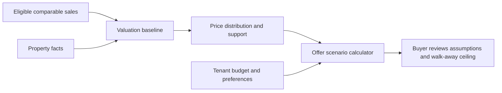

Keep the market-value estimate tied to the property, comparable sales and valuation date. Underwriting answers a different question: how much cash remains for this buyer after operating expenses, reserves and debt payments? Record the period and source for each input. Rent due under a lease, cash collected and an agent's projected rent can differ. Label each basis and show missing inputs before presenting a total.

Offer strategy combines valuation uncertainty with tenant budget, financing, repair reserves, and risk tolerance. It can compare scenarios and calculate a walk-away ceiling without asserting a seller's acceptance probability when no calibrated model supports one. The product does not submit offers or negotiate on behalf of a user.

#### Orchestration and partial results

AWS uses Step Functions Standard for multi-step analysis, SQS for buffered work, and EventBridge for schedules and domain-event routing. Engineers keep state-machine payloads small by passing IDs and evidence references. Each task commits its result and outbox event in one database transaction; an outbox publisher bridges the database and queue.

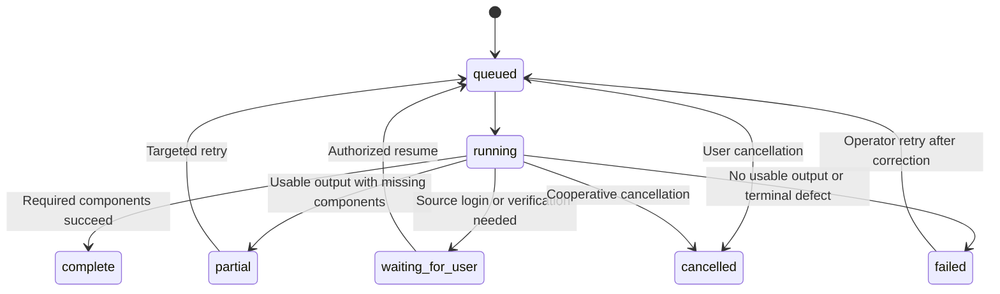

Step Functions Standard supplies workflow execution semantics [R1], but engineers still protect task side effects against retries, queue redelivery, and operator replay. Idempotency keys include task kind, subject, source version, analyzer version, and relevant preference revision. A partial result lists missing components and their failure classes; it never presents stale values as fresh.

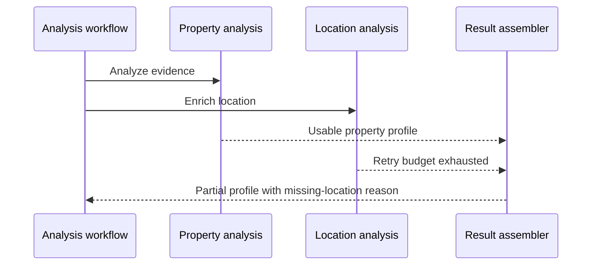

#### AI providers and evaluation

Engineers define a provider-independent inference request with capability, schema, evidence references, limits, and model policy. Adapters return validated structured output, usage, latency, and provider metadata. The first analyzer brings its first adapter; the team adds a second provider before claiming interchangeable-provider support. We propose OpenAI as that first adapter, behind the provider-independent contract. No benchmark in the planning record favors it over Anthropic, so the choice stays open for the user.

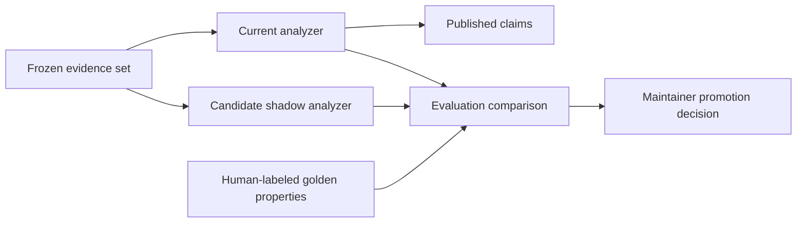

Provider fallback preserves the requested capabilities and privacy constraints. Engineers record fallback use and validate outputs again. A failed call does not authorize an unlimited cascade of paid attempts. Shadow outputs remain outside published claims, ranking, and notifications until a maintainer promotes a version.

The evaluation set covers duplicate identities, noisy listings, source conflicts, hard-filter unknowns, quiet-street uncertainty, and valuation holdouts. Engineers separate training examples from held-out evaluation and report results by source and field. A scalar confidence from a language model requires calibration before the product treats it as a probability.

#### Deployment, authentication, and operations

Dogfood runs on DigitalOcean with containerized Python services, Postgres, object storage, and MiniStack for the AWS APIs it proves compatible. Engineers pin the MiniStack image digest and test the specific services used; the upstream service list is a capability claim, not evidence of deployment parity [R7]. A restart-safe polling worker may substitute for an unsupported local scheduling or workflow feature behind the same task contracts.

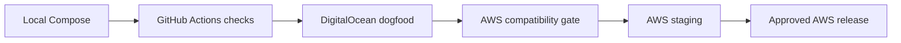

AWS starts with API Gateway and Lambda for FastAPI, Cognito for identity, S3 for evidence, and RDS Postgres with bounded connection pools. The MCP adapter runs as its own Lambda behind the same API Gateway at `/mcp`; dogfood runs it as a separate container behind the same TLS proxy. Fargate handles browser sessions and tasks whose measured runtime or memory exceeds the Lambda budget. CDK in TypeScript defines AWS infrastructure; DigitalOcean uses a documented container deployment manifest rather than an invented claim that AWS CDK deploys it.

Users authenticate with Cognito authorization code flow and PKCE in dogfood and AWS. Local development can use a signed fixture issuer behind an explicit development flag. Engineers validate issuer, audience, token use, expiry, and tenant membership in both adapters. Service workers use scoped workload credentials rather than a user's browser token.

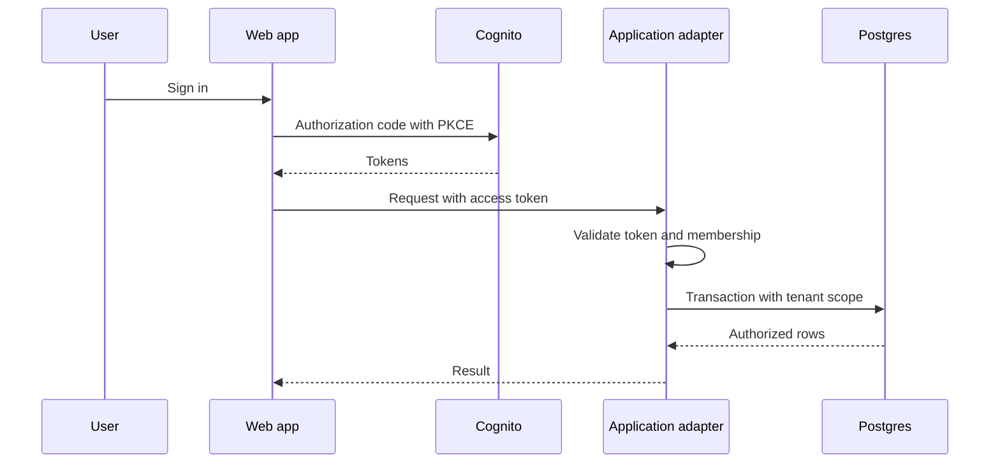

Engineers use database row-level security as defense in depth, alongside application authorization. Runtime roles neither own tables nor bypass row security. Pool users set tenant context per transaction and clear it at transaction end. Shared, rights-cleared intelligence uses explicit authorization paths rather than a null-tenant shortcut [R5].

Operators use an operations screen to inspect queue age, failures, credential status, cost, and replay history. OpenTelemetry correlates requests, jobs, source calls, and model calls; AWS exports telemetry to CloudWatch. Engineers redact email bodies, cookies, tokens, and financial details from logs.

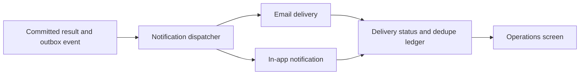

Notifications cover new qualified matches, material changes, and user action requests. Users choose email and in-app preferences; digests and cooldowns prevent repeated alerts for the same result version. External mail delivery can remain ambiguous after a timeout, so the dispatcher uses provider idempotency where available and records uncertain sends for reconciliation.

Engineers attribute paid work to tenant, property, job, analyzer, model, provider, and shared-intelligence scope from the first paid call (D56). Before a provider call, workers reserve estimated spend in a transactional budget ledger; completion reconciles actual usage. Budgets are configured per analysis tier, such as baseline versus deep analysis (D1), not inside individual analyzers (D56). Budget exhaustion defers optional enrichment while preserving intake and access to existing results. The ledger and reservations arrive with the first paid analyzer in phase 3; phase 5 adds cost views and operator budget controls.

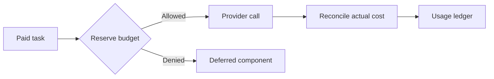

Operators back up Postgres and evidence outside the dogfood host. The initial recovery objectives are a 24-hour recovery point and an 8-hour recovery time, pending a measured restore drill. Before AWS production, the team must demonstrate point-in-time database recovery and restoration of evidence references, encryption access, and application configuration.

```mermaid
flowchart LR
    Live[Database and evidence] --> Backup[Encrypted independent backups]
    Backup --> Isolated[Isolated restore environment]
    Isolated --> Verify[Reference and digest checks]
    Verify --> Drill[Operator recovery report]
```

### Non-goals

- Commercial acquisitions and lease searches. Residential lease documents remain relevant evidence for a purchase.

- Automated offer submission, brokerage transaction management, and autonomous negotiation.
- Nationwide source coverage or a general web crawler in the MVP.
- A lender appraisal, guaranteed sale price, or calibrated seller acceptance prediction before supporting evaluation.
- A custom workflow engine, ontology editor, feature store, or vector database before a demonstrated use case.
- A public multi-tenant SaaS launch during household dogfood. Engineers still enforce tenant isolation from the first migration.
- Replacing source licensing agreements with a technical caching policy.

### Alternatives and trade-offs

| Decision | Attractive alternative | Reason for rejection or deferral | Accepted cost |
|---|---|---|---|
| Two product sections on one website | Separate websites at launch | Both audiences need the same sign-in, listing evidence and calculations. Separate route groups let each audience start with its own questions. | Maintain two sets of navigation and page layouts. A later domain split can reuse the same API. |
| Python modular monolith | Independent microservices | Early boundaries will change; network contracts add deployment and debugging work | Shared release cadence; enforce modules through import rules |
| Postgres plus JSONB | Document-only store | Identity, access scope, provenance, and idempotency need transactions and constraints | Schema migrations plus JSON schema evolution |
| Claims plus evidence | One mutable AI summary | Reviewers cannot reconstruct conflicting observations or reproduce scoring | More records and explicit resolution policy |
| Deterministic matching | LLM ranks homes from prompts | Prompt/model changes would change hard eligibility without a stable explanation | Engineers maintain utility functions and ontology mappings |
| Step Functions Standard | Temporal | Durable workflows fit both, but AWS-native orchestration matches the selected hosting path and reduces dogfood infrastructure | Local parity needs tests; workflow definitions use AWS semantics |
| Lambda-first | Fargate for all compute | Idle containers add operating cost for intermittent short jobs | Cold starts, connection constraints, task-size discipline |
| Fargate browser worker | Browser in all Lambdas | Session management and variable page runtimes complicate a short-lived runtime | A container worker and credential lease need operations |
| OpenAPI codegen | Hand-maintained frontend client | Two endpoint/type definitions drift | Generated output and deterministic regeneration become CI inputs |
| Parallel MCP adapter | MCP wrapper around REST | Shared use cases avoid transport coupling and retain one authorization implementation | Two adapter contract suites |
| MiniStack dogfood | AWS-only development | Local/dogfood feedback benefits from the selected emulator path | Engineers prove service compatibility in real AWS before release |
| Content-addressed evidence | Mutable source URL references | Source pages change or expire | Storage, retention, access entitlement, and deletion obligations |
| Selective verification | Human review of all claims | Review volume could block the feed | Low-impact inferred fields retain uncertainty labels |
| Comparable-sales baseline | Opaque valuation model first | No supplied training corpus or backtest supports a more complex initial model | Sparse markets may require abstention |

### Phased rollout

Milestones describe release scope. Engineers generate task-level work from the BTL after reviewing the design.

| Phase | Outcome and scope boundary | Exit evidence |
|---|---|---|
| 0. Foundation | Monorepo, configuration, auth, tenancy, migrations, CI, Compose, MiniStack compatibility inventory | Two-tenant isolation checks and repeatable clean bootstrap |
| 1. MLS ingestion | Dedicated mailbox, raw retention, TheMLS email parser, identity and listing snapshots | Replayed email corpus creates no duplicate listing episode or snapshot |
| 2. TheMLS enrichment | Browser credential lifecycle, media capture, evidence manifests, failure classification | Captured listing with expired-session recovery and immutable evidence |
| 3. Property intelligence | Ontology v1, claims, resolution, first multimodal analyzer, minimal budget ledger and reservations for paid calls, targeted verification | Golden-property evaluation and evidence-linked profile |
| 4. Preferences and matching | Preference revisions, hard filters, score, explanations | Deterministic golden ranking and unknown handling |
| 5. Homebuyer dogfood | Single-family home search, Homebuyer feed/detail UI, shortlist and visit questions, evidence, corrections, email and in-app notifications, basic ops, cost views and operator budget controls | One household completes the intake-to-review loop on DigitalOcean; restore drill passes |
| 6. Location intelligence | Street quality, first permitted external location source, stale-data rules | Field-level evaluation with measured versus inferred labels |
| 7. Market intelligence | Comps, price distributions, freshness, holdout evaluation | Backtest report and calibrated interval checks or explicit abstention |
| 8. Investor experience and offer strategy | Investor onboarding and feed, rent-roll intake, unit-level occupancy, operating expenses, financing, cash flow and walk-away ceiling. Expose the live-in scenario in Homebuyer too. | One duplex evaluated under both strategies, plus reproducible scenarios and isolation tests |
| 9. AWS release hardening | CDK deployment, Step Functions/Fargate compatibility, shadow promotion, operational drills | AWS staging smoke, fault injection, budget alarms, restore and rollback reports |

The team implements baseline evaluation, security, telemetry, idempotency, and backups in the phases that first need them. Phase 9 expands those controls; it does not postpone them until after dogfood.

### Risks and open questions

| Risk or unresolved input | Current design response | Decision owner and deadline |
|---|---|---|
| TheMLS automation, media storage, and reuse rights | Do not assume access rights; scope source connector and cached results to authorized use | User/source account owner before live source capture |
| Real email and page formats absent | Use synthetic fixtures, then capture redacted authorized examples | User and connector engineer before parser acceptance |
| Mail host and authentication method unknown | IMAP port with provider configuration; prefer OAuth where supported | User before live mailbox setup |
| TheMLS MFA, session lifetime, and source-ID reuse unknown | Credential leases, `auth_required`, fixture research, explicit episode policy | Connector engineer in phase 2 |
| MiniStack service fidelity and CDK bootstrap compatibility | Pin digest; record actual API tests and unsupported operations | Infrastructure engineer in phase 0 and AWS gate |
| Initial ontology and preference weights unconfirmed | Seed proposed fields; require household review of preference revision | User in phase 4 |
| Licensed evidence may prohibit cross-tenant reuse or long retention | Entitlement-aware storage and retention classes | Source owner before sharing or locking evidence |
| No valuation corpus or calibration target supplied | Baseline and holdout design; abstain until release gate passes | Model owner in phase 7 |
| AI budget and useful latency target unconfirmed | Configurable conservative limits; measure pilot distribution | User and operator before the first paid analyzer run in phase 3 |
| Recovery targets may exceed single-host dogfood capability | Independent backups and timed restore drill | Operator before phase 5 release |
| OpenAI as default first AI provider: D31 requires a multi-provider abstraction with one or two initial implementations but names no vendor, and no benchmark favors one | Recommend OpenAI behind the provider-independent contract; Anthropic is the alternative first adapter | User, before confirmation |
| Which MCP clients must connect, and whether they support remote streamable HTTP with OAuth | Recommend streamable HTTP at `/mcp` with Cognito authorization code and PKCE and a pre-registered client ID; a local stdio server is the alternative | User, before confirmation |

- [ ] Confirm the Investor launch size range before sourcing evaluation data. One to four units is the proposed starting boundary. Five-plus-unit support remains undecided.
- [ ] Confirm the first mailbox provider and authorized TheMLS workflow.
- [ ] Supply representative redacted MLS emails and permitted page/media examples.
- [ ] Confirm initial geography, hard requirements, budget limits, and notification destinations.
- [ ] Approve retention and reuse policy before immutable retention or shared caching of licensed material.
- [ ] Set valuation release thresholds after measuring the baseline on a representative held-out set.

---

## BELOW THE LINE: Execution Spec

> Human reviewers may stop here. Engineers and task-generation agents should use the following paths, contracts, acceptance criteria, and release gates.

### Scope and repository map

All paths below are repository-relative and designate files to create. There are no existing product files to modify. Generate lockfiles during bootstrap and commit them. Create modules when their phase begins; do not create empty framework layers merely to populate this map.

```text
/specs/property-focus/master-plan.md                 This document
/specs/property-focus/architecture-decisions.md       Canonical user decision register (D1–D56)
/specs/property-focus/source-rights.md                Rights, retention and entitlement decisions
/specs/property-focus/compatibility.md                MiniStack versus AWS operation matrix
/specs/property-focus/evaluation-policy.md            Dataset splits, metrics, release thresholds
/specs/property-focus/operations.md                   Runbooks, recovery, incident and replay procedures
/README.md                                          Bootstrap and commands
/AGENTS.md                                          Boundaries, verification and generated-file rules
/.gitignore                                         Secrets, sessions, local evidence and caches
/.env.example                                       Placeholder configuration; no credentials
/pyproject.toml                                     uv workspace, Python dependencies and tooling
/uv.lock                                            Locked Python dependency graph
/package.json                                       pnpm workspace and root commands
/pnpm-workspace.yaml                                Web, API client and CDK workspaces
/pnpm-lock.yaml                                     Locked JavaScript dependency graph
/tsconfig.base.json                                 Shared strict TypeScript settings
/Makefile                                           Exact commands specified below
/compose.yaml                                       Local Postgres, services, MiniStack and dev mail sink
/docker/api.Dockerfile                              API and ordinary worker image build stages
/docker/browser.Dockerfile                          Pinned Playwright and browser image
/.github/workflows/ci.yml                            Checks and artifact build
/.github/workflows/deploy-dogfood.yml                Reviewed DigitalOcean deployment
/.github/workflows/deploy-aws.yml                    OIDC, CDK diff, protected release
/.github/workflows/evaluate.yml                      Manual/scheduled replay and shadow evaluation
/.github/workflows/backup-restore-check.yml          Restore validation on isolated resources
/apps/backend/pyproject.toml                        property_focus package and CLI entrypoint
/apps/backend/alembic.ini                           Migration configuration
/apps/backend/migrations/env.py                     Alembic metadata and settings
/apps/backend/migrations/versions/0001_core.py      Tenants, identity, evidence, claims, jobs, budget ledger
/apps/backend/migrations/versions/0002_matching.py  Preferences, evaluations, shortlist, feedback, notifications
/apps/backend/migrations/versions/0003_finance.py    Market, valuation, offer scenario persistence
/apps/backend/src/property_focus/__init__.py         Package marker
/apps/backend/src/property_focus/config.py           Typed settings and environment validation
/apps/backend/src/property_focus/cli.py             migrate/seed/replay/evaluate/restore-check commands
/apps/backend/src/property_focus/domain/identity.py  Property and listing matching rules
/apps/backend/src/property_focus/domain/claims.py    Claims, evidence, resolution and scope rules
/apps/backend/src/property_focus/domain/ontology.py  Ontology validation and migration compatibility
/apps/backend/src/property_focus/domain/preferences.py Preference revision and criterion contracts
/apps/backend/src/property_focus/domain/matching.py  Three-valued filters and deterministic scores
/apps/backend/src/property_focus/domain/valuation.py Comparable selection and price distribution
/apps/backend/src/property_focus/domain/offers.py   Scenario and walk-away calculations
/apps/backend/src/property_focus/domain/underwriting.py Unit income, cash flow and expense normalization
/apps/backend/src/property_focus/domain/errors.py    Stable failure taxonomy
/apps/backend/src/property_focus/application/ports.py Repository, storage, AI and source protocols
/apps/backend/src/property_focus/application/context.py Authenticated principal, tenant and entitlement
/apps/backend/src/property_focus/application/ingestion.py Intake, document upload and identity use cases
/apps/backend/src/property_focus/application/intelligence.py Analysis, profile and verification use cases
/apps/backend/src/property_focus/application/matching.py Match and preference use cases
/apps/backend/src/property_focus/application/finance.py Valuation and offer use cases
/apps/backend/src/property_focus/application/jobs.py  Leases, idempotency, outbox and state transitions
/apps/backend/src/property_focus/application/notifications.py Notification selection and deduplication
/apps/backend/src/property_focus/application/budgets.py Reservations and usage attribution
/apps/backend/src/property_focus/adapters/rest/app.py FastAPI factory and middleware
/apps/backend/src/property_focus/adapters/rest/schemas.py Pydantic API request/response schemas
/apps/backend/src/property_focus/adapters/rest/routes.py API endpoint bindings
/apps/backend/src/property_focus/adapters/mcp/server.py Streamable HTTP transport at /mcp and tool bindings
/apps/backend/src/property_focus/adapters/auth/cognito.py Token and membership checks for REST and MCP; MCP protected-resource metadata
/apps/backend/src/property_focus/adapters/db/models.py SQLAlchemy models and constraints
/apps/backend/src/property_focus/adapters/db/repositories.py Scoped repositories and unit of work
/apps/backend/src/property_focus/adapters/db/rls.sql   Row security definitions installed by migrations
/apps/backend/src/property_focus/adapters/storage/objects.py S3-compatible evidence store
/apps/backend/src/property_focus/adapters/sources/imap.py Mailbox polling and checkpoint handling
/apps/backend/src/property_focus/adapters/sources/themls_email.py MIME and listing-link parser
/apps/backend/src/property_focus/adapters/sources/themls_browser.py Playwright extraction and auth state
/apps/backend/src/property_focus/adapters/sources/location.py First licensed location source
/apps/backend/src/property_focus/adapters/sources/market.py First licensed comparable-sales source
/apps/backend/src/property_focus/adapters/ai/base.py  Provider capability and response validation
/apps/backend/src/property_focus/adapters/ai/openai.py First provider adapter; recommended default pending user confirmation (Risks)
/apps/backend/src/property_focus/adapters/ai/anthropic.py Second adapter; passes the shared capability contract by the AWS ready gate (phase 9), earlier if needed
/apps/backend/src/property_focus/adapters/notifications/email.py Email provider and delivery reconciliation
/apps/backend/src/property_focus/adapters/telemetry.py OTel setup and redaction
/apps/backend/src/property_focus/workers/handlers.py  Bounded task handlers for local and AWS invocations
/apps/backend/src/property_focus/workers/poller.py    Restart-safe dogfood queue/schedule runner
/apps/backend/src/property_focus/workers/browser.py   Browser container entrypoint
/apps/backend/src/property_focus/workers/outbox.py    Outbox and notification dispatch loop
/apps/backend/src/property_focus/analyzers/property.py Property analysis schema and prompt binding
/apps/backend/src/property_focus/analyzers/location.py Street/location inference
/apps/backend/src/property_focus/analyzers/market.py Market summary from deterministic metrics
/apps/backend/src/property_focus/analyzers/documents.py Rent roll, lease and expense statement extraction (phase 8)
/apps/backend/tests/unit/test_identity.py            Matching, merges, units and relistings
/apps/backend/tests/unit/test_claims.py              Resolution, provenance and scope
/apps/backend/tests/unit/test_matching.py            Eligibility, score, coverage and reproducibility
/apps/backend/tests/unit/test_finance.py            Quantiles, leakage, scenario arithmetic
/apps/backend/tests/unit/test_underwriting.py       Duplex, vacancy basis, missing values and debt service
/apps/backend/tests/unit/test_ai.py                  Schema validation, fallback and accounting
/apps/backend/tests/integration/test_ingestion.py   MIME, IMAP checkpoints and evidence writes
/apps/backend/tests/integration/test_tenancy.py      RLS, signed evidence URLs and adapter parity
/apps/backend/tests/integration/test_jobs.py         Retries, leases, outbox and budget races
/apps/backend/tests/integration/test_browser.py      Recorded browser pages and auth expiry
/apps/backend/tests/integration/test_recovery.py    Restore manifests and evidence integrity
/apps/backend/tests/integration/test_evidence_immutability.py Write-once and restore checks against the real dogfood bucket
/apps/backend/tests/contract/test_api.py             OpenAPI responses and error contracts
/apps/backend/tests/contract/test_mcp.py             Tool schemas, authorization and result parity
/apps/backend/tests/aws/test_pipeline.py             Real AWS deployed smoke and redelivery
/apps/web/package.json                              React/Vite scripts and dependencies, including @axe-core/playwright
/apps/web/index.html                                Vite entry document
/apps/web/vite.config.ts                            Build and proxy settings
/apps/web/tsconfig.json                             Strict web TypeScript settings
/apps/web/src/main.tsx                              React root
/apps/web/src/app/store.ts                          Redux store and RTK Query registration
/apps/web/src/app/router.tsx                        Routes and sign-in boundary
/apps/web/src/auth/session.ts                       PKCE session and token lifecycle
/apps/web/src/products/homebuyer/Layout.tsx         Homebuyer navigation and route group
/apps/web/src/products/homebuyer/Onboarding.tsx     Household requirements and search creation
/apps/web/src/products/homebuyer/HomeFeed.tsx       Homebuyer feed under /homebuyer: fit, eligibility status and unknowns
/apps/web/src/products/homebuyer/PropertyDetail.tsx Homebuyer detail: fit, evidence, unknowns, history, shortlist, visit questions
/apps/web/src/products/investor/Layout.tsx          Investor navigation and route group (phase 8)
/apps/web/src/products/investor/Onboarding.tsx      Strategy, budget and financing assumptions
/apps/web/src/products/investor/AcquisitionFeed.tsx Investment criteria and incomplete estimates
/apps/web/src/products/investor/PropertyDetail.tsx  Rent roll, expense evidence and scenario comparison
/apps/web/e2e/products.spec.ts                      Same-account searches and duplex strategy switch
/apps/web/e2e/accessibility.spec.ts                 axe scan and keyboard-only path for feed, dialogs and verification
/apps/web/src/pages/Preferences.tsx                 Revision editor and comparison
/apps/web/src/pages/Verification.tsx                Review queue and corrections
/apps/web/src/pages/Notifications.tsx               In-app inbox and channel settings
/apps/web/src/pages/Operations.tsx                  Role-gated failures, costs and retry controls
/apps/web/src/pages/Valuation.tsx                   Distribution and comparable explanations
/apps/web/src/pages/OfferScenarios.tsx              Tenant scenario inputs and output
/apps/web/src/components/EvidenceViewer.tsx         Authorized image/document display
/apps/web/src/components/ResultStatus.tsx           Partial, stale and unknown indicators
/apps/web/src/styles.css                           Accessible layout and status styles
/apps/web/tests/matching.test.tsx                   Fit and unknown presentation
/apps/web/tests/operations.test.tsx                 Replay confirmation and role controls
/apps/web/e2e/dogfood.spec.ts                       Sign-in, feed, evidence, preference and feedback loop
/packages/api-client/package.json                  Client build and generation scripts
/packages/api-client/openapi.json                   Committed exported schema
/packages/api-client/codegen.ts                     RTK Query OpenAPI configuration
/packages/api-client/src/baseApi.ts                 Auth headers, errors and cache tags
/packages/api-client/src/generated.ts               Generated endpoints and types
/packages/ontology/v1.json                          Proposed field types, units and enums
/packages/ontology/CHANGELOG.md                     Version compatibility and field migrations
/packages/prompts/property-v1.md                    Versioned extraction instructions
/packages/prompts/location-v1.md                    Versioned location interpretation instructions
/packages/prompts/documents-v1.md                   Versioned rent roll, lease and expense extraction instructions
/infra/cdk/package.json                             CDK build, synth, test and deployment scripts
/infra/cdk/cdk.json                                 CDK app configuration
/infra/cdk/bin/property-focus.ts                      App and environment selection
/infra/cdk/lib/data-stack.ts                        RDS, S3, KMS and backup configuration
/infra/cdk/lib/identity-stack.ts                    Cognito, web application client and public MCP client (PKCE)
/infra/cdk/lib/api-stack.ts                         API Gateway, REST and MCP (/mcp) Lambdas and permissions
/infra/cdk/lib/workflow-stack.ts                    Step Functions, queues, events and browser task
/infra/cdk/lib/observability-stack.ts               Dashboards, alarms and budget notifications
/infra/cdk/workflows/analyze.asl.json                Standard workflow definition
/infra/cdk/test/security.test.ts                    Public access, IAM and encryption assertions
/infra/cdk/test/workflow.test.ts                    Retry, catch, timeout and reference-only payloads
/infra/dogfood/compose.yaml                         DigitalOcean production override, including the mcp service
/infra/dogfood/Caddyfile                            TLS termination and routes for web, /v1 API and /mcp
/infra/dogfood/deploy.sh                            Pinned image deployment and health checks
/infra/dogfood/backup.sh                            Database and object backup entrypoint
/scripts/export_openapi.py                         Deterministic schema exporter without live services
/scripts/check_boundaries.py                       Import rules for domain/application/adapters
/scripts/check_fixture_secrets.py                  Fixture and credential leak checks
/evals/datasets/golden-properties.jsonl             Redacted/synthetic labeled property cases
/evals/datasets/valuation-holdout.jsonl              Time-split sales, added when licensed
/evals/fixtures/mail/multipart.eml                  Synthetic multipart MLS email
/evals/fixtures/mail/duplicate.eml                  Duplicate delivery fixture
/evals/fixtures/themls/listing.html                 Synthetic recorded page
/evals/fixtures/themls/login.html                   Session-expired page
/evals/config/baseline.yaml                         Dataset hashes, metrics and thresholds
/evals/reports/.gitkeep                             Report output directory marker
```

Files to modify: none at project start. Later migrations MUST append new migration files rather than rewrite a released migration. Task specs MUST enumerate additional exact files before creating them.

Off-limits: credentials, browser storage state, unredacted private email, licensed source corpora, production database contents, and another tenant's private records. Do not commit these to the repository or evaluation fixtures. Do not edit `/packages/api-client/src/generated.ts` by hand. Do not introduce `/.pvpd/` paths.

### Data model and invariants

Use UUID primary keys, UTC `timestamptz`, integer monetary minor units with ISO currency, decimal ratios, explicit unit codes, and WGS84 coordinates. Include `created_at` and schema version on persisted versioned records. Avoid floating-point money arithmetic.

| Table | Required fields and constraints |
|---|---|
| `tenants`, `users`, `memberships` | Membership unique on tenant/user; roles `member`, `reviewer`, `operator`; user identity bound to issuer/sub |
| `source_accounts` | Tenant, provider, credential secret reference, entitlement group, browser session state (`HEALTHY`, `SESSION_EXPIRING`, `AUTH_REQUIRED`, `BLOCKED`); secret values absent |
| `ingest_messages` | Account, mailbox, UIDVALIDITY, UID, raw evidence ID, digest, parse version, state; unique account/mailbox/UIDVALIDITY/UID |
| `properties`, `property_aliases` | Stable ID, normalized address components, unit, country, provisional state; parcel anchors scoped by jurisdiction; alias and merge audit |
| `property_units` | Stable unit ID, parent property FK, source aliases and unit label. The listing FK targets the sale property. Scope rent/occupancy claims to a unit and building expenses to the property. |
| `listings`, `listing_aliases` | Property ID, source, source-account scope, external ID, episode key, first/last seen; unique scoped episode key |
| `listing_snapshots` | Listing, effective source time, captured time, content hash, normalized JSONB, evidence ID; unique listing/content hash |
| `evidence` | Scope/entitlement, subject, source locator, object key/version, SHA-256, media type, size, captured time, retention class; no update of object locator/digest |
| `ontology_versions` | Version and digest, publication time, schema object reference; versions append-only |
| `claims`, `claim_evidence` | Subject type/ID, field, typed JSONB value, ontology version, observation/validity time, confidence method/value, author/model, scope, supersedes; evidence join with locator |
| `verification_events` | Claim/identity target, reviewer, correction claim ID, rationale, time; append-only |
| `intelligence_profiles` | Subject type/ID, immutable revision, ontology/resolver versions, resolved values, claim IDs, component status, freshness, input digest, scope |
| `searches` | Tenant, search ID, name, originating experience and current preference revision. One membership can access multiple searches and either product subject to the same access checks. |
| `shortlist_entries` | Tenant, search and property foreign keys, saved by and saved at. Unique per search/property; private RLS. |
| `preference_revisions` | Tenant, search ID, strategy, revision, ontology version, hard criteria, soft criteria, unknown policy, budget, financing assumptions for investor strategies, digest; append-only |
| `match_results` | Tenant, search ID, property/profile revision, preference revision, scoring version, underwriting version and digest (null for `owner_occupy`), eligibility, score, coverage, reasons, input digest |
| `market_profiles`, `comparable_sales` | Geography/class/time scope, sale date/price, rights, provenance; dedupe source sale ID; exclude future information from historical runs |
| `valuations` | Property/profile, model/data versions, as-of, currency, quantiles, support, comps, assumptions, status |
| `offer_scenarios` | Tenant, search ID, preference revision, strategy, selected owner unit if applicable, unit input revisions, valuation version, financial assumptions, scenario output, budget ceiling and version; private RLS |
| `jobs`, `job_components`, `job_attempts` | Tenant/scope, kind, input digest, state, lease expiry, fencing token, failure, parent, timestamps, result references |
| `idempotency_records` | Scope, operation, key, request digest, state, result ID, lease; unique scope/operation/key |
| `outbox_events`, `processed_events` | Event ID/version, aggregate revision, payload reference, publish state; consumer/event unique |
| `notifications`, `notification_deliveries` | Tenant/user, event, result revision, channel, dedupe key, provider ID, state; channel dedupe unique |
| `budget_reservations`, `usage_events` | Tenant/shared owner, property, job, analysis tier, analyzer, provider/model, estimate/actual, currency, tokens, duration, state; unique provider operation reference where available |
| `feedback` | Tenant, search ID, property ID, principal, target revision, `kind` (`note` or `visit_question`), text, time; private RLS; `visit_question` requires non-empty text; feedback does not mutate source evidence |
| `audit_events` | Tenant, principal, target revision, action, redacted metadata, time |

Use indexes on scoped external IDs, subject/field/observation time, tenant/job state/created time, outbox pending time, and profile input digest. Add GIN JSONB indexes only for measured query patterns. Store polygons and spatial queries with PostGIS only if the first location source requires them; record the extension in migrations and compatibility tests.

Tenant-private tables MUST have `tenant_id NOT NULL`, scoped foreign keys where appropriate, and forced RLS. Evidence shared through an entitlement group MUST require an explicit membership join. Database maintenance roles and backup roles require a documented separation from runtime roles.

### Requirements and acceptance criteria

MUST: Bootstrap the pinned monorepo and enforce dependency direction in phase 0.
- On a clean macOS arm64 or Linux x86_64 machine with Docker, the bootstrap commands below install dependencies, start local services, migrate an empty database and seed synthetic data without private credentials. `ci.yml` runs the bootstrap on a Linux x86_64 runner; the Foundation ready gate's clean-bootstrap log covers macOS arm64.
- `check_boundaries.py` fails if domain imports an adapter or application imports REST/MCP.
- CI runs `pnpm install --frozen-lockfile` and `uv sync --all-packages --frozen` before any check; a manifest change without a matching `pnpm-lock.yaml` or `uv.lock` update fails the build.

MUST: Authenticate and authorize REST, MCP, jobs, evidence retrieval and operations controls.
- A token for tenant A cannot read, infer existence of, mutate, export or obtain signed URLs for tenant B's private records.
- Expired, wrong-audience, wrong-issuer and wrong-token-use tokens fail. MCP and REST return equivalent permitted results for the same principal and use case.
- Operators need an explicit role and scope for retry, merge, source login, and budget changes; audit records identify actor and reason.
- MCP serves streamable HTTP at `/mcp`. An unauthenticated MCP request returns 401 with a `WWW-Authenticate` header naming `/.well-known/oauth-protected-resource`, whose metadata names the Cognito issuer. A Cognito access token issued to the MCP app client through authorization code with PKCE succeeds, validated by the same `adapters/auth/cognito.py` checks as REST (`apps/backend/tests/contract/test_mcp.py`).

MUST: Preserve and deduplicate MLS intake in phase 1.
- Store raw MIME bytes with digest before parse success; malformed messages remain visible in operations with an evidence reference.
- Re-deliver one UID, replay its parsed content, and deliver an equivalent message under another UID: intake records preserve delivery history while normalized listing/snapshot output remains deduplicated.
- Resetting UIDVALIDITY rescans safely; malformed messages do not halt the mailbox; checkpoint advancement requires durable intake for the covered messages.

MUST: Separate the experience, the search and the acquisition strategy.
- Phase 5 ships Homebuyer onboarding, feed and property detail under `/homebuyer` (`products/homebuyer/HomeFeed.tsx`, `products/homebuyer/PropertyDetail.tsx`). Phase 8 ships equivalent Investor entry points under `/investor` with acquisition criteria, rent roll and cash-flow comparison. Both call the same generated client and application use cases.
- Under one sign-in, create two searches with distinct preferences. Editing one search leaves the other ranking intact. Include search ID and revision in match caches, shortlist records, alerts and notification dedupe. Reuse authorized evidence without duplicating ingestion.
- REST and MCP reject a preference revision from another search. Load search membership and input entitlements on the server regardless of the active route.

MUST: Let search members shortlist homes and flag visit questions in phase 5.
- `PUT /searches/{search_id}/shortlist/{property_id}` returns `201` on the first save and `200` with the same entry on repeats; one row exists per search/property. `DELETE` on the same path returns `204`, also when no entry exists.
- An entry saved in one search does not appear in `GET /searches/{other_search_id}/shortlist` for the same tenant. A tenant B token receives `404` for tenant A's search shortlist, both on read and on `PUT`.
- `POST /properties/{id}/feedback` (D30) with `kind: visit_question` and non-empty `text` stores a private question for the search and property; `GET /searches/{search_id}/feedback?kind=visit_question&property_id=...` lists it; tenant B receives `404`. Empty `text` returns `422`.
- `apps/backend/tests/contract/test_api.py` and `apps/backend/tests/integration/test_tenancy.py` cover these cases; `apps/web/e2e/dogfood.spec.ts` shortlists a home and flags a visit question from the Homebuyer property page.

MUST: Resolve property and listing identities without destructive guesses.
- A duplex offered in one sale produces one feed item with two child units. A lease or rent roll cannot create another sale listing. Unclear sale scope enters identity review.
- Same parcel/jurisdiction links an existing property when unit/parcel evidence is consistent; different condominium units remain distinct.
- A new marketing episode creates a listing linked to the same property. Ambiguous address-only matches enter review.
- Merge and split fixtures retain aliases, evidence relationships and a reversible audit trail; source-ID reuse cannot erase prior episodes.

MUST: Capture TheMLS pages through a credential-scoped browser worker in phase 2.
- Capture a recorded listing's normalized facts, source time, HTML and referenced media with stable evidence locators.
- Expired-session fixture transitions to `waiting_for_user/auth_required` after one detection, emits one action notification, and resumes after operator-provided session refresh.
- Concurrent jobs for one account serialize; expired lease holders cannot overwrite a newer session or job result.
- Disallowed hosts, private IP redirects, oversized downloads and unsupported media fail with explicit classes and no internal network fetch.

MUST: Implement evidence integrity and access scope before analysis.
- Attempted overwrite of a committed digest/object reference fails; re-fetch verifies SHA-256; signed downloads expire and check entitlement at issuance.
- A correction creates another record and preserves the prior evidence. A deletion/retention procedure records tombstones and invalidates dependent published views where source rights require removal.
- `infra/cdk/test/security.test.ts` asserts S3 versioning, a deny-overwrite/delete policy for runtime roles, and Object Lock only on evidence classes that `source-rights.md` permits. An Object Lock policy must not prevent a required licensed-data deletion without a reviewed policy decision.
- `make storage-check ENV=dogfood` runs `apps/backend/tests/integration/test_evidence_immutability.py` against the real DigitalOcean evidence bucket. A runtime-credential overwrite or delete of a committed object fails or leaves the recorded version readable with its recorded SHA-256; objects restored from the independent backup match their recorded digests. A MiniStack run of the same test does not count.

MUST: Publish ontology and claim resolution versions in phase 3.
- Validate field, type, unit, enum and subject compatibility. Reject unsupported fields or preserve them only in raw source payloads.
- Resolve a conflict from a fixed fixture with a deterministic versioned rule and retain both claims.
- Profile output includes value status, evidence/claim IDs, input digest, scope, ontology version and resolver version; replaying identical inputs and versions yields the same canonical output digest.
- Ontology breaking changes create a new major version and explicit migration mapping; no silent reinterpretation of old claims.

MUST: Implement bounded, provider-independent AI calls with structured validation.
- A fake provider can exercise analyzers without network access; two real adapters pass the same capability contract in `apps/backend/tests/unit/test_ai.py` before the AWS ready gate (phase 9), or earlier when a second provider enters use.
- Invalid output is rejected; permit one bounded repair attempt under budget, then classify `schema_invalid` and preserve safe metadata.
- Record provider, model, prompt hash, schema hash, input evidence IDs, usage, latency and result digest. Do not log private source text.
- A malicious instruction embedded in email or HTML cannot call tools, change the schema, access credentials or authorize a write.

MUST: Implement deterministic hard filters and scores in phase 4.
- Fixed profile/preference/scoring revisions produce identical eligibility, score, coverage and explanation digest.
- Hard false yields fail; hard unknown yields unknown unless another criterion fails, in which case fail takes precedence. Hard pass requires all hard criteria true.
- Exclude failed homes from confirmed-match ranking. Display unknown homes as a distinct review state.
- Validate weights as nonnegative with positive total. Calculate `score = 100 * sum(weight * known_utility) / sum(all_weights)` and `coverage = sum(known_weights) / sum(all_weights)`; preserve component contributions and round only the display value.
- Missing, stale and disputed values follow the frozen missing-data policy and cannot silently pass hard requirements.
- From phase 8, for `rental_hold` and `live_in_and_rent` searches, `application/matching.py` calls `domain/underwriting.py` with the preference revision's budget and financing assumptions and the property's resolved unit and expense values. Criteria on `underwriting.net_operating_income` and `underwriting.cash_flow` then evaluate like any other field; a null underwriting output yields `unknown`. `match_results` stores the underwriting version and digest, and `test_matching.py` asserts identical results for identical inputs.
- A `live_in_and_rent` hard criterion on `unit.available_at_closing` passes when at least one unit is `true`, fails when every unit is `false`, and is `unknown` otherwise. Unknown homes appear in the verification feed, never among confirmed matches.

MUST: Keep reusable intelligence separate from tenant decisions.
- Two authorized tenants may reuse a rights-cleared property profile, while their match results, preference revisions and offer scenarios differ and remain private.
- A profile built from restricted tenant evidence is not served to another tenant through shared cache lookup.
- Changing preferences recomputes matching without recapturing unchanged source evidence; changing an ontology or analyzer creates a new profile revision.

MUST: Deliver the phase 5 user loop with graceful partial results.
- A user can sign in, inspect the feed, open evidence, inspect fit reasons and unknowns, edit preferences, and submit a correction.
- A location timeout leaves property facts visible with component status, last success time and retry information. The UI does not use color alone to convey eligibility or failure.
- `apps/web/e2e/accessibility.spec.ts` (run by `make test-e2e`) scans the feed, property detail dialogs and verification views with `@axe-core/playwright` and reports zero serious or critical violations. The same spec completes feed, evidence dialog and verification correction using the keyboard alone.

MUST: Route REST and MCP through application use cases.
- Contract tests compare canonical results for `get_property`, `evaluate_match`, `request_analysis`, `get_job` and `create_search` through both adapters; from phase 8 they add `create_offer_scenario` and `get_offer_scenario`.
- Transport modules contain validation/serialization and authentication binding; domain calculations remain outside adapters.
- Regeneration of the OpenAPI schema and RTK Query client produces no uncommitted diff after a clean build.

MUST: Implement durable, idempotent jobs and outbox delivery before paid or external work.
- Crash after database commit but before publish, after publish but before acknowledge, and after provider success but before job completion: retries preserve one committed domain result and account for possible provider-side ambiguity.
- Duplicate queue delivery uses a unique idempotency key; same key/different input returns conflict. Lease expiry permits recovery and fencing tokens reject stale completion.
- Cancelled jobs publish no new profile after cancellation wins the commit race; preserve already committed evidence and usage.

MUST: Apply failure taxonomy, bounded retries and operations recovery.
- Each failed component stores stable code, retryability, safe explanation, attempt count and correlation ID.
- Retry transient failures with exponential backoff and jitter, honor provider Retry-After, cap attempts at four including the initial attempt, and cap elapsed work by job deadline.
- Schema defects, authorization failures, exhausted budgets and invalid inputs do not enter generic retry loops. Dead-lettered work appears in operations with scoped replay and audit.

MUST: Enforce cost reservations and attribution from the first paid analyzer call in phase 3; add budget controls in phase 5.
- Phase 3: `application/budgets.py` reserves estimated spend in `budget_reservations` before every provider call against the tenant's hard budget for the call's analysis tier, configured in `config.py`; analyzers contain no cost limits (D56). Each usage event records property, job, analyzer, model and provider. Concurrent tasks cannot reserve more than the available budget (`test_jobs.py`); reservations expire or reconcile after uncertain outcomes through a repair job.
- Every paid operation has one usage event linked to its job and payer; shared costs have an explicit owner rather than duplicate full charges to multiple tenants.
- Exhausted budget prevents new optional provider calls, marks those components deferred and leaves ingestion and existing-result access usable.
- Phase 5: `GET /ops/costs` and `pages/Operations.tsx` show estimated versus actual usage, missing provider prices, and budget reset timezone; an operator with budget-change scope adjusts limits with an audit record. Do not report an unknown cost as zero.

MUST: Provide email and in-app notifications with deduplication.
- Replaying an event does not duplicate the in-app record; email dedupe uses result/event revision plus recipient/channel and records ambiguous provider outcomes.
- User opt-out, digest window and cooldown affect dispatch; source login failures notify once per unresolved episode.
- Notification content does not disclose private financial details; deep links require authenticated authorization.

MUST: Deploy through GitHub Actions with a secrets strategy.
- CI scans committed files and fixtures for secrets; cloud deployments use GitHub OIDC with scoped roles and protected production environments.
- Store production application secrets in AWS Secrets Manager; store dogfood secrets in a restricted encrypted host provisioning mechanism with an out-of-band recovery copy. Use parameter/config storage for nonsecret settings.
- Keep browser session state encrypted outside Git and logs. Rotating a source credential invalidates affected sessions without losing evidence.
- Build once, tag with commit and digest, promote the same image, run migrations as one controlled job, then run smoke checks. Roll back application images without reversing destructive schema changes; use expand/contract migrations.

MUST: Install telemetry, backup and recovery controls before dogfood release.
- Correlate REST/MCP request ID, job ID, event ID and provider call ID; export redacted OTel traces, metrics and structured logs to the environment's collector and CloudWatch in AWS.
- Alert on oldest queue age, intake lag, credential failure, repeated parser failure, DLQ growth, job latency, error rate, database saturation and budget exhaustion. Initial thresholds are configurable and documented, then tuned from pilot observations.
- Restore an independent backup into an isolated environment; verify relational counts, evidence manifests/digests, and decryption access. Record measured RPO/RTO against 24-hour/8-hour initial objectives.

MUST: Establish real AWS compatibility before AWS release.
- Deploy CDK stacks into an isolated account/environment and exercise S3, SQS redelivery/DLQ, EventBridge schedule, Step Functions retries/catches, Lambda auth and Fargate browser launch.
- Bound Lambda task runtime below its configured timeout; use references rather than HTML/media in workflow state. Use capped database pools and RDS Proxy only if concurrency measurements justify it.
- `compatibility.md` records operation, pinned emulator version, local result, AWS result and fallback. An unsupported emulator operation cannot count as an AWS pass.

MUST: Evaluate changes using golden properties and shadow runs.
- Version dataset manifests with evidence hashes, labels, consent/rights and split assignment. Freeze historical as-of times to prevent future-data leakage.
- Report identity precision, field-level correctness/abstention, hard-filter false passes, ranking changes, evidence support, latency and cost; target zero false passes in the curated hard-filter gate.
- Shadow runs cannot publish profiles, change rankings or send user notifications. Promotion requires a report and maintainer action; regression blocks automatic promotion.

MUST: Gate probabilistic valuation and tenant offer strategy in phases 7 and 8.
- In phase 8, accept a permitted rent roll, lease or expense statement through `POST /properties/{id}/documents` as immutable evidence and create dated unit claims for occupancy, lease end, contractual rent and rent period. Keep collected and projected rent as distinct claim types. Store operating expenses with subject, period and source. A buyer assumption remains private to its scenario.
- For a common period and currency, compute effective rental income from included units under a stated rent basis and explicit vacancy assumption. Apply vacancy once. Subtract operating expenses to obtain net operating income, then debt service and separately identified reserves for modeled cash flow. A live-in scenario excludes rent for the selected owner unit but keeps whole-property costs. Return null and missing-field reasons for incomplete required inputs. Allow an explicit zero.
- Return ordered p10/p50/p90 price quantiles with currency, as-of time, comparable IDs, support and model version; return `insufficient_data` when support policy fails.
- Backtest on time-separated held-out sales; report median absolute percentage error, bias and empirical p10-p90 coverage, including sparse segments. Store release thresholds in `evaluation-policy.md` before promotion; do not pick them after seeing candidate performance.
- Recalculate offer scenarios from frozen tenant inputs, valuation revision, financing assumptions and repair reserves. Output the budget ceiling and each binding constraint; do not exceed a confirmed hard financial limit.
- Omit seller acceptance probabilities unless a separately evaluated probability model supports them.

SHOULD: Prefer one source, one concrete analyzer and one deployment path per new phase.
- A phase task spec names the first implementation and a measurable need before adding another abstraction; unused placeholder services do not enter the release.

SHOULD: Refresh by subject freshness and material input changes.
- Unchanged evidence and matching versions produce a cache hit; source price/status changes invalidate dependent views; preference-only edits avoid a browser fetch.

SHOULD: Minimize raw personal data and make retention enforceable.
- Source account deletion revokes credentials, cancels queued source work and applies the approved evidence policy. Audit records retain only the metadata the policy permits.

MAY: Add a licensed MLS API connector in place of browser capture.
- It implements the same snapshot/evidence contract and passes replay/identity tests; switching sources preserves property IDs and source attribution.

MAY: Add PostGIS, search indexing or vector retrieval after measured need.
- A benchmark or concrete query requirement justifies each dependency, and tests prove tenant/scope filtering before retrieval results reach analyzers.

### Initial interfaces and API shapes

Use Python 3.13+ (D20) and a current supported Node LTS selected and pinned at bootstrap. These are compatibility floors, not claims about the newest release. Resolve supported library versions then commit locks; avoid unbounded version ranges in deployment images.

```python
from dataclasses import dataclass
from datetime import datetime
from decimal import Decimal
from typing import Literal, Protocol
from uuid import UUID

Eligibility = Literal['pass', 'fail', 'unknown']
ComponentState = Literal['pending', 'running', 'complete', 'deferred',
                         'failed', 'waiting_for_user', 'stale']

@dataclass(frozen=True)
class ExecutionContext:
    principal_id: str
    tenant_id: UUID
    entitlement_ids: tuple[UUID, ...]
    correlation_id: str
    roles: frozenset[str]

@dataclass(frozen=True)
class TaskInput:
    schema_version: int
    job_id: UUID
    subject_type: Literal['property', 'unit', 'location', 'market']
    subject_id: UUID
    input_digest: str
    task_version: str
    idempotency_key: str
    deadline: datetime
    # Tenant/scope MUST be loaded from the trusted job record, not queue fields.

@dataclass(frozen=True)
class CriterionResult:
    field: str
    outcome: Eligibility
    contribution: Decimal | None
    reason_code: str
    claim_ids: tuple[UUID, ...]

class EvidenceStore(Protocol):
    async def put_immutable(self, *, scope_id: UUID, content: bytes,
                            media_type: str, sha256: str) -> UUID: ...
    async def read_authorized(self, ctx: ExecutionContext,
                              evidence_id: UUID) -> bytes: ...

class AnalysisProvider(Protocol):
    async def infer(self, request: 'InferenceRequest') -> 'InferenceResult': ...
```

`InferenceRequest` is a Pydantic model with `request_id`, `capability` (`text`, `vision`, `structured_output`), `model_policy`, `prompt_version`, `output_schema`, `evidence_refs`, `max_output_tokens`, `timeout_seconds`, `budget_reservation_id`, and `data_handling_policy`. `InferenceResult` contains validated JSON output, provider/model IDs, token/image usage where supplied, latency, finish reason, raw-response evidence reference where retention permits, and billable-operation reference. Return `unsupported_capability` before a paid call if an adapter cannot meet the contract.

Initial ontology keys: `listing.asking_price`, `listing.status`, `property.bedrooms`, `property.bathrooms`, `property.interior_area`, `property.lot_area`, `property.parking`, `property.condition`, `property.outdoor_space`, `location.street_activity`, `location.noise`, `location.hazards`, and `location.zoning`. Use field-specific units and enums. Do not seed a buyer's desired values as observed property facts.

Phase 8 adds an additive ontology minor version with unit, lease and expense keys: `property.unit_count`, `unit.label`, `unit.bedrooms`, `unit.bathrooms`, `unit.occupancy_status` (`occupied`, `vacant`, `owner_occupied`), `unit.lease_start`, `unit.lease_end`, `unit.available_at_closing` (boolean; no supporting claim resolves to `unknown`), `unit.contractual_rent`, `unit.collected_rent`, `unit.projected_rent` (each with amount, currency and rent period), `property.operating_expense` (category, amount, currency, period), `property.property_tax` and `property.insurance`. `underwriting.net_operating_income` and `underwriting.cash_flow` are criterion fields computed per search by `domain/underwriting.py` and stored with `match_results`; they are not claims.

```typescript
type AcquisitionStrategy = 'owner_occupy' | 'live_in_and_rent' | 'rental_hold';
type Experience = 'homebuyer' | 'investor';
type ValueStatus = 'verified' | 'inferred' | 'disputed' | 'unknown' | 'stale';
type JobState = 'queued' | 'running' | 'complete' | 'partial' |
  'waiting_for_user' | 'failed' | 'cancelled';

interface ResolvedValue {
  field: string;
  value: unknown; // OpenAPI emits field-specific unions where stable.
  unit: string | null;
  status: ValueStatus;
  claim_ids: string[];
  evidence_ids: string[];
  observed_at: string | null;
  expires_at: string | null;
  confidence: { method: string; value: number | null };
}
interface PropertyIntelligenceProfile {
  property_id: string;
  revision: string;
  ontology_version: string;
  resolver_version: string;
  input_digest: string;
  generated_at: string;
  values: ResolvedValue[];
  components: Array<{
    name: string; state: string; last_success_at: string | null;
    failure_code: string | null;
  }>;
}
interface MatchResult {
  search_id: string;
  strategy: AcquisitionStrategy;
  property_id: string;
  profile_revision: string;
  preference_revision: string;
  scoring_version: string;
  underwriting_version: string | null; // null for owner_occupy
  eligibility: 'pass' | 'fail' | 'unknown';
  score: number | null;
  coverage: number;
  criteria: Array<{
    field: string; outcome: 'pass' | 'fail' | 'unknown';
    contribution: number | null; reason_code: string; claim_ids: string[];
  }>;
}
interface Problem {
  type: string;
  title: string;
  status: number;
  code: string;
  detail: string; // Redacted, user-safe message.
  correlation_id: string;
  retryable: boolean;
  retry_after_seconds?: number;
}
```

Tenant comes from authenticated membership selection, not an arbitrary body field. Use `/v1/tenants/{tenant_id}` as an explicit selector and validate membership; never trust the path alone. The paths below are relative to that prefix, except `/health/live`, `/health/ready` and the administrative OpenAPI export.

| Method and path | Request | Success response and behavior |
|---|---|---|
| `POST /searches` | `{name,experience,strategy}` | `201 {search_id,preference_revision}`; initialize search-scoped preferences |
| `PUT /searches/{search_id}/shortlist/{property_id}` | Empty body | `201` on first save, `200` with the same entry on repeat; DELETE on the same path returns `204`, idempotent; phase 5 |
| `GET /searches/{search_id}/shortlist` | Cursor | Shortlist entries for this search only |
| `GET /searches` | None | Authorized searches and their current revisions |
| `GET /properties` | `search_id` for ranked feed, `cursor`, `limit` 1..100, `eligibility`, `status`, `as_of` | `{items: PropertySummary[], next_cursor: string|null}`; with `search_id`, order by eligibility group (`pass`, `unknown`, `fail`), then score descending, then `id`, with the opaque cursor bound to scope and match revision; without `search_id`, stable `(updated_at,id)` ordering and a scope-bound cursor |
| `GET /properties/{id}` | Optional `profile_revision` and `search_id` | Sale property and component units, listing history, profile, match for selected search when supplied, component status |
| `GET /properties/{id}/evidence` | Pagination | Authorized metadata, no raw storage credentials |
| `POST /evidence/{id}/download` | Empty body | Short-lived signed URL and expiry; default 5 minutes |
| `POST /properties/{id}/documents` | `multipart/form-data`: one `file` (`application/pdf`, `text/csv`, `application/vnd.openxmlformats-officedocument.spreadsheetml.sheet`, `image/jpeg`, `image/png`; max 20 MiB), `document_type` (`rent_roll`, `lease`, `expense_statement`), optional `unit_id`; `Idempotency-Key` | `202 {evidence_id,job_id,status_url}`; stores tenant-private evidence before extraction; the completed job's result references list the created claim IDs; a repeated digest returns the existing evidence; `413` oversize, `415` unsupported type; phase 8 |
| `POST /analyses` | `{property_id, components, force:false}` plus `Idempotency-Key` | `202 {job_id,state,status_url}`; force restricted and budget checked |
| `GET /jobs/{id}` | None | Job state, component states, safe failures, result references |
| `POST /jobs/{id}/cancel` | `{reason}` | `202` cancellation request; cooperative semantics |
| `GET /searches/{search_id}/preferences/current` | None | Current immutable revision and ETag |
| `POST /searches/{search_id}/preferences/revisions` | Strategy, criteria, weights, unknown policy, budget, financing assumptions; `If-Match` | `201` revision, schedules recompute; `412` stale base |
| `POST /matches/evaluate` | `{search_id,property_id,profile_revision,preference_revision}` | `200 MatchResult`, cached or deterministic calculation |
| `POST /claims/{id}/verifications` | `{outcome,corrected_value?,reason}` | `201` verification event and correction reference; reviewer authorization |
| `GET /verifications` | State, cursor | Review queue restricted to allowed scope |
| `POST /properties/{id}/feedback` | `{search_id,target_revision,kind,text?}`; `kind` is `note` or `visit_question`; `text` required for `visit_question` | `201` private feedback (D30) |
| `GET /searches/{search_id}/feedback` | `kind`, `property_id`, cursor | Private notes and visit questions for this search |
| `GET /notifications` | Cursor, unread filter | In-app inbox |
| `PATCH /notifications/{id}` | `{read:true}` | Updated record |
| `PUT /notification-settings` | Channel settings, digest window, timezone | Validated settings |
| `GET /valuations/{id}` | None | Versioned quantiles, comps, assumptions, support |
| `POST /valuations` | `{property_id,as_of}` and idempotency key | `202` job; phase 7 |
| `POST /offer-scenarios` | Search ID, preference and valuation revisions, owner unit ID for live-in, rent basis, `expense_claim_ids`, optional `expense_overrides` (category, amount, currency, period), financing and reserves | `201` immutable scenario; each expense line is labelled `claim` or `buyer_assumption`; overrides stay private to the scenario; phase 8 |
| `GET /offer-scenarios/{id}` | None | Immutable scenario inputs and output; phase 8 |
| `GET /ops/jobs` | Failure code, age, source, cursor | Scoped operator list |
| `POST /ops/jobs/{id}/retries` | Components, reason and idempotency key | `202` child job with prior-attempt links |
| `POST /ops/identities/merges` | Candidate IDs and reason | `201` audited merge; reviewer/operator gate |
| `GET /ops/costs` | Time range and grouping | Usage, reservations, unknown-cost flags and budgets; phase 5 |
| `POST /ops/source-accounts/{id}/resume` | Refreshed secret version reference, reason | `202` retry episode; never accept a raw session in a loggable URL |

REST errors use `application/problem+json`. Use 400 for malformed input, 401 for missing/invalid authentication, 403 for disallowed capabilities, 404 for absent or inaccessible object IDs, 413 for oversized uploads, 415 for unsupported upload media types, 409 for idempotency conflicts or invalid state transitions, 412 for stale preference revisions, 422 for schema/domain validation, 429 for rate/budget admission limits and 503 for unavailable dependencies. Use `202` with deferred component status when a queued analysis can still provide useful work. Never return 200 with a hidden terminal failure.

For product-specific requests, MCP accepts the same search ID and revision inputs as REST. Offer scenario results, through REST and the phase 8 MCP tools, include strategy, currency, period, included units, rent basis, effective rent, operating expenses, net operating income, debt service, reserves, cash flow and missing inputs. Return computed subtotals for which all inputs are available.

MCP tool names: `search_properties`, `get_property`, `get_evidence_metadata`, `evaluate_match`, `request_analysis`, `get_job`, `get_preferences`, `create_preference_revision`, `record_feedback`; phase 5 adds `create_search`, and phase 8 adds `create_offer_scenario` and `get_offer_scenario`. Use the same request/result schemas and principal context. Mark mutating tools as writes, require idempotency keys for job creation, and apply membership and budget checks. Do not expose source credentials, arbitrary SQL, arbitrary URL fetching, or operator tools in the initial MCP surface. Evidence content access uses authorized application reads, not public object URLs.

MCP transport and auth: serve the streamable HTTP transport at `/mcp` in stateless mode with JSON responses, so each request fits one Lambda invocation. `make dev` serves it on loopback 8001; dogfood runs it as the `mcp` service in `infra/dogfood/compose.yaml`, routed by `infra/dogfood/Caddyfile`; AWS runs it as a Lambda behind the API Gateway in `infra/cdk/lib/api-stack.ts`. Publish OAuth protected-resource metadata at `/.well-known/oauth-protected-resource` naming the Cognito issuer, per the MCP authorization specification [R8]. Cognito offers no dynamic client registration, so `identity-stack.ts` defines a public MCP app client using authorization code with PKCE, and MCP clients are configured with its client ID. MCP clients present the access token as `Authorization: Bearer`; the same `adapters/auth/cognito.py` checks as REST validate it and resolve the Cognito subject to the internal `users` row and tenant membership (D28). The MCP Lambda imports the application layer directly (D29); Fargate is not used for MCP (D26, D27).

#### Workflow contract

`analyze.asl.json` MUST implement the following states. Store per-component results in Postgres so a workflow retry does not lose partial success.

```mermaid
flowchart TD
    Load[Load and authorize trusted job] --> Acquire[Acquire lease and reserve budget]
    Acquire --> Inputs[Resolve input evidence]
    Inputs --> Parallel[Run selected independent components]
    Parallel --> Property[Property analyzer]
    Parallel --> Location[Location analyzer]
    Parallel --> Market[Market analyzer when enabled]
    Property --> Persist[Persist component result or classified failure]
    Location --> Persist
    Market --> Persist
    Persist --> Assemble[Assemble versioned partial or complete result]
    Assemble --> Commit[Commit result and outbox event]
    Commit --> Release[Reconcile budget and release lease]
```

In ASL, implement independent branches with catches inside each branch; do not fail the whole Parallel state for optional enrichment errors. Human waits persist as database state and terminate the current workflow; resume starts a new bounded execution. Use deterministic execution names derived from the admitted job revision. A scheduler repairs expired leases, stranded outbox events and unresolved budget reservations. Avoid a permanently polling state machine.

Local workers invoke the same task handlers with the same input envelope. They are not required to emulate Step Functions internals. The compatibility report MUST distinguish domain replay tests from actual ASL execution tests.

### Error handling and edge cases

| Scenario / stable code | Expected behavior | Recovery |
|---|---|---|
| `invalid_input` | Reject before external work; identify safe invalid fields | User correction |
| `unauthorized` / `forbidden` | No source call or information leakage | Sign in or request allowed membership |
| `duplicate` | Return existing admitted result/job for matching digest | No retry work |
| `idempotency_conflict` | Same key with changed input returns 409 | Caller selects a new operation key |
| `identity_ambiguous` | Preserve provisional identity and candidates | Audited human link/merge |
| `auth_required` | Pause source work and notify once per episode | Operator refresh and explicit resume |
| `source_changed` | Preserve HTML/screenshot, stop unsafe parse, partial profile | Connector fix plus versioned replay |
| `source_removed` | Record observed unavailability; preserve authorized history | Refresh/status review; avoid declaring sold without evidence |
| `rate_limited` | Honor Retry-After and shared source concurrency | Delayed retry within deadline |
| `dependency_transient` | Bounded exponential retry, component status visible | Retry then partial/DLQ |
| `timeout` | Cancel child work if possible; release/reconcile resources | Targeted retry or Fargate routing after measurement |
| `schema_invalid` | Exclude unvalidated claims; preserve safe diagnostic reference | One budgeted repair attempt then analyzer review |
| `unsupported_capability` | Reject provider selection before charge | Compatible adapter or deferred component |
| `budget_exceeded` | No new optional paid call | Budget approval or next period; keep usable result |
| `insufficient_data` | Abstain from valuation or specific inference | Additional permitted evidence |
| `evidence_integrity` | Quarantine artifact and dependent publication | Re-fetch authorized source; investigate storage |
| `entitlement_revoked` | Deny reads and reuse; cancel work | Policy-driven retention/deletion |
| `conflicting_claims` | Preserve alternatives and disputed status | Field-specific resolver/human verification |
| `stale_input` | Display age; hard filters treat stale input per revision | Refresh component |
| `notification_unknown` | Keep in-app record; flag ambiguous external send | Provider reconciliation before resend |
| `internal_defect` | Redacted failure, correlation ID and DLQ | Engineer fix; audited replay |
| MIME attachment bomb | Enforce byte/part/decompression limits; quarantine | Manual review; do not auto-open executable content |
| IMAP UID reset or mailbox move | Start new UIDVALIDITY namespace; content dedupe remains | Bounded rescan |
| Price/status arrives out of order | Retain observation and effective times; prevent older snapshot replacing newer status | Deterministic event-time resolution |
| Provider charged before process crash | Preserve reservation and uncertain call status | Reconcile provider operation; do not promise exactly-once billing |
| Database unavailable | Do not acknowledge queue or advance intake checkpoint | Retry after recovery |
| Object stored but DB commit fails | Leave unreferenced content-addressed object | Delayed orphan collector after safety window |
| In-flight cancellation | Gate publication in commit transaction | Preserve sunk usage and captured evidence |

Default source limits: 25 MiB raw email, 100 MIME parts, 20 MiB per media object, 200 MiB cumulative media per listing job, and 60-second source request timeout. Treat these as configurable initial safety limits; log limit events and tune from authorized fixtures. Never silently truncate evidence and mark it complete.

### Test strategy and exact commands

The implementation MUST provide these commands in the named manifests and Makefile. They are the verification contract for future code; this planning delivery has not implemented or run them. Tests should protect domain and operational behavior, rather than mirror method bodies.

| Level | Included | Scope |
|---|---|---|
| Unit | Yes | Identity, resolution, matching, money, quantiles, retries and taxonomy |
| Integration | Yes | Real Postgres constraints/RLS, object store, mailbox fixture server, queue redelivery and budget races |
| Contract | Yes | OpenAPI generation, MCP parity, AI capability/output contracts, source fixture schemas |
| Browser E2E | Yes | Product loop, auth redirects, evidence permissions, partial results and operations roles |
| Evaluation | Yes | Frozen golden properties, replay diffs, historical valuation holdouts and shadow isolation |
| Infrastructure | Yes | CDK assertions, IAM scope, storage encryption, timeout/catch coverage and AWS smoke |
| Recovery | Yes | Independent restore, object integrity, secret access and outbox restart |
| Live source checks | Opt-in | Authorized credentialed smoke only; never required for ordinary pull requests |

Bootstrap from repository root:

```sh
corepack enable
pnpm install --frozen-lockfile
uv sync --all-packages --frozen
cp .env.example .env
# Fill only required local values; synthetic mode needs no private source credentials.
docker compose up -d postgres ministack mailpit
uv run --package property-focus python -m property_focus.cli migrate
uv run --package property-focus python -m property_focus.cli seed --dataset synthetic
make dev
```

At first bootstrap before lockfiles exist, maintainers run `pnpm install` and `uv sync --all-packages`, review resolved versions, and commit both locks. Thereafter use the frozen commands. `make dev` starts API on loopback port 8000, MCP on loopback 8001 and Vite on 5173; it refuses non-development configuration.

Pull-request verification:

```sh
# CI installs from locks first; lock drift fails the build.
pnpm install --frozen-lockfile
uv sync --all-packages --frozen
uv run ruff check apps/backend scripts
uv run ruff format --check apps/backend scripts
uv run mypy apps/backend/src
uv run python scripts/check_boundaries.py
uv run python scripts/check_fixture_secrets.py
uv run pytest apps/backend/tests/unit -q
uv run pytest apps/backend/tests/integration apps/backend/tests/contract -q
uv run python scripts/export_openapi.py
pnpm --filter @property-focus/api-client generate
# The Make target fails if committed schema/client differ after regeneration.
make check-generated
pnpm --filter @property-focus/web lint
pnpm --filter @property-focus/web typecheck
pnpm --filter @property-focus/web test --run
pnpm --filter @property-focus/web build
pnpm --filter @property-focus/infra test --run
pnpm --filter @property-focus/infra synth
```

E2E, replay, evaluation and recovery:

```sh
make test-e2e
uv run --package property-focus python -m property_focus.cli replay --manifest evals/datasets/golden-properties.jsonl --offline
uv run --package property-focus python -m property_focus.cli evaluate --config evals/config/baseline.yaml --offline --fail-on-regression
uv run --package property-focus python -m property_focus.cli evaluate --config evals/config/baseline.yaml --mode shadow --no-publish
make restore-check
make compatibility-local
```

`make test-e2e` MUST start isolated synthetic services, run `pnpm --filter @property-focus/web exec playwright test`, and clean up its own resources; the run includes `e2e/accessibility.spec.ts`. `make restore-check` restores a selected test backup to an isolated database/object namespace and runs `test_recovery.py`; it MUST refuse production targets. `make compatibility-local` produces the MiniStack operation report, including unsupported operations.

Deployment validation after authorized provisioning:

```sh
pnpm --filter @property-focus/infra diff --context environment=staging
make smoke-aws ENV=staging
make smoke-dogfood
make storage-check ENV=dogfood
```

`make smoke-aws` MUST require an explicit staging account allowlist and invoke `uv run pytest apps/backend/tests/aws -q`; it must not create or delete production data. `make smoke-dogfood` uses a synthetic tenant and verifies API readiness, queued work and authorized evidence access. `make storage-check ENV=dogfood` runs `test_evidence_immutability.py` against a dedicated test prefix in the dogfood bucket and refuses MiniStack endpoints. GitHub Actions controls deployments; no command above authorizes spending or a deployment as part of writing this document.

Key scenarios:

| Input | Expected assertion |
|---|---|
| Same email delivered three times, two UIDs | Delivery history retained; one listing snapshot per content digest |
| Two condos in one building, each offered for sale | Two property identities and two feed entries |
| Whole duplex offered once, two units on its rent roll | One sale property and one feed entry with two unit records |
| Duplex units A/B have documented monthly rent of $1,500/$1,200; zero vacancy assumption, $700 operating expenses, $800 debt service, $100 reserves | Rental hold cash flow is $1,100/month. Occupying A leaves $1,200 rent and −$400/month. Both scenarios reference the same valuation revision. |
| Missing rent for B, only an agent projection available | Contractual-basis cash flow is unknown with B identified. A separate projection scenario labels its assumption. |
| Relisting with new external ID | New listing, existing property, preserved history |
| Missing hard requirement and high soft score | Unknown eligibility; no confirmed pass |
| Contradictory bedroom claims | Deterministic resolution/disputed label and both evidence links |
| One failed optional enrichment | Partial profile, successful facts and component retry |
| Tenant A tries tenant B's evidence ID | Indistinguishable 404; no signed URL |
| Concurrent worker retries and expired lease | One committed result; stale completion rejected |
| Two paid calls compete for remaining budget | At most the budget-supported reservation succeeds |
| Shortlist the same home twice in search 1, then open search 2 | One entry in search 1 (`201` then `200`); search 2's shortlist is empty; tenant B gets `404` |
| Flag a visit question on a home in search 1 | `feedback` row with `kind: visit_question`; listed for search 1 only; private to the tenant |
| Live-in duplex search requires a unit available at closing; no claim supports `unit.available_at_closing` for either unit | Eligibility `unknown`; home appears in the verification feed, not among confirmed matches |
| Dogfood bucket: overwrite and delete a committed evidence object with runtime credentials, then restore from backup | Recorded version and SHA-256 unchanged; restored objects match digests (`test_evidence_immutability.py`) |
| LLM output invents ontology key | Validation failure, no published unsupported claim |
| Source HTML includes prompt injection | No tool execution or policy change |
| Preference revision changes only weights | New match version; no source recapture |
| Shadow candidate scores better | Report only; no publication without promotion |
| Sparse comps or future-dated sale | Abstention or exclusion; no leaked future sale in backtest |
| Backup restore after host loss | Evidence references resolve and measured RPO/RTO report exists |

### Execution order and release gates

Create downstream task specs under `/specs/property-focus/tasks/` with exact files, dependencies and phase-specific acceptance evidence. The master plan defines scope; generated task specs own task decomposition.

| Gate | Dependencies | Required artifacts |
|---|---|---|
| Foundation ready | Auth/RLS, migrations, locked tooling, synthetic fixtures | Clean-bootstrap log, tenancy tests, compatibility inventory |
| Intake ready | Evidence store, identity and outbox | Replay report, raw MIME integrity checks, ambiguity review fixture |
| Intelligence ready | Browser, claims, ontology, first AI adapter, minimal budget ledger and reservations | Source session drill, profile evidence audit, golden-field report |
| Dogfood ready | Matching, UI, shortlist and visit questions, notifications, ops, budget controls, backups | End-to-end report, accessibility report, user-confirmed preference revision, dogfood storage-check and restore report |
| Location ready | Permitted source and field evaluation | Street inference labels, freshness tests, source-rights entry |
| Valuation ready | Licensed comps and as-of dataset | Frozen thresholds, holdout report, abstention behavior |
| Investor and offer ready | Valuation, rent evidence, financing, search-scoped routes | Same-account two-search E2E, duplex comparison, missing-rent checks and privacy report |
| AWS ready | Infrastructure parity, shadows, operations drills | CDK diff review, AWS smoke, two-adapter capability contract report, failure/recovery and rollback reports |

No gate requires all future features. Dogfood uses real household decisions only after source authorization, user-reviewed preference inputs, budget configuration and evidence visibility work. Engineers can build and test synthetic functionality while these inputs remain open.

### Research findings

#### Codebase findings

- The user states this is a brand-new repository. The current workspace contained no product source files during planning; there are no established code patterns, package boundaries or migrations to preserve.
- The proposed paths are design outputs, not findings from an existing application. No explorer agents or subagents inspected a codebase for this plan.
- The retrieved chat confirms the sequence from foundation through ingestion, TheMLS enrichment, property intelligence, matching, usable product, location, market, offers and hardening. The full set of 56 confirmed decisions now lives in [architecture-decisions.md](architecture-decisions.md), the canonical decision list; the current user's architecture inventory supplies the broader required scope.

#### External research

These are primary-source findings checked on 2026-11-01. They support product/platform behavior, not source access rights or performance claims. Recheck live quotas, library support, regional availability and pricing during implementation. No production throughput or cost measurements exist yet.

| Ref | Source and finding | Design consequence |
|---|---|---|
| R1 | [AWS: Choosing workflow type](https://docs.aws.amazon.com/step-functions/latest/dg/choosing-workflow-type.html) distinguishes Standard and Express execution semantics. [Step Functions best practices](https://docs.aws.amazon.com/step-functions/latest/dg/sfn-best-practices.html) covers workflow reliability and operational constraints. | Start with Standard; protect external task effects against retries and replay. Do not equate workflow semantics with exactly-once provider billing. |
| R2 | [AWS Lambda quotas](https://docs.aws.amazon.com/lambda/latest/dg/gettingstarted-limits.html) documents the ordinary function invocation timeout limit of 900 seconds. | Bound short tasks; route browser/long work to Fargate based on measurements. |
| R3 | [Redux Toolkit: Code generation](https://redux.js.org/toolkit/rtk-query/usage/code-generation) documents OpenAPI support through `@rtk-query/codegen-openapi`. | Export FastAPI schema and generate RTK Query endpoints; check regeneration in CI. |
| R4 | [Playwright Python: Authentication](https://playwright.dev/python/docs/auth) warns that saved authentication state can impersonate an account. | Encrypt session state, exclude it from Git and diagnostics, scope and lease its use. |
| R5 | [PostgreSQL: Row security policies](https://www.postgresql.org/docs/17/ddl-rowsecurity.html) explains row policies and privileged-role behavior. | Combine application checks with RLS; separate runtime ownership/bypass privileges and validate backup completeness. |
| R6 | [Amazon S3: Object Lock](https://docs.aws.amazon.com/AmazonS3/latest/userguide/object-lock.html) requires versioning and applies retention to object versions. | Record exact versions; choose retention per evidence class and source obligations before enabling a lock policy. |
| R7 | [MiniStack upstream repository](https://github.com/ministackorg/ministack) describes an AWS-emulation service surface. The documentation does not establish parity for this application's CDK resources or failure semantics. | Pin the image, test exact operations, maintain an explicit real-AWS release gate. |
| R8 | [MCP specification: Authorization](https://modelcontextprotocol.io/specification/2025-06-18/basic/authorization) and [Transports](https://modelcontextprotocol.io/specification/2025-06-18/basic/transports) define OAuth 2.1 with PKCE, protected-resource metadata and the streamable HTTP transport. Added during plan review; recheck the current revision during implementation. | Serve `/mcp` over streamable HTTP and authorize with Cognito bearer tokens. |

Research still required: authorized TheMLS terms and page structure, mailbox OAuth support, initial location and comp providers, DigitalOcean storage retention behavior, model data handling terms, regional AWS architecture pricing and measured pilot costs. Do not invent citations or claim those checks have passed.

#### User-provided artifacts and confirmed inputs

Canonical decision list: [architecture-decisions.md](architecture-decisions.md) (`/specs/property-focus/architecture-decisions.md`) records the user's 56 confirmed architecture decisions. Where this plan and the register disagree, the register wins.

Subsequent product decisions: Homebuyer and residential Investor share a backend and sign-in, with separate sections of one website. Homebuyer ships first. The scope covers single-family homes and residential income acquisitions.

Verbatim user path override and repository statement from the referenced chat:

> `/.pvpd/specs/<project-name>/master-plan.md` don't use this, let's just have a /specs dir at the root level
> this is a brand new repo

Verbatim current architecture inventory:

> MLS email ingestion, TheMLS headless browser, property/listing identity, Postgres + JSONB, claims/evidence, versioned ontology and preferences, reusable property/location/market intelligence, deterministic hard filters and scoring, probabilistic valuation, tenant-specific offer strategy, Python/FastAPI backend, React/Vite/RTK Query frontend with OpenAPI codegen, MCP as a parallel adapter over the same application layer, TypeScript CDK, MiniStack/DigitalOcean dogfood, AWS Lambda-first + Step Functions/SQS/EventBridge/Fargate escape hatch, Cognito, multi-provider AI abstraction, immutable evidence/object storage, selective human verification, evaluation/shadow runs/golden properties, GitHub Actions, secrets strategy, OpenTelemetry/CloudWatch, email+in-app notifications, backups, graceful partial results, idempotency, failure taxonomy/ops UI, cost attribution/budgets, and phased MVP implementation.

User-supplied format artifact: `SKILL.md`, name `master-plan-format`, retrieved from the referenced chat attachment. Its required output structure is ATL design narrative plus BTL execution specification, exact file scope, imperative requirements with acceptance criteria, interfaces, error handling, tests, research links and artifact provenance. The user overrode its `.pvpd` path convention.

User-supplied style artifact: `stop-slop`, provided after the assistant identified the missing skill. The skill requires filler/structure checks, active prose and a five-dimension score with revision below 35/50.

No source email corpus, TheMLS credential/session, property examples, ontology file, concrete household preferences, financial inputs, valuation dataset or deployment secrets were provided. Synthetic fixtures are proposed implementation artifacts and must not be represented as user-supplied source data.
